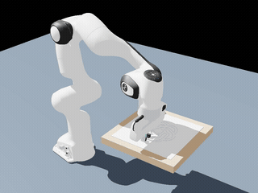
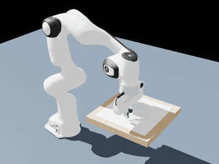
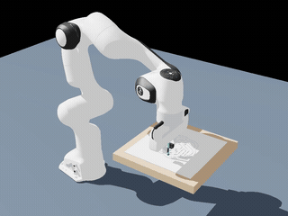

# robot arm artist · raa-v0

第一版让一台虚拟的 Franka Emika Panda 七轴机械臂，在 Isaac Sim 的三维场景中画出 ChatGPT 六瓣结标志。可以把它理解成：先给机械臂一张画线地图，再计算每个关节应该怎样转动，最后通过关节力矩让虚拟笔尖跟随地图。

本版使用项目内置的 SVG，不需要提供图片。绘制的是标志的 **8 条闭合边界线**：画完一条便抬笔，再移动到下一条。成品是标志的轮廓，不做区域填色。纸面上的青绿色线展示实际笔尖的 XY 轨迹投影，便于与目标路线对照；笔尖真实高度另外记录和评估。

## 成果展示

下面的动图来自八个真实 Isaac Sim **▶ Play 三维视口录制**，是完整视频的 **8 倍速预览**。点击动图或控制器名称，可打开或下载约 116 秒的完整 MP4。动图和视频均使用仓库内的相对路径。

### 正常绘画

| **[PD](video/pd_normal.mp4)** | **[重力补偿 PD](video/gc-pd_normal.mp4)** |
| :---: | :---: |
| [](video/pd_normal.mp4)<br>按位置偏差纠正；自重使轮廓偏离明显。 | [](video/gc-pd_normal.mp4)<br>先托住机械臂自重，轮廓更贴近目标。 |
| **[RBF 自适应](video/rbf_normal.mp4)** | **[模糊自适应](video/fuzzy_normal.mp4)** |
| [](video/rbf_normal.mp4)<br>边画边学习补偿，完成标志轮廓。 | [](video/fuzzy_normal.mp4)<br>根据误差规则补偿，本次正常整体误差最小。 |

### 外力干扰

四种控制器使用同样的三次笔尖推力：20–22 秒 `(3,0,0)` N、55–57 秒 `(0,−3,0)` N、90–92 秒 `(2,2,0)` N。目标路线保持一致，观察实际画线的偏移与撤力后的恢复。

| **[PD](video/pd_disturbed.mp4)** | **[重力补偿 PD](video/gc-pd_disturbed.mp4)** |
| :---: | :---: |
| [](video/pd_disturbed.mp4)<br>观察笔尖受推后的额外偏移与恢复。 | [](video/gc-pd_disturbed.mp4)<br>受推时短暂偏离，本次撤力恢复最快。 |
| **[RBF 自适应](video/rbf_disturbed.mp4)** | **[模糊自适应](video/fuzzy_disturbed.mp4)** |
| [](video/rbf_disturbed.mp4)<br>受推时在线学习补偿，观察轨迹修正过程。 | [](video/fuzzy_disturbed.mp4)<br>持续更新补偿，本次受推整体误差最小。 |

纸面青绿色线条显示实际笔尖的 XY 投影，三维误差按真实笔尖位置计算。灰线为目标轮廓；普通 PD 的高度偏差会遮挡推力箭头，可结合轨迹记录判断其受扰响应。

## 运行

在项目根目录 `Rbt-Project-Mid/` 中执行。入口是 Python 程序，会自动寻找已有 Isaac Sim，并切换到它自带的 Python 运行环境；无需另外安装 MuJoCo、ROS 或 Isaac Lab。

当前启动器面向 Linux 上的 Isaac Sim 6 解压安装版，使用安装包内自带的 Python 3.12。换一台电脑时，可用 `--isaac-root` 指定它已有的安装目录；项目配置通过 `ISAAC_PATH` 寻找扩展，不依赖本机用户名。已有安装包中的 Lula、NumPy、SciPy 和 Torch 会直接复用，其中 Torch 来自 `extsDeprecated/omni.isaac.ml_archive/pip_prebundle/`，程序不执行 `pip install`。

先查看图案和检查本机安装：

```bash
python3 Pro1/main.py --preview
python3 Pro1/main.py --check-env
```

`--preview` 只使用 Python 标准库，生成可用浏览器打开的图案预览；它不启动三维仿真。`--check-env` 列出 Isaac 安装位置、版本、本地 Panda URDF 是否存在和 GPU 信息；这属于环境检查，不能代替实际运行验证。

打开三维窗口并用默认的重力补偿 PD 绘制：

```bash
python3 Pro1/main.py
```

在终端用 `--config` 选择控制方案。四份内置配置都会打开三维窗口，分别使用普通 PD、重力补偿 PD、RBF 自适应控制和模糊自适应控制：

```bash
python3 Pro1/main.py --config pd
python3 Pro1/main.py --config gc-pd
python3 Pro1/main.py --config rbf
python3 Pro1/main.py --config fuzzy
```

每次选择一种运行即可；这些命令会启动同一条绘图路线，控制器参数从相应的 JSON 文件读取。直接执行无参数命令仍保持原先的启动方式，不弹出交互菜单。

窗口默认显示机械臂、桌面和画线。鼠标放在三维视口内，滚轮缩放，中键拖动平移，`Alt` 加左键拖动绕视角旋转；也可用 `Alt` 加右键拖动缩放。调整视角只影响观察画面。

无窗口完成一次绘制并保存数据：

```bash
python3 Pro1/main.py --headless
```

例如，无窗口运行模糊控制配置，也可以直接指定配置文件路径：

```bash
python3 Pro1/main.py --config Pro1/configs/fuzzy.json --headless
```

只运行 240 个物理步，检查启动、模型加载与控制链路：

```bash
python3 Pro1/main.py --headless --max-steps 240
```

短验证不会完成整个标志，也不能代表完整绘画精度。完整绘制包含 8 笔、笔画之间的抬笔移动和角点减速，运行时间取决于规划长度和所选速度。

按默认图案宽度与速度，规划约 114 秒的机器人运动；这指仿真时间，实际等待时间还包括逆运动学预计算、模型加载和渲染。默认 `--dt` 为 0.001 秒，所以 `--max-steps 240` 仅执行约 0.24 秒的运动，通常尚未完成首次落笔。

项目使用 `raa.experience.kit` 加载绘图所需的物理、机械臂、模型导入和单个视口扩展，并采用 `MinimalRendering` 简化渲染。首次启动可能需要数分钟编译 RTX 着色器，本机一次新渲染配置首次编译约 230 秒；这时尚未开始机器人运动，终端日志可能暂时不更新。之后还会完成本地模型导入和整条路线的 IK 预计算；看到 `[raa-v0] 开始绘图` 后，才进入力矩控制与数据记录。再次运行通常可以复用已有着色器和 `Pro1/cache/` 中的模型缓存。

## 录制四种控制器的正常与受扰实验

这里的录制是让 Isaac Sim 的时间轴进入 **▶ Play**，机械臂在 PhysX 中实际运动，再保存三维视口画面。每种控制器各运行两次：一次正常绘图，一次在绘图中向笔尖施加外力，共 8 个视频。两次使用相同的目标路线，外力作用于机器人本身，因此可观察被推开后的偏移与恢复。

先查看将执行的命令和配置，不启动仿真：

```bash
python3 Pro1/run_experiments.py --plan
```

执行全部实验：

```bash
python3 Pro1/run_experiments.py
```

程序按 `pd`、`gc-pd`、`rbf`、`fuzzy` 的顺序，先运行四组 `normal`，再运行四组 `disturbed`，每次只有一个 Isaac 进程。默认不弹出窗口，但仍渲染和录制三维视口；每组保存完整数据、MP4 和图表。PNG 导出使用本机已有 Chrome，程序会自动查找，也可通过 `--chrome` 指定其路径。

默认文件位置如下，`{controller}` 为上述四个名称，`gc-pd` 保留连字符：

| 内容 | 位置 |
| --- | --- |
| 正常实验数据 | `Pro1/output/normal/{controller}/` |
| 受扰实验数据 | `Pro1/output/disturbed/{controller}/` |
| 正常视频 | `Pro1/video/{controller}_normal.mp4` |
| 受扰视频 | `Pro1/video/{controller}_disturbed.mp4` |
| 每组终端日志 | `Pro1/output/logs/{controller}_{normal或disturbed}.log` |
| 实验状态、参数与文件哈希 | `Pro1/output/experiment_manifest.json` |
| 八组数值汇总 | `Pro1/output/summary.csv` |
| 同一控制器正常／受扰对比 | `Pro1/output/comparisons/{controller}/` |
| 正常／受扰单次图表副本 | `Pro1/pictures/{normal或disturbed}/{controller}/` |
| 正常／受扰比较图表副本 | `Pro1/pictures/comparisons/{controller}/` |

每组有四幅数据图：目标与实际叠加、目标轨迹、实际轨迹、XYZ 跟踪误差，另保留原始图案预览。每个控制器另有三幅正常／受扰比较图：轨迹对照、三维跟踪误差对照、外力引起的 XYZ 位置差，附逐时刻 `comparison.csv` 与完整 `comparison_metrics.json`。数据图中只保留标题、必要坐标轴和图例；RMSE、最大偏差、恢复时间和样本数放在 JSON、CSV 中。SVG 保持矢量形式，同时导出同名 PNG。

若一次批量执行中断，可继续执行：

```bash
python3 Pro1/run_experiments.py --resume
```

`--resume` 只复用已完成且源码、配置、参考轨迹、数据和视频哈希均匹配的实验。修改控制参数或代码后，相关组会重新运行。也可用 `--controllers rbf fuzzy` 或 `--conditions disturbed` 选择部分实验；正常／受扰对比需要该控制器两组结果都存在且验证通过。`--output-root`、`--video-root`、`--pictures-root` 可更改输出目录，`--isaac-root` 可指定已有安装。

单独录制一个方案时，例如模糊控制的受扰绘图：

```bash
python3 Pro1/main.py --config fuzzy --headless --disturbance --output Pro1/output/disturbed/fuzzy --record-video Pro1/video/fuzzy_disturbed.mp4
```

默认视频为 **960×720、30 fps、H.264 MP4**。每帧来自对应仿真时刻的实际三维视口；等待图像读回只渲染，不增加物理步或学习步。绘制结束后重复最后画面展示 2 秒，这段静止尾帧单独计数，不延长源仿真时间。视频旁的 `.recording.json` 保存运动帧数、尾帧数、源时间范围、编码帧数和完成状态；未完成的编码会删除不完整 MP4，并留下 `.aborted.json`。编码使用 Isaac 自带的 `omni.videoencoding`，不需要额外安装 ffmpeg。

本机原生编码器把部分依赖前帧的 H.264 帧错误标成可独立解码的关键帧，直接快进可能出现跳到错误时刻或画面解码异常。录制结束后，程序会根据实际 IDR 帧修正 MP4 容器中的同步标记，让播放器从正确的关键帧开始解码。修正只改变容器标记，不重新编码；修复前后的视频媒体数据 SHA-256 必须相同，报告写入录制元数据的 `mp4_sync_flags`。解析或一致性检查失败时按未完成录制清理。

批量录制的实际等待时间还包含每组启动、IK 规划和三维渲染，不能按约 114 秒的仿真时长估算整批耗时。各组完成后立即记录状态与结果，异常时停止并保留日志。

## 常用参数

| 参数 | 默认值 | 用途 |
| --- | --- | --- |
| `--config` | 不读取配置文件 | 内置名称 `pd`、`gc-pd`、`rbf`、`fuzzy`，或 JSON 文件路径 |
| `--controller` | `gc-pd` | 控制器名称：`pd`、`gc-pd`、`rbf`、`fuzzy`；改换方案建议选择对应配置 |
| `--headless` / `--gui` | 显示窗口 | 显式覆盖配置文件中的窗口设置 |
| `--show-config` | 关闭 | 打印最终合并配置并退出，不启动 Isaac |
| `--logo-width` | `0.16` | 图案最大边长，单位米，保持原图比例 |
| `--center X Y` | `0.45 0.0` | 图案中心的世界坐标，单位米 |
| `--draw-z` | `0.305` | 虚拟绘图平面高度，单位米 |
| `--speed` | `0.04` | 绘图速度上限，单位米/秒，包含平滑起停 |
| `--isaac-root` | 自动查找 | 指定已有 Isaac Sim 安装目录 |
| `--output` | `Pro1/output/` | 指定结果目录 |
| `--hold-seconds` | `15` | 绘制完成后窗口继续展示的秒数；无窗口模式忽略 |
| `--dt` | `1/1000` | 物理与力矩控制步长，单位秒 |
| `--planning-dt` | `1/60` | 笛卡尔轨迹与逆运动学的规划采样间隔，单位秒 |
| `--disturbance` / `--no-disturbance` | 不施加外力 | 覆盖配置中的外力开关，保留原有脉冲设置 |
| `--record-video PATH` | 不录制 | 指定三维视口 MP4 路径 |
| `--video-fps` | `30` | 视频帧率，正整数 |
| `--video-width` / `--video-height` | `960` / `720` | 视频像素尺寸，必须为正偶数 |
| `--video-tail-seconds` | `2` | 录制结束后静止展示最后画面的秒数 |

例如，指定安装位置并使用普通 PD：

```bash
python3 Pro1/main.py --isaac-root /home/xqw/isaacsim6.0.1 --controller pd --output Pro1/output-pd
```

`--center X Y` 设置世界坐标中的图案中心，`--draw-z` 设置绘图平面高度。调整尺寸、中心或高度会改变机械臂所需姿态，应留意逆运动学是否可解和关节是否接近限位。

## 配置文件怎样使用

配置文件像一张实验设置表：选哪种控制器、图案放在哪里、画多快、每个关节用多大的纠正力度，都放在一个 JSON 文件里。这样换控制方案时只需换 `--config`，也方便保留并复现实验设置。

| 终端选择 | 配置文件 | 默认结果目录 |
| --- | --- | --- |
| `--config pd` | `configs/pd.json` | `output/pd/` |
| `--config gc-pd` | `configs/gc_pd.json` | `output/gc-pd/` |
| `--config rbf` | `configs/rbf.json` | `output/rbf/` |
| `--config fuzzy` | `configs/fuzzy.json` | `output/fuzzy/` |

表内路径均相对 `Pro1/`。不使用 `--config` 时，默认结果目录仍是 `Pro1/output/`。不同方案的预设目录分开，方便并排查看；重复运行同一目录会更新其中的结果。

参数优先级为：**程序默认值 < JSON 配置 < 显式命令行参数**。例如，下面沿用 RBF 的增益与学习设置，改成无窗口运行，并把目标速度改为 0.03 米/秒：

```bash
python3 Pro1/main.py --config rbf --headless --speed 0.03
```

运行前可检查实际生效的配置：

```bash
python3 Pro1/main.py --config rbf --headless --speed 0.03 --show-config
```

JSON 中的 `output`、`isaac_root`、`record_video` 相对路径以**该 JSON 文件所在目录**为基准；命令行中显式传入的路径以当前工作目录为基准。复制配置到其他目录后，需留意相对路径。配置中的字段名、数值类型、有限值和控制器参数会在启动仿真前检查，拼错字段或混用 RBF／模糊专用参数会报错。

`control` 保存 `kp`、`kd` 和七轴 `torque_limits`；`adaptive` 保存自适应控制器的学习率、输入尺度和补偿上限。普通 PD 和重力补偿 PD 的 `adaptive` 为空。要改换自适应方案，应使用对应的 `--config`；例如把 `--config rbf` 与 `--controller fuzzy` 混用会留下不兼容的 RBF 参数，因此程序会拒绝该配置。

自适应控制要求物理步长 `dt≤0.01` 秒，默认使用 0.001 秒；额外补偿上限不得超过对应关节的总力矩上限，泄漏系数与步长的乘积不得超过 1。RBF 的高斯宽度 `rbf_width` 不得小于 `1e-6`。这些约束也会在合并配置时检查。

外力与视频参数也可写入 JSON。例如在原有配置中加入以下字段，让机器人在第 2 至第 3 秒受到沿世界 X 正方向的 3 N 推力：

```json
{
  "disturbance": {
    "enabled": true,
    "pulses": [
      {"start_s": 2.0, "end_s": 3.0, "force_world_n": [3.0, 0.0, 0.0]}
    ]
  },
  "record_video": "../video/fuzzy_custom.mp4",
  "video_fps": 30,
  "video_width": 960,
  "video_height": 720,
  "video_tail_seconds": 2.0
}
```

`start_s ≤ t < end_s` 时施力，各段按时间排序且不能重叠。`--disturbance` 与 `--no-disturbance` 只切换开关，不会覆盖已配置的脉冲、增益或学习设置；只有开关、没有自定义 `pulses` 时，使用下文的默认三段外力。

## 系统怎样画图

从通俗角度看，整个过程分为四步：

1. **描出路线**：读取内置 SVG，将曲线转换成密集的点，缩放到桌面绘画区域。
2. **安排时间**：让笔尖按平滑的速度起步、停止，在明显角点减速，并安排抬笔、平移和落笔。
3. **安排关节**：通过逆运动学，把笔尖位置和朝向转换成七个关节的目标角度。
4. **施加力矩**：读取真实的仿真关节角度和速度，用控制器计算下一步七个关节需要施加的力矩。

专业上，绘图参考是带时间的笛卡尔轨迹 `p_d(t)`，不是只有形状的点集。规划输出包含三维位置、时间、落笔状态和笔画编号。圆滑段采用五次多项式调节弧长进度，分段端点的目标速度与加速度为零；明显尖角处停顿后换向。相邻笔画之间先向上抬笔 0.025 米，在高处平移，再向下落笔。

连续逆运动学求解生成关节参考 `q_d(t)`：首先求解一个有效初始姿态，之后沿上一点的解进行局部更新，并检查笔尖位置误差、朝向误差、关节限位和突跳。力矩控制以更小的物理步长运行，利用相邻规划点的插值得到当前时刻的关节目标，因此规划步长与控制步长可以不同。

虚拟笔尖是末端坐标系中一个固定偏移位置，它与法兰中心并不重合。规划和实际位置记录都必须使用同一个笔尖定义：先利用末端朝向把偏移转换到世界坐标，再加到末端位置上。因此，逆运动学也需要考虑这个偏移，才能让真正的笔尖沿着桌面的目标线走。

本版采用虚拟画线方式，不进行笔与桌面的接触压力控制。抬笔阶段不留下线条；根据参考路线的落笔标记，显示灰色目标路径和青绿色实际轨迹。

三维视口里的青绿色墨迹取实际笔尖的 X、Y 坐标，统一显示在绘图平面上方 0.001 米处。这是虚拟绘画的平面投影：普通 PD 可能因自重使笔尖低于纸面，直接画三维轨迹会被纸或桌面遮住，投影让它的平面偏差仍清楚可见。投影只改变线条的显示高度；机器人和笔尖仍处在真实物理姿态，`trajectory.csv` 的 XYZ、三维误差和外力施加点均使用实际笔尖位置。元数据 `ink_visualization` 与 `ink_plane_z_m` 记录这一显示方式，因此纸面上的线条不代表笔尖高度误差为零，也不代表发生了笔与纸的接触。

## 控制与结果含义

默认平台是 Isaac Sim 6 系列的 PhysX 物理仿真，Panda 从安装目录中的本地 URDF 加载。重力保持开启；七个机械臂关节原有的位置驱动关闭，由本项目直接发送力矩。夹爪不参与七轴控制器比较。

普通 PD 的力矩为：

\[
\tau = K_p(q_d-q)+K_d(\dot q_d-\dot q)
\]

位置偏差决定纠正力度，速度偏差帮助抑制振荡。默认的重力补偿 PD 在此基础上加入抵消机械臂自重所需的力矩 `g(q)`。最终力矩按 Panda 的逐关节上限裁剪：前四轴为 87 N·m，后三轴为 12 N·m。普通 PD 也保持重力开启，因此可能出现因自重引起的稳态偏差。

新增的两种自适应方案都在重力补偿 PD 上增加一项**边画边学习的额外力矩**。可以把基础 PD 理解为负责及时纠偏的驾驶员，重力补偿负责托住机械臂的重量，而自适应模块根据持续出现的偏差，逐渐学会在特定状态下多推一点或少推一点。每次实验都从零权重开始，不需要预训练模型或外部数据集。

| 方案 | 使用的信息 | 在线学习的内容 |
| --- | --- | --- |
| `pd` | 当前与目标关节角度、角速度 | 无在线学习 |
| `gc-pd` | PD 信息与当前重力补偿力矩 | 无在线学习 |
| `rbf` | 每轴的实际关节角度与角速度 | 高斯 RBF 网络的输出权重，默认每轴 9 个节点 |
| `fuzzy` | 每轴的位置误差与速度误差 | 模糊规则的输出力矩，固定每轴 25 条规则 |

专业上，令 `e=q_d-q`、`ė=dq_d-dq`，其中 `dq` 表示关节角速度，自适应控制的力矩为：

\[
\tau=\operatorname{sat}_{\tau_{\max}}
\left(K_pe+K_d\dot e+g(q)+\hat\tau\right),\qquad
\hat\tau_i=W_i^{T}\phi_i
\]

`φ_i` 是第 `i` 个关节的归一化激活向量，元素非负、总和为 1；`W_i` 是该轴对应的学习权重。每一轴有独立的小型近似器，共 7 组。基础 PD 增益保持不变，自适应模块学习的是额外补偿力矩。

RBF 模块先用 `position_scale`、`velocity_scale` 把实际关节角度和角速度缩放，再计算它与二维高斯节点的距离。默认在两个输入轴上各放 3 个中心，形成 3×3 的 9 个节点；某个状态离一个节点越近，该节点对输出的影响越大。输入缩放后截到 `[-2,2]`，高斯激活采用数值稳定的归一化。

模糊模块先用 `error_scale`、`velocity_error_scale` 缩放位置误差和速度误差，并截到 `[-1,1]`。每个输入使用“负大、负小、零、正小、正大”5 个三角隶属函数，两两组合形成 5×5 的 25 条规则。例如，“位置误差正小、速度误差接近零”激活的规则，会在正向偏差持续时逐渐学到合适的纠正力矩。这是零阶 Sugeno 模糊系统：规则的输出是可学习的力矩数值，经归一化加权得到总补偿；每轴同时最多激活 4 条规则。

两种方法共用离散学习律。学习信号为 `s=ė+Λe`，它同时考虑位置和速度偏差；单步学习使用截到 `[-1,1]` rad/s 的 `s`：

\[
W_{i,k+1}=\operatorname{Proj}\left[
W_{i,k}+\Delta t\left(
\Gamma_i\phi_{i,k}\,a_{i,k}\operatorname{clip}(s_{i,k},-1,1)
-\sigma W_{i,k}\right)\right]
\]

这里 `Γ` 是学习率，`Λ` 决定位置偏差在学习信号中的比例，`σ` 是缓慢削减旧权重的泄漏系数。`a` 通常为 1；若某轴已经达到力矩上限，而且学习方向会继续推向该上限，则把该轴的学习项置零，保留泄漏。`Proj` 把每轴权重限制在配置的补偿范围内。由于激活非负且总和为 1，额外补偿也保持在同一范围内；默认前四轴为 ±6 N·m，后三轴为 ±2 N·m，最终总力矩仍经过关节上限裁剪。

当前步使用更新前的权重计算力矩，然后把新权重留给下一步。初始化时各方案统一使用独立的重力补偿 PD 稳定姿态，不训练自适应模块。正式运行每个记录步学习一次；GUI 绘制结束后的停留展示冻结权重与泄漏，不继续改变实验的学习结果。目前保存权重用于分析，没有自动加载权重或续训入口。

这些实现是基于七个关节局部输入的残差力矩学习，不是完整机械臂动力学辨识。权重和额外力矩有明确上限，但这不能直接证明任意轨迹的全局跟踪稳定性，也不能预先保证比重力补偿 PD 更准确；是否改善需要看同条件运行的数据。

## 外力怎样施加与比较

受扰实验可以理解为：机器人仍照着原来的地图画图，但有人在笔尖处推它一段时间。灰色目标线保持原样，实际机器人通过控制器抵抗推力并恢复。橙色箭头只在施力时出现，用于显示推力方向；它不参与碰撞和动力学。

箭头放在实际笔尖附近。普通 PD 的真实笔尖因自重低于桌面，在本次受扰视频的施力时刻，箭头被桌面遮挡；纸面墨迹仍显示实际 XY 投影。是否施力应结合 `trajectory.csv` 的外力列和记录窗口判断，不能只凭箭头是否可见。

默认三段推力如下，每段持续 2 秒：

| 计划时段附近 | 世界坐标外力 `(Fx, Fy, Fz)` | 推力大小 |
| --- | --- | --- |
| 20 秒 | `(3, 0, 0)` N | 3 N |
| 55 秒 | `(0, -3, 0)` N | 3 N |
| 90 秒 | `(2, 2, 0)` N | 约 2.828 N |

程序把每段窗口放到距这些时间最近、能够完整容纳 2 秒的落笔区间，保证推力发生在画线时。安排只依赖目标路线，与控制器和实际误差无关，所以四种控制器使用相同的窗口。最终起止时间写入 `metrics.json` 的 `disturbance_windows`；调整尺寸或速度后应读取该记录，不直接假定仍是 20–22、55–57、90–92 秒。

专业上，外力通过 PhysX 的刚体接口施加到 `panda_hand`，施力点为当前实际虚拟笔尖的世界坐标，力也在世界坐标系定义。物理引擎根据施力点与刚体质心的距离计算力矩效应。单位是牛顿，不是冲量；每个物理步直接发送当前外力，不乘时间步长，也不修改目标轨迹或七轴参考角度。无外力时显式发送零力。

比较分两层：跟踪误差是“实际位置减同一时刻的目标位置”；外力引起的位置差是“受扰实际位置减同一时刻的正常实际位置”。前者回答画得准不准，后者回答这次推力额外带来多少偏离。只有两次完整运行的时间、目标和落笔状态逐点对齐，程序才生成正常／受扰比较文件。

恢复时间默认按第二种三维位置差计算：撤力后，位置差连续至少 0.5 秒不超过 2 mm，视为恢复，报告从撤力到这段连续区间开始的时间。若在下一段外力前或记录结束前没有足够证据，记录为 `null`；阈值、持续时间、确认时刻与观察终点均保存在 `comparison_metrics.json`，方便判断该指标的含义。

## 输出文件与指标

结果默认保存在 `Pro1/output/`：

| 文件 | 内容 |
| --- | --- |
| `logo_preview.svg` | 计划绘制的 8 条标志轮廓，浏览器可打开 |
| `reference_cartesian.csv` | 完整三维规划路线，包含 `time_s`、XYZ 米制位置、落笔状态和笔画编号 |
| `reference_joints.npz` | NumPy 压缩文件；`time` 为秒，`q` 为七轴参考角度（弧度），`dq` 为参考角速度（弧度/秒），`tip` 为参考笔尖位置（米） |
| `trajectory.csv` | 时间对齐的目标与实际笔尖轨迹、落笔状态、关节控制记录和外力；自适应方案另含逐轴补偿力矩、学习信号与权重范数 |
| `metrics.json` | 运行元数据和 `metrics` 指标字典；包括控制器、仿真步长、IK 误差、完整运行状态 `completed`、外力窗口、视频、最终控制器状态和图案来源 |
| `resolved_config.json` | 本次运行实际生效的配置，已合并默认值、JSON 与命令行覆盖 |
| `controller_state.json` | 最终控制器状态；自适应方案包含权重、训练步数和学习统计，PD 方案记录其增益与重力补偿设置 |
| `controller_state.npz` | 仅自适应方案生成；可用 NumPy 读取最终权重、基函数中心、参数和激活等数值数组 |
| `drawing_result.svg` | 目标与实际画线的二维对照图，浏览器可打开 |
| `target_trajectory.svg` | 目标落笔轨迹，二维等比例显示 |
| `actual_trajectory.svg` | 实际落笔轨迹，二维等比例显示 |
| `error_history.svg` | 同一时刻的实际位置减去目标位置，展示 XYZ 有符号误差，纵轴为毫米，含抬笔阶段 |
| `scene.usda` | 最终三维场景快照；引用本地模型缓存，保留 `Pro1/cache/` 后可在同一环境重新打开 |
| `scene.png` | 有可用渲染视口时保存的三维场景截图；截图不可用时，其余数据输出仍可使用 |

`--preview` 只生成 `logo_preview.svg`。仿真运行先保存完整规划路线，再保存实际执行记录；短验证中的规划文件仍覆盖整幅图案，实际记录只覆盖已执行的时间。若尚未落笔，绘图误差指标为 `null`，对照图会标出没有落笔采样。先查看 `metrics.json` 的 `completed`，再判断结果是否代表完整绘图。

误差比较使用**同一时刻的目标点与实际点**。因此，机械臂虽然沿着正确轮廓走、却明显落后于目标，也会产生跟踪误差。三维指标同时计入高度偏差；XY 指标衡量平面画图偏差。带 `drawing_` 前缀的指标只统计落笔阶段，其他轨迹指标还包括抬笔和移动。RMSE 表示整段轨迹的总体误差，最大误差表示最严重的偏离，单位均为米。

力矩 RMS 反映整体用力水平，饱和比例表示有多少关节采样达到力矩上限。比较控制器时，应保持图案、速度、初始条件与时间步长一致，并区分完整运行与通过 `--max-steps` 截断的运行。

`trajectory.csv` 的 `external_force_x_n`、`external_force_y_n`、`external_force_z_n` 记录当前发送给物理引擎的世界坐标外力；`disturbance_active` 和 `disturbance_pulse_index` 标记对应时段。它们与该行实际位置和控制器状态使用同一个采样时刻。

自适应运行的 `trajectory.csv` 中，`adaptive_tau1` 到 `adaptive_tau7` 是本行实际使用的额外补偿力矩，单位 N·m；`sliding_error1` 到 `sliding_error7` 是未截断的学习信号，单位 rad/s；`weight_norm1` 到 `weight_norm7` 是本步学习更新后各轴权重向量的 L2 范数。该步力矩仍由更新前的权重计算，避免把更新后的权重误当成已经用于当前力矩。`controller_state.json` 的 `training_step_count` 应与正式运行的记录行数一致，可用非零权重、权重范数变化与补偿记录确认在线学习确实发生。

状态文件中的 `weights` 是最后一次学习后的权重；NPZ 另存 `last_used_weights`，它是最后一个已记录控制步实际用于生成力矩的权重，两者相差最后一次学习更新。JSON 的 `last_used_weight_norms_by_joint` 记录后者的逐轴范数，`weight_state_timing` 字段说明这一时序。

本版已接入四种关节力矩控制器、配置文件选择、真实笔尖外力、三维视口录制和八组批量实验。具体结果以每组 `completed`、视频完成状态与批量清单为准。可编辑的 10 页汇报已完成，八个视频完整内嵌，第 8、9 页分别自动同时播放四个正常／受扰视频；说明与静态预览见 `ppt/`。

## 本机实测

### 八组完整实验

正式批量运行已经完成，`output/experiment_manifest.json` 的状态为 `completed`，8 组运行和 4 份正常／受扰比较全部通过验证。平台为本机 Isaac Sim `6.0.1-rc.7`、RTX 5070 Laptop GPU；本次整批耗时约 37 分钟，包含启动、规划、实际物理运动、录制和图表生成。

各组使用相同的 0.16 米图案、0.001 秒物理步长、PD 增益、关节力矩上限及初始稳定方式。每组有 **113935 个记录与物理步、87418 个落笔样本，8 笔全部完成**，采样时间覆盖 0 至 113.934 秒。自适应方案分别从零权重开始，正常与受扰运行各学习 113935 步。四组受扰实验均在 20–22、55–57、90–92 秒施加外力，每段 2000 步；向量分别为 `(3,0,0)`、`(0,-3,0)`、`(2,2,0)` N。

下表误差只统计落笔阶段，单位为毫米；力矩 RMS 统计整段七轴控制记录，单位 N·m。八组力矩饱和比例均为 **0%**。

| 控制器 | 条件 | 三维 RMSE | XY RMSE | 最大三维误差 | 最大 XY 误差 | 力矩 RMS |
| --- | --- | ---: | ---: | ---: | ---: | ---: |
| PD | 正常 | 32.955 | 24.114 | 55.942 | 51.245 | 3.155 |
| PD | 受扰 | 32.832 | 23.945 | 50.720 | 45.476 | 3.156 |
| GC-PD | 正常 | 0.562 | 0.400 | 3.874 | 1.670 | 9.682 |
| GC-PD | 受扰 | 2.558 | 2.344 | 12.334 | 12.323 | 9.674 |
| RBF | 正常 | 0.567 | 0.398 | 4.082 | 1.700 | 9.682 |
| RBF | 受扰 | 2.096 | 1.918 | 11.206 | 11.197 | 9.673 |
| Fuzzy | 正常 | 0.518 | 0.368 | 3.917 | 1.690 | 9.682 |
| Fuzzy | 受扰 | 1.769 | 1.613 | 11.135 | 11.128 | 9.673 |

配对比较进一步衡量推力额外造成的偏移。下表的三维偏移是同一时刻“受扰实际位置减正常实际位置”；最大值统计整段记录，恢复时间依次对应上述三段外力，采用撤力后回到 2 mm 内并保持至少 0.5 秒的定义。

| 控制器 | 落笔偏移 RMSE（mm） | 最大偏移（mm） | 第一次恢复（s） | 第二次恢复（s） | 第三次恢复（s） |
| --- | ---: | ---: | ---: | ---: | ---: |
| PD | 3.014 | 19.676 | 2.294 | 4.410 | 1.356 |
| GC-PD | 2.550 | 12.528 | 0.184 | 0.244 | 0.244 |
| RBF | 2.071 | 11.499 | 1.687 | 2.710 | 2.206 |
| Fuzzy | 1.743 | 11.446 | 0.616 | 0.827 | 1.203 |

这次实验中，重力补偿显著改善正常绘图精度；模糊控制在正常与受扰条件下的落笔三维 RMSE 都最低。受扰时，RBF 与模糊控制的落笔三维 RMSE 分别比 GC-PD 低约 18.1% 和 30.9%，但 **GC-PD 三次撤力恢复均最快**。因此平均跟踪精度与撤力恢复速度应分别评价，不能把较低 RMSE 直接解释为全面更强的抗扰能力。

普通 PD 受扰后的整体 RMSE 略低，仍有数厘米的跟踪偏差，配对最大额外偏移达 19.676 mm。推力在部分时段可能抵消它原有的偏差；判断抗扰响应应读取配对偏移与恢复时间。纸面显示使用 XY 投影，真实高度误差完整保留；该视频中的力箭头被桌面遮挡，外力记录与真实物理响应已核对。

在线学习状态也已导出。RBF 正常／受扰的最终权重 L2 范数分别为 0.044542／0.055957，模糊控制为 0.491320／1.088558；两种方案的补偿均非零。完整配置、权重、逐步补偿与误差可在各组状态文件和 CSV 中追溯。

八个视频均为 **3479 帧、30 fps、960×720、115.966667 秒**，包含 3419 个真实运动帧和 60 个静止尾帧。源仿真时间止于 113.934 秒；视频时长包含帧时间取整和 2 秒尾帧。每个运动帧均完成捕获，无丢帧；渲染未额外推进物理时间。容器同步标记修正前后的媒体数据 SHA-256 一致，八个视频已通过浏览器实际解码及时间定位检查。

`pictures/` 共保存 **52 张 SVG 与 52 张 PNG**：32 张单次数据图、8 张图案预览、12 张比较图。核心数值保存在 `output/summary.csv` 与各组 JSON；独立 CSV 复算、相同参考轨迹和配对恢复时间的核查记录见 `output/independent_batch_audit.json`。这些结论对应当前图案、速度、外力及单次参数配置，调整实验设置后应重新测量。

### 此前的集成与历史验证

真实外力与视口录制链路已做成对的模糊控制短验证：两次均记录 6000 个物理步，步长 0.001 秒，目标路线逐点相同；受扰组在第 2 至第 3 秒施加 `(3,0,0)` N，实际施力 1000 步。施力前两次实际位置一致，施力后最大的正常／受扰位置差为 7.062 mm，确认推力确实进入物理仿真。正常组与受扰组的短段落笔三维 RMSE 分别为 0.645 mm、2.690 mm，数据在 `output/recording-normal-smoke/` 与 `output/recording-smoke/`。两组均为截断运行，不代表完整标志性能。

这次短集成验证也核查了时间轴处于 Play、每个运动视频帧完成一次视口读回、渲染不增加物理时间，以及静止尾帧不增加学习步。下面保留此前单次运行的数值，不能替代上面的统一批量比较。

固定总帧数的 MP4 编码另已通过容器检查：196 帧、30 fps、960×720，视频轨道与文件头时长均为 6.533333 秒。其中 181 帧来自真实运动，15 帧为 0.5 秒静止尾帧；文件时长包含尾帧，源仿真时间范围单独保存在录制元数据中。

浏览器实际播放核查了 0.5、1.5、2.1、2.5、3.1 秒的帧，机器人姿态正常，施力时段能看到橙色箭头；此前异常画面来自原生 MP4 的关键帧标记。程序现已接入容器标记修复并保留媒体数据一致性检查。

新增 RBF 控制链路已经完成一次 Isaac Sim 无窗口短验证，结果在 `output/rbf-smoke/`。物理步长 0.001 秒，共记录 5000 行，时间覆盖 0 到 4.999 秒，`completed=false`；落笔阶段三维 RMSE 为 0.712 mm，力矩饱和比例为 0%。`training_step_count=5000` 与记录行数一致，最终 7×9 权重矩阵的 L2 范数为 0.032974，额外补偿力矩非零，确认在线学习及状态导出链路已经在真实物理仿真中执行。该短运行只验证局部执行，不用于与下面的完整基线比较。

以下为加入新控制器前保留的重力补偿 PD 基线结果。2026-10-10，使用本机 Isaac Sim `6.0.1-rc.7` 和 RTX 5070 Laptop GPU，在默认参数下完成一次无窗口绘图。物理步长为 0.001 秒，图案最大边长为 0.16 米；参考运动时长 113.93 秒，完整执行记录 113935 个样本，8 笔均完成，`completed=true`。

新增 RBF 配置也已经完成整幅 8 笔标志，同样使用 0.001 秒物理步长和默认绘图路线，`completed=true`；共记录 113935 个样本，其中 87418 个为落笔采样。下面列出两次完整运行的结果，均未人为施加外力：

| 指标（误差仅统计落笔阶段） | GC-PD 历史基线 | RBF 完整运行 |
| --- | --- | --- |
| 三维笔尖 RMSE | 0.562 mm | 0.567 mm |
| XY 平面 RMSE | 0.400 mm | 0.398 mm |
| 最大三维偏差 | 3.874 mm | 4.082 mm |
| 最大 XY 偏差 | 1.670 mm | 1.700 mm |
| 力矩饱和比例 | 0% | 0% |

`output/metrics.json` 和 `output/trajectory.csv` 保留历史 GC-PD 完整结果，`output/drawing_result.svg` 可直接查看其实际轮廓。独立读取 CSV 重算指标，与 JSON 一致；另外用本地 URDF 和记录的关节角重建 1164 个笔尖位置，与记录位置的最大差小于 0.5 微米。该基线的绘图循环实际耗时约 175 秒，还需额外计入启动和 IK 规划时间。三维窗口模式另做了 1500 步启动与输出验证，该短运行保存在 `output/gui-smoke/`，不作为完整图案结果。

RBF 完整结果保存在 `output/rbf/`，绘图循环实际耗时约 190 秒。`training_step_count=113935` 与记录行数一致，最终权重矩阵为 7×9、L2 范数为 0.044542，补偿力矩非零。此次 RBF 的三维 RMSE 略高于历史 GC-PD，XY RMSE 略低，不能据此宣称自适应网络整体优于基线。

这些数值是默认参数下的单次完整运行记录。四种控制器的统一性能与抗扰比较应读取新批量目录，不能把历史基线与不同设置的短运行混在一起。更改速度、尺寸、控制器或物理步长后，需要重新运行并查看新的指标。

## 图案来源

内置图案为 [Wikimedia Commons 的 OpenAI 标志 SVG](https://commons.wikimedia.org/wiki/File:OpenAI_logo_2025_(symbol).svg)，保存在 `assets/chatgpt_logo.svg`。代码读取原始矢量轮廓，不需要联网下载图案。

OpenAI 与 ChatGPT 标志属于 OpenAI；本项目用于独立课程演示。标志的使用信息可参考 [OpenAI 品牌说明](https://openai.com/brand/)。图案来源说明不代表本项目源码已经指定某种开源许可证。

## 汇报与 GitHub 展示

- [静态 PDF 预览](ppt/raa-v0.pdf)。
- [可编辑 PPT（内嵌八个视频）](https://github.com/Xlovlhj/tongji-proClass-AAR/releases/download/raa-v0/raa-v0.pptx)。进入第 8 或第 9 页时，该页四个视频自动同时播放。
- [实验数值汇总](results/summary.csv)与[保存的实验结果](results/README.md)。

README 动图保存在 `video/preview/`，完整视频在 `video/`；两者都会随代码提交。动图可以通过以下 Python 入口重新生成，复用本机已有 FFmpeg，不启动 Isaac Sim，也不修改原视频：

```bash
python3 Pro1/build_showcase.py
```

本仓库将约 360 MiB 的 PPT 放在 Release 附件中，普通 Git 提交保留代码、完整 MP4、动图、图表与 PDF。大体积原始 CSV、模型缓存和本机日志留在被忽略的 `output/` 与 `cache/`；完成 `run_experiments.py` 后可以重新生成这些数据。GitHub 普通仓库的单文件上限见[官方大文件说明](https://docs.github.com/en/repositories/working-with-files/managing-large-files/about-large-files-on-github)。
