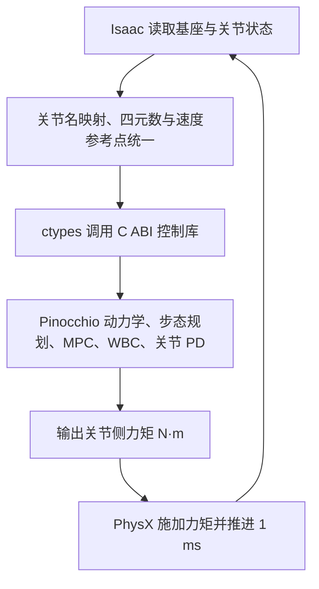

# 青龙人形机器人：Isaac Sim + 原 C++ MPC/WBC

这个目录把青龙原来的 C++ 控制程序接到 Isaac Sim。Python 负责建立场景、读取机器人状态、推进仿真和保存实验数据；原工程的 MPC、WBC、步态规划、Pinocchio 动力学和关节控制仍在 C++ 中运行。

运行后，机器人先保持初始站姿，再进入全身控制。选择 `walk` 时，默认在第 5 秒开始行走；选择 `stand` 时持续站立。初始基座高度由关节姿势和实际足底碰撞盒计算，脚底从地面上方 2 mm 开始。

## 快速启动

以下命令均在仓库根目录（包含 `Pro2/` 的目录）执行。入口是 [run_isaac.py](run_isaac.py)，会自动寻找本地 Isaac 安装、编译控制库，再切换到 Isaac 自带的 Python。

检查环境：

```bash
python3 Pro2/run_isaac.py --check-env
```

打开窗口，运行 12 秒站立仿真：

```bash
python3 Pro2/run_isaac.py --mode stand --duration 12
```

打开窗口，运行默认前进行走：

```bash
python3 Pro2/run_isaac.py --mode walk --duration 20 --vx 0.2
```

无窗口运行相同控制逻辑，并指定新的输出目录：

```bash
python3 Pro2/run_isaac.py --headless --level L0 --mode walk --duration 12 \
  --output Pro2/output/L0/walk_baseline
```

打开 Isaac 窗口、自动进入 Play，并录制 10 秒、30 FPS 的 L0 行走视频：

```bash
python3 Pro2/run_isaac.py --level L0 --mode walk --duration 10 \
  --walk-start 3 --vx 0.2 --record-video --video-fps 30 \
  --output Pro2/output/L0/walk_10s_video_gui
```

显式指定本机 Isaac 安装路径：

```bash
python3 Pro2/run_isaac.py --isaac-root /home/xqw/isaacsim6.0.1 --mode walk
```

首次运行需要编译 C++ 和转换模型，后续使用缓存。`--no-build` 跳过编译，`--build-only` 只编译控制库，`--rebuild-asset` 强制重新导入模型。程序按 `--level L0` 至 `--level L4` 把成果写入对应层级；默认输出目录在该层级下按时间创建。指定的输出目录若已有 `run.json`，程序会拒绝覆盖。

窗口需要获得键盘焦点：

| 按键 | 行为 |
|---|---|
| W | 请求前进，前进速度至少 0.1 m/s |
| S | 将前进速度目标减到零；仍可处于步行状态 |
| A / D | 行走时请求左转 / 右转，角速度为 ±0.15 rad/s |
| H | 将转向角速度目标清零 |
| 空格 | 切换站立 / 行走请求；停止时控制器先减速并完成接触切换 |

按键修改持续保持的目标值，松开按键不会自动归零。行走请求仍受 `walk_start` 限制；前 3 秒保留初始姿势建立过程。

暂停时间线时控制器时钟也会暂停；停止时间线会结束本次运行，重新启动程序即可同时重置机器人和控制器。

## 所需环境

当前实现针对本机 Linux 的 **Isaac Sim 6.0.1** API，实测安装版本为 `6.0.1-rc.7+release.42383.32955d8d.gl`。使用现有安装，不自动下载或安装依赖。

| 组件 | 用途 |
|---|---|
| 系统 Python 3 | 启动入口、环境检查、编译调度 |
| Isaac 自带 Python 3.12 与扩展 | USD 导入、场景、渲染、PhysX 接口 |
| CMake ≥ 3.16、支持 C++17 的编译器 | 构建原控制算法的共享库；检测到 `g++-11` 时优先使用 |
| NVIDIA GPU 与可用驱动 | Isaac 图形运行环境；无窗口模式仍需要可用的 GPU 环境 |
| 原工程的 `third_party/` | Eigen、Pinocchio、URDFDOM、qpOASES、JSON 等现有头文件和库 |

默认采用**单 GPU 渲染、CPU PhysX**。项目的渲染启动提示设置只影响弹窗显示，不改变系统 IOMMU 状态。

Isaac 搜索顺序包括 `--isaac-root`、环境变量 `OPENLOONG_ISAAC_ROOT` / `ISAAC_PATH`、用户目录中的 `isaacsim*` 和常见 IsaacLab 安装目录。运行时缓存和日志重定向到 `Pro2/cache/runtime/` 及当次输出目录。

## 配置与实验

`--show-config` 查看本次实际参数而不启动仿真：

```bash
python3 Pro2/run_isaac.py --show-config --mode stand
```

主要参数如下。表中的频率按照**仿真时间**定义，实际计算不保证达到实时速度。

| 参数 | 默认值 | 意义 |
|---|---:|---|
| `--level` | `L0` | 成果层次；输出只能写入 `output/L0` 至 `output/L4` 中对应的目录 |
| `--mode` | `walk` | `stand` 或 `walk` |
| `--duration` | 20 s | 仿真时长 |
| `--dt` | 0.001 s | 物理步长及 C++ 控制周期，1 kHz |
| `--mpc-dt` | 0.005 s | MPC 求解周期，200 Hz，必须是 `dt` 的整数倍 |
| `--walk-start` | 5 s | 允许进入行走的时刻，至少 3 s |
| `--vx` / `--vy` | 0.2 / 0 m/s | 机身局部坐标系的平面速度指令 |
| `--wz` | 0 rad/s | 转向角速度指令 |
| `--swing-time` | 0.4 s | 摆动阶段时长 |
| `--step-height` | 0.12 m | 摆动脚抬脚高度 |
| `--stand-height` | 1.08 m | 控制器期望基座高度，也用于初始腿部逆运动学 |
| `--render-hz` | 30 Hz | 渲染采样频率 |
| `--log-hz` | 100 Hz | 状态保存频率 |
| `--push-at` | 未设置 | 开始施加外力的仿真时刻；未设置时无外力 |
| `--push-duration` | 0.1 s | 外力持续时间 |
| `--push-force` | `0 50 0` N | 世界坐标系中的机身外力 `[Fx,Fy,Fz]` |
| `--record-video` | 关闭 | 按仿真时间捕获视口并生成 `demo.mp4` |
| `--video-fps` | 30 FPS | 录像帧率，允许 1 至 60；10 秒、30 FPS 对应 300 帧 |

例如，修改步态并设置转向指令：

```bash
python3 Pro2/run_isaac.py --mode walk --duration 20 --vx 0.15 --wz 0.1 --swing-time 0.45
```

施加第 8 秒开始、持续 0.1 秒的侧向 50 N 外力：

```bash
python3 Pro2/run_isaac.py --headless --duration 15 --push-at 8 --push-duration 0.1 --push-force 0 50 0
```

也可以将实验设置保存为 JSON。项目中已经建立了明确的相对路径，例如基线配置为 `Pro2/experiments/L2/mpc_vx_weight/baseline.json`：

```json
{
  "mode": "walk",
  "duration": 20.0,
  "vx": 0.2,
  "swing_time": 0.4,
  "step_height": 0.12,
  "u_weight": 0.000001,
  "state_weights": [1, 1, 1, 0.001, 100, 1, 0.001, 0.001, 0.001, 1, 100, 1],
  "input_weights": [1, 1, 1, 1, 1, 1, 1, 1, 1, 1, 1, 1, 1]
}
```

```bash
python3 Pro2/run_isaac.py --level L2 \
  --config Pro2/experiments/L2/mpc_vx_weight/baseline.json --headless \
  --output Pro2/output/L2/mpc_vx_weight/baseline
```

命令行覆盖同名 JSON 设置。JSON 使用下划线名称；权重只能通过 JSON 配置。`state_weights` 的 12 项按姿态、位置、角速度、线速度排列，每组 3 项；`input_weights` 对应原 MPC 的 13 维输入，包括左右脚接触力/力矩和重力项。`u_weight` 是输入代价的整体权重。

当前预测步数沿用原 `mpc.h` 中的 `mpc_N=10`、控制时域 `ch=3`，未提供改变步数的命令行选项。改变 `mpc_dt` 同时影响离散预测步长和 MPC 更新周期，开展时域实验时应记录这两个影响。

## 作为控制初学者的修改与分析入口

最容易形成“我确实读懂并修改了控制项目”证据的做法，是先保持模型、速度和实验时长一致，每次只改一个参数，然后用同一组指标比较。参数实验优先通过 JSON 和命令行完成，这样原始 C++ 版本可作为基线，实验也容易复现。

| 学习内容 | 修改或阅读位置 | 可以说明的问题 |
|---|---|---|
| MPC 状态权重与输入权重 | 修改 `Pro2/experiments/L2/mpc_vx_weight/baseline.json`、`low.json`、`high.json` 中的 `state_weights`、`input_weights`、`u_weight`；参数入口是 [run_isaac.py](run_isaac.py)，代价矩阵构造在 [mpc.cpp](OpenLoong-Dyn-Control/algorithm/mpc.cpp) 的 `MPC::set_weight` | 为什么提高某个状态误差的权重会改变跟踪、姿态和力矩之间的折中 |
| 预测长度和控制时域 | [mpc.h](OpenLoong-Dyn-Control/algorithm/mpc.h) 中的 `mpc_N=10`、`ch=3`，离散周期由 `--mpc-dt` 提供 | 预测更远是否改善控制，以及计算时间为何增加；改变 `mpc_dt` 时要说明它也改变 MPC 更新频率 |
| 步态参数 | `--swing-time`、`--step-height`、`--vx`、`--vy`、`--wz`；步态切换在 [gait_scheduler.cpp](OpenLoong-Dyn-Control/algorithm/gait_scheduler.cpp)，落脚规划在 [foot_placement.cpp](OpenLoong-Dyn-Control/algorithm/foot_placement.cpp) | 步频、抬脚高度和目标速度怎样影响稳定性、跟踪误差和控制 effort |
| 落脚反馈增益 | [controller_bridge.cpp](isaac/native/controller_bridge.cpp) 中当前为 `0.03` 的 `kp_vx/kp_vy/kp_wz`；更完整的改法是把它们接到 JSON，而不是长期保留硬编码 | 落脚点对速度误差和转向误差的反馈作用 |
| WBC 任务优先级与任务增益 | [wbc_priority.cpp](OpenLoong-Dyn-Control/algorithm/wbc_priority.cpp) 中的站立/行走任务顺序及各任务 `kp/kd`，[priority_tasks.cpp](OpenLoong-Dyn-Control/algorithm/priority_tasks.cpp) 中的优先级求解 | 接触约束、机身姿态、摆动脚和冗余关节为什么不能同时以相同优先级处理 |
| 关节级 PD/PVT | [PVT_ctrl.cpp](OpenLoong-Dyn-Control/common/PVT_ctrl.cpp) 中的力矩公式和 [joint_ctrl_config.json](OpenLoong-Dyn-Control/common/joint_ctrl_config.json) 中的关节参数 | `K_p`、`K_d`、WBC 前馈力矩和饱和限制怎样组合成最终关节力矩 |
| Isaac 适配与抗扰 | [simulation.py](isaac/simulation.py) 中的外力、状态采样、PhysX 推进和录像，[adapter.py](isaac/adapter.py) 中的坐标转换，[controller_bridge.cpp](isaac/native/controller_bridge.cpp) 中的 C++ 调用顺序 | 为什么同一个控制器换仿真器后还要统一关节顺序、四元数、速度参考点和力矩单位 |

`state_weights` 的 12 项顺序是 `[roll,pitch,yaw,x,y,z,wx,wy,wz,vx,vy,vz]`。例如研究前进速度跟踪时，可保持其余 11 项不变，只调整第 10 项 `vx` 权重。所有权重必须明确记录原值、修改值和修改原因。

适合 L2 的三类单变量对照如下。下面的数值是实验起点，需要以实际稳定运行为准，不能提前当作结论：

1. `vx` 状态权重：使用默认值 `1` 作为基线，再比较较低和较高权重；保存到 `output/L2/mpc_vx_weight/baseline`、`low`、`high`。
2. 步态周期：在相同 `vx` 下比较 `swing_time=0.35/0.40/0.45 s`；保存到 `output/L2/swing_time/` 的三个子目录。
3. 侧向抗扰：保持控制参数不变，比较 `0/50/100 N`，固定作用时刻和持续时间；保存到 `output/L2/lateral_push/` 的三个子目录。

每组实验至少从 `states.csv` 计算以下量：机身坐标系前向速度的 RMSE、roll/pitch 的峰值与 RMS、基座高度的均值与标准差、关节力矩峰值与 RMS、MPC/WBC 求解时间的均值与 P95，以及 QP 状态。转弯时，CSV 的速度是世界坐标系量，应先用 yaw 转到机身坐标系：

$$
v_x^B=\cos(\psi)v_x^W+\sin(\psi)v_y^W,
\qquad
\mathrm{RMSE}_{v_x}=\sqrt{\frac{1}{N}\sum_{k=1}^{N}(v_{x,k}^B-v_{x,k}^{cmd})^2}.
$$

其中 `cmd_vx_body_m_s` 是外部阶跃指令，`controller:command_vx_mps` 是 `JoyStickInterpreter` 平滑后真正送给控制栈的内部参考。前者的 RMSE 表示从用户命令到机器人运动的整体闭环响应，后者的 RMSE 更适合描述 MPC 对内部参考的跟踪；报告中应分别命名，不能混成同一个指标。

`\int\sum_i\tau_i^2\,dt` 可以作为控制 effort 指标，不能直接称为能耗。CSV 同时保存了 `dq`，所以还可计算关节机械功率 `P=\sum_i\tau_i\dot q_i` 及 `\int|P|dt`；这仍不是包含电机和驱动器损耗的电能。CSV 中左右脚 `force_z_est_N` 是控制器动力学估计值，也不能表述为 PhysX 接触传感器实测值。

关节 PD 有一个容易误判的细节：前 3 秒初始姿态建立结束、`ready=true` 后，双腿 12 个关节的 `kp/kd` 会在 [controller_bridge.cpp](isaac/native/controller_bridge.cpp) 中每步重新设置。因此，只修改 `joint_ctrl_config.json` 里的腿部 `kp/kd`，不会直接改变正常行走阶段最终采用的腿部 PD 增益；力矩上限和低通滤波参数仍来自 JSON。要做 PD 对照，应修改或参数化桥接层中的这组值，并在报告中说明生效路径。

步态调度也有一个适合源码学习的小问题：[gait_scheduler.h](OpenLoong-Dyn-Control/algorithm/gait_scheduler.h) 声明了 `FzThrehold`，实际换腿和停止判定仍在 `gait_scheduler.cpp` 中使用 `280 N` 与 `200 N` 常数。可将阈值统一成有明确含义的配置参数，再做落脚时刻和稳定性对照。这比只改常数更能体现对数据流和控制逻辑的理解。

## 输出文件

| 文件或目录 | 内容 |
|---|---|
| `output/<L0-L4>/<实验>/config.json` | 本次解析后的配置 |
| `output/<L0-L4>/<实验>/run.json` | 状态、上游提交、Isaac 版本、关节映射、初始姿势、步数、耗时和汇总数据 |
| `output/<L0-L4>/<实验>/states.csv` | 时间、基座位置/姿态/速度、指令、外力、31 关节位置/速度/施加力矩，以及 MPC/WBC 诊断 |
| `output/<L0-L4>/<实验>/isaac.log` | Isaac 运行日志 |
| `output/<L0-L4>/<实验>/final_frame.png` | 成功结束时的视口截图；是否保存也记录在 `run.json` 中 |
| `output/<L0-L4>/<实验>/demo.mp4` | 使用 `--record-video` 时生成的 H.264 视频 |
| `output/<L0-L4>/<实验>/video_frames/` | 录像的逐帧 PNG，帧数和帧率写入 `run.json` |
| `output/<L0-L4>/<实验>/scene.usda` | 成功结束时导出的场景层；依赖模型缓存，不是独立打包资产或完整轨迹回放 |
| `output/<L0-L4>/<实验>/failure.json` | 运行异常时的错误类型及说明 |
| `cache/robot/` | 生成 URDF、模型参数、USD 资产及资产清单 |
| `isaac/build/` | C++ 编译产物与生成的适配源文件 |

CSV 中 `tau_nm:*` 是送给仿真器的**关节侧力矩命令**。`controller:left_force_z_est_N` 和 `right_force_z_est_N` 是原控制器动力学估计的足底竖向力，不是直接读取的 PhysX 接触传感器值。`mpc_solve_s` / `wbc_solve_s` 记录原求解器报告的时间，`controller_step_s` 记录一次 C++ 控制调用耗时。

程序遇到非有限状态、MPC/WBC 求解失败或明显倒地时会停止并保留已写入数据。录像按仿真时间采样，因此 10 秒、30 FPS 会生成 300 帧和 10 秒播放时长，即使控制计算的墙钟时间超过 10 秒。当前不自动生成轨迹图或计算跟踪 RMSE；这些分析可基于 CSV 开展。

## 适配的技术细节

数据每个物理步按下面的顺序流动：



### 模型与物理属性

[model_metadata.py](isaac/model_metadata.py) 读取原 URDF 与 MJCF，[asset_builder.py](isaac/asset_builder.py) 使用本地 Isaac 6 的 `URDFImporterConfig` 导入浮动基模型。

- 保留 31 个原关节名、URDF 连杆质量、质心位置和完整惯量；总连杆质量约 77.352584 kg。
- 解析 URDF 中 `AzureLoong`、`AzureDragon` 两种网格包别名，使用实际本地网格路径。
- 将双脚碰撞改为原 MuJoCo 的足底盒，正确把 MJCF 半尺寸转换为 URDF 全尺寸。
- 从 MJCF 的继承默认值及关节配置读取 armature、阻尼、库仑摩擦、关节限位和减速比；保留原自碰撞排除对。
- 将物理关节阻尼/摩擦写入 `PhysxJointAxisAPI`；转动关节黏性阻尼从每弧度转换为 USD 属性使用的每度。它与驱动器的 PD 增益是不同属性。
- 关闭 USD/Isaac 内置位置和速度驱动增益，避免与 C++ 的 PD 力矩重复作用。
- 根据初始逆运动学结果计算双脚盒全部角点，自动确定初始基座高度。

PhysX 与 MuJoCo 使用不同的接触求解器；MuJoCo 的扭转/滚动摩擦参数不能直接作为 PhysX 材质中的同名系数使用，相关原值保存在元数据中。因此跨仿真器结果应通过实验比较，不能把模型成功导入等同于物理行为完全相同。

### 状态反馈和力矩单位

适配器采用**仿真真值反馈**：机身位置、姿态、线速度、角速度和关节状态直接来自 Isaac。没有运行 IMU 噪声模型或原 IMU/Kalman 状态估计循环；原足底力估计仍用于步态调度及诊断。

输入 C++ 的四元数按 `wxyz` 排列，C++ 内部转换成 Pinocchio 所需形式。基座状态参考点是 `base_link` 原点：PhysX 返回的质心线速度通过

$$
v_{\mathrm{base}}=v_{\mathrm{COM}}-\omega\times(Rr_{\mathrm{COM}})
$$

转换为原点速度。关节按名称一一匹配，不假设 USD 和控制器数组顺序相同。

原 MuJoCo 电机接口会把关节力矩除以减速比，随后由执行器模型再乘回去。这里直接读取 `PVT_Ctr::motor_tor_out_link` 并调用 Isaac effort API，因此输出始终是**关节侧 N·m**；不能再次除以减速比。armature 也是源 MJCF 中的关节侧惯量，不再乘减速比平方。

### 控制核心与上游代码

[OpenLoong-Dyn-Control/](OpenLoong-Dyn-Control/) 保存上游源码和本项目实际使用的 C++ 修改，Isaac 适配代码集中在 [isaac/](isaac/)。上游版本、修改文件和许可证见 [UPSTREAM.md](OpenLoong-Dyn-Control/UPSTREAM.md)；完整工程改动说明见 [工程与参数改动清单](output/final/工程与参数改动清单.md)。CMake 直接编译原算法，并在 `isaac/build/` 中生成两处必要的适配副本：

1. Pinocchio 模块按仓库绝对位置加载 `common/joint_ctrl_config.json`，避免修改整个 Isaac 进程的工作目录。
2. MPC 预测接触相位使用实际 `Data.tSwing`，使修改 `swing_time` 时预测器与步态调度器一致。

桥接层还处理了数据初始化、WBC 37 维速度中只提取末尾 31 个关节速度、连续 yaw、QP 返回状态和时间步检查。前 3 秒输出初始姿势 PD；随后站立模式采用 WBC 与关节 PD，行走模式再启用 MPC 和步态调度。

## 当前验证记录

以下记录来自当前工作目录中的实际运行产物；命令示例中的其他参数组合不代表已经全部验证。

| 验证 | 结果与证据 |
|---|---|
| 无 Isaac 的模型与接口检查 | 13 项单测通过：模型元数据、足底几何、初始高度、坐标转换及关节映射 |
| 原 C++ 控制库 | 8 项回归检查通过：关节顺序、初始 IK、关节侧力矩、站立到行走、错误输入、跨 ±π 的连续 yaw 等 |
| Isaac 模型导入及 0.2 s 仿真 | `output/L0/verify_import/run.json`：`status=completed` |
| 默认 12 s 行走 | `output/L0/verify_walk/run.json`：`status=completed`；第 5 秒发出前进指令，目标 0.2 m/s；最高绝对 roll/pitch 约 0.03981 rad，最低基座高度约 1.06038 m |
| GUI 下转向与侧向推扰，12 s | `output/L0/verify_gui_turn_push/run.json`：`status=completed`；前进 0.2 m/s、转向 0.1 rad/s；第 8 秒施加世界 Y 方向 50 N 外力，持续 0.1 s；最终位置约 `(1.0982, 0.3797, 1.0861)` m，yaw 约 0.6168 rad；最高绝对 roll/pitch 约 0.04098 rad；日志中的 MPC/WBC QP 状态均为 0；最终截图文件已生成 |
| 最终版本默认 GUI 行走，20 s | `output/L0/verify_default/run.json`：`status=completed`，20,000 个物理步；最终位置约 `(2.7700, -0.0153, 1.0820)` m；最高绝对 roll/pitch 约 0.03981 rad（2.28°）；日志中的 MPC/WBC QP 状态均为 0；`screenshot_saved=true` |
| 10 s 行走录像 | `output/L0/walk_10s_video/run.json`：`status=completed`，10,000 个物理步、300 帧、30 FPS；`demo.mp4` 为 H.264、960×720、时长 10.000 s |

最初的 12 秒行走验证耗时约 260.29 秒，后续 GUI 转向与推扰验证耗时约 24.20 秒，最终版本 20 秒默认行走耗时约 42.23 秒。运行速度受设置和运行条件影响；最终版本仍约为实时速度的 0.47 倍。这些记录验证了相应轨迹及这一次推扰的闭环执行；GUI 键盘切换、参数扫描和更多扰动条件仍需分别验证。

默认运行的实际画面：[final_frame.png](output/L0/verify_default/final_frame.png)。L0 的 10 秒成片为 [demo.mp4](output/L0/walk_10s_video/demo.mp4)。

从项目根目录执行已有检查：

```bash
python3 Pro2/run_isaac.py --build-only
python3 Pro2/isaac/native/test_bridge.py
python3 -m unittest discover -s Pro2/isaac/tests -v
```

控制库的独立测试使用人工输入状态，不能替代真实物理仿真；实际闭环结果以对应输出目录中的 `run.json` 和 `states.csv` 为准。
