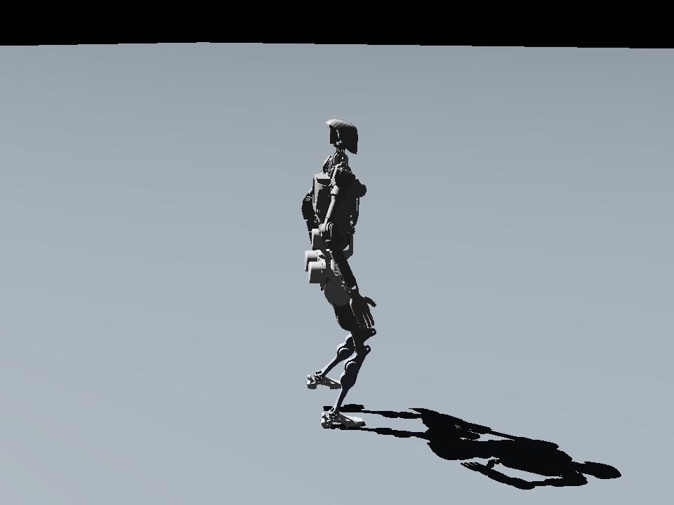
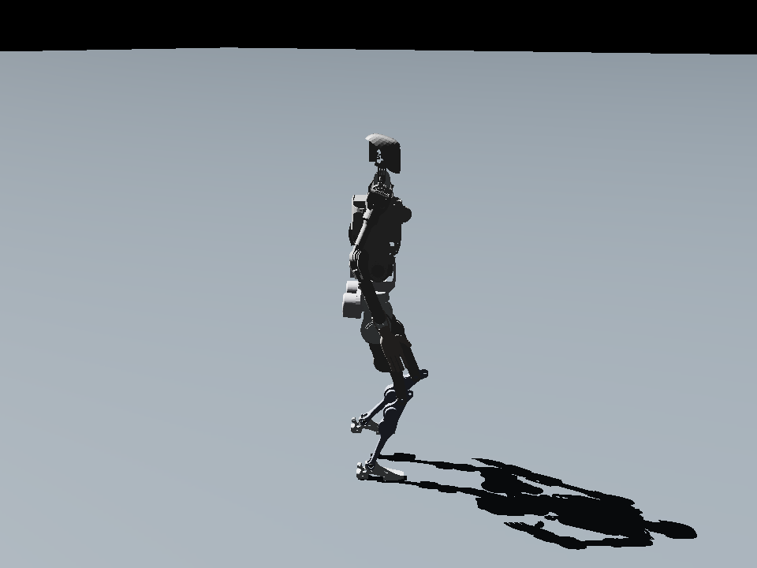
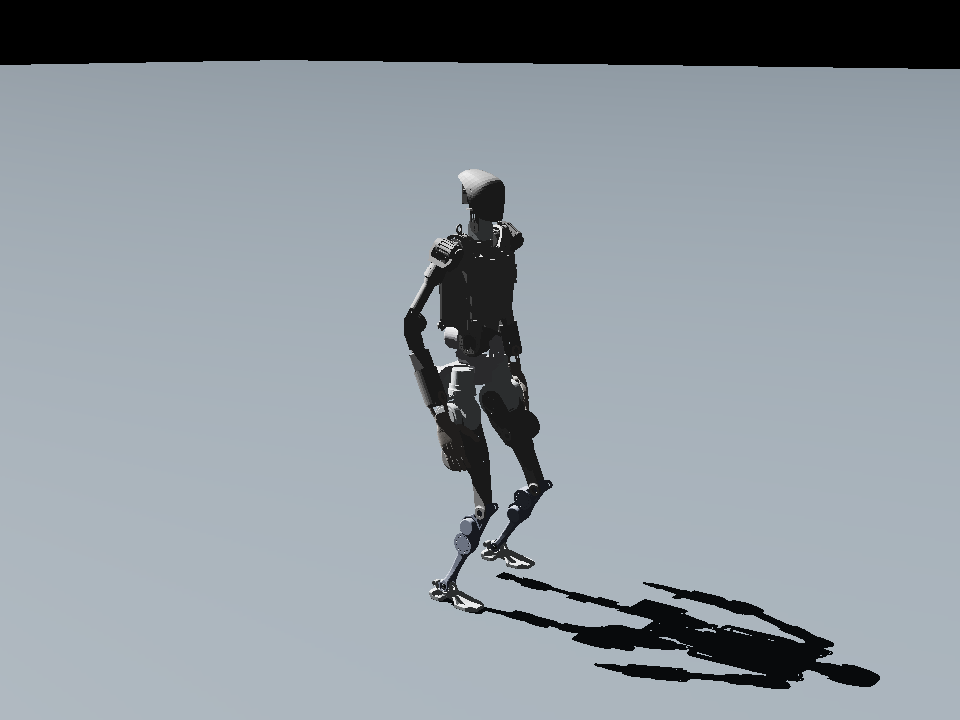
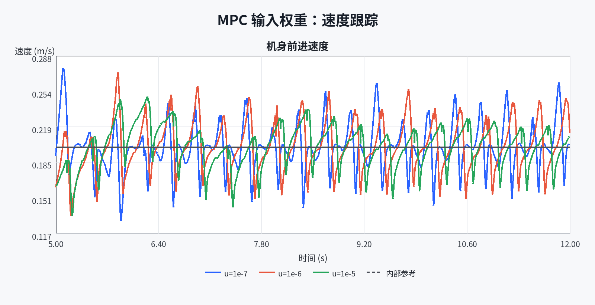
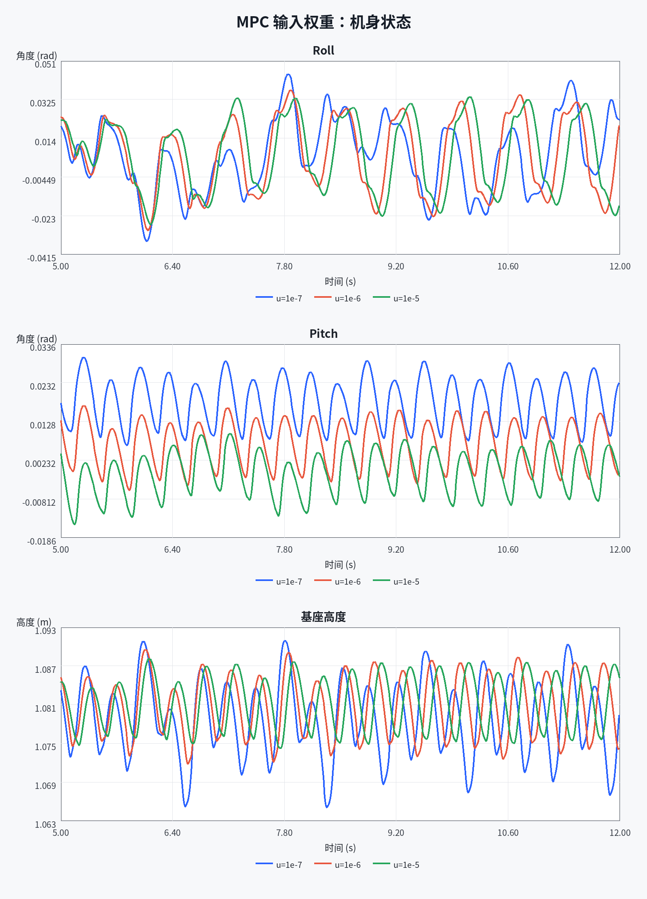
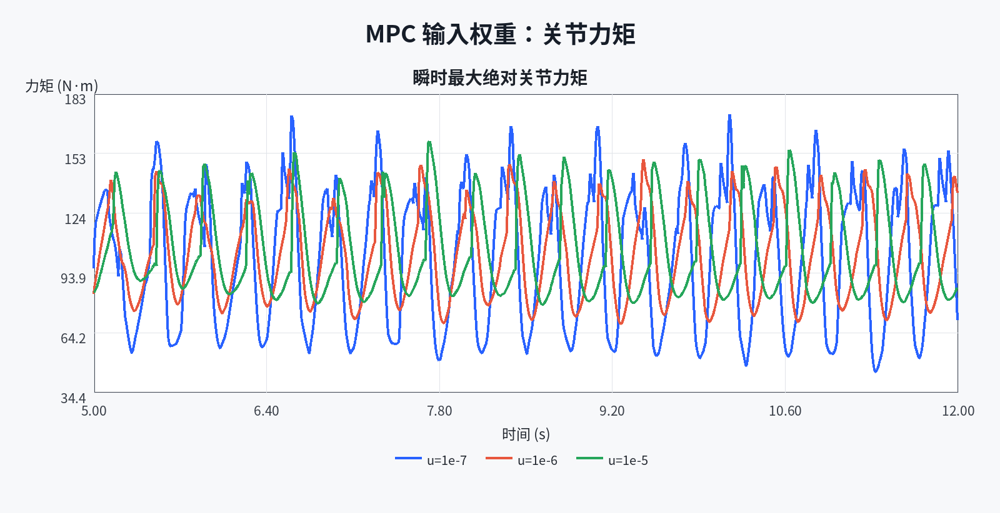

# 青龙人形机器人 MPC/WBC 项目 L0 验收报告

## 1. 验收任务与所选路线

本项目选择项目书的路线 B：`openloong-dyn-control` 青龙人形机器人。L0 的要求是完成环境搭建和编译，在仿真中跑通默认示例，使机器人能够稳定站立并按指令前进、转向，同时提交可复现的环境与启动记录以及演示视频。

项目书中，四足路线使用 ROS 与 Gazebo；青龙人形路线默认使用 MuJoCo，并且明确不依赖 ROS。本机没有照搬青龙原工程的 MuJoCo 仿真接口，而是保留原 C++ MPC、WBC、步态调度、足端规划、Pinocchio 动力学和关节控制器，自行完成 Isaac Sim 6.0.1/PhysX 仿真适配。因此，本成果属于 OpenLoong 控制栈的 Isaac Sim 闭环复现，不能表述成原生 MuJoCo 示例原样运行。

## 2. 实际环境

| 项目 | 实际配置 |
|---|---|
| 操作系统 | 双系统中的 Ubuntu 22.04.5 LTS，x86_64 |
| 编译器 | g++ 11.4.0，C++17 |
| 构建工具 | CMake 3.22.1 |
| 仿真器 | Isaac Sim `6.0.1-rc.7+release.42383.32955d8d.gl` |
| 物理与渲染 | CPU PhysX、单 NVIDIA GPU 渲染 |
| 控制工程 | OpenLoong commit `4dd7a7e42a9cfd588afc78f3e429998ed8a30f4e` |
| ROS | 未使用；青龙路线本身不依赖 ROS |
| 控制依赖 | 使用原仓库 `third_party/` 中的 Eigen、Pinocchio、qpOASES、URDFDOM、JSON 等 |

## 3. 为 Isaac Sim 完成的适配（ai辅助完成）

1. 将原 URDF/MJCF 的模型信息整理并导入为 Isaac 可加载的浮动基 USD，保留 31 个关节、质量、质心、惯量、关节限位、减速比、足底碰撞盒和被动关节参数。
2. 按关节名称建立 C++ 控制器与 USD 关节的双向映射，不依赖两个系统内部数组顺序相同。
3. 统一四元数顺序、世界坐标角速度以及质心速度与 `base_link` 原点速度的参考点，避免把不同状态定义直接混用。
4. 通过 C ABI 和 Python `ctypes` 将 Isaac 状态送入原 C++ 控制栈，并把控制器输出的关节侧力矩直接施加到 PhysX；Isaac 内置关节驱动增益设为零，避免重复 PD 控制。
5. 使用 1 ms 物理和 WBC/PVT 周期（1 kHz），每 5 ms 运行一次 MPC（200 Hz），保存配置、状态、QP 状态、求解时间、力矩、日志、场景和画面。
6. 新增按仿真时间采样的 MP4 录制入口，使用 Isaac 自带 H.264 编码器，使 10 秒仿真得到 300 帧、30 FPS、10 秒视频。

主要入口为 [run_isaac.py](../../run_isaac.py)，仿真循环为 [simulation.py](../../isaac/simulation.py)，C++ 桥接为 [controller_bridge.cpp](../../isaac/native/controller_bridge.cpp)。原下载仓库保持不变，必要的生成式适配位于 `isaac/build/`。

## 4. 复现命令

以下命令均从 `Rbt-Project-Mid/` 项目根目录执行。

环境检查：

```bash
python3 Pro2/run_isaac.py --check-env
```

只构建 C++ 控制库：

```bash
python3 Pro2/run_isaac.py --build-only
```

打开 Isaac 窗口、自动进入 Play，并新录制一份 10 秒 L0 验收视频：

```bash
python3 Pro2/run_isaac.py --level L0 --mode walk --duration 10 \
  --walk-start 3 --vx 0.2 --record-video --video-fps 30 \
  --output Pro2/output/L0/walk_10s_video_gui
```

程序加载完成后自动进入 Play 状态，不需要再运行 Isaac Lab 的 `play.py`。前 3 秒用于建立初始站姿，随后约 7 秒展示 MPC/WBC 行走。视频保存为 `Pro2/output/L0/walk_10s_video_gui/demo.mp4`，同一目录还会保存本次配置、状态 CSV、运行清单、Isaac 日志、最终截图和场景文件。每次实验应使用新的输出子目录，程序会拒绝覆盖已有的 `run.json`。

本报告所附的现有成片通过同一入口以无窗口方式运行，命令为：

```bash
python3 Pro2/run_isaac.py --no-build --headless --level L0 --mode walk \
  --duration 10 --walk-start 3 --vx 0.2 --record-video --video-fps 30 \
  --output Pro2/output/L0/walk_10s_video
```

`--headless` 只是不显示交互窗口，仍然从同一个 Isaac 视口相机取帧；控制器、PhysX 物理循环和录像内容与窗口模式使用同一套代码。

## 5. 已有闭环验收证据

### 5.1 原验收记录

`verify_import`、`verify_walk`、`verify_gui_turn_push` 和 `verify_default` 是建立 L0–L4 分层规则以前生成的历史验证记录，现已整体归档到 `output/L0/`。这些历史 JSON 内的 `config.output` 仍保留运行当时的旧绝对路径，未手工改写成新路径；它们的状态、轨迹和日志文件均随目录一起迁移。`walk_10s_video` 是启用 `--level L0` 后直接生成在 L0 目录中的新记录。

| 验证项 | 实际结果 |
|---|---|
| 模型导入和力矩闭环 | [verify_import/run.json](verify_import/run.json)：0.2 秒仿真完成，`status=completed` |
| 10 秒验收成片 | [walk_10s_video/demo.mp4](walk_10s_video/demo.mp4) 与 [run.json](walk_10s_video/run.json)：10,000 个物理步、300 帧、30 FPS，H.264、960×720，播放时长经容器检查为 10.000 秒；最终位置约 `(1.1739, -0.0182, 1.0874)` m，最大倾角约 0.04058 rad（2.33°），最低基座高度约 1.06519 m；记录中没有出现非零 MPC/WBC QP 失败状态 |
| 12 秒直行验证 | [verify_walk/run.json](verify_walk/run.json)：12,000 步、12 秒完成；最终位置约 `(1.1699, -0.0240, 1.0875)` m，最大倾角约 0.03981 rad（2.28°），最低基座高度约 1.06038 m |
| 转向与侧向扰动 | [verify_gui_turn_push/run.json](verify_gui_turn_push/run.json)：`vx=0.2 m/s`、`wz=0.1 rad/s`，第 8 秒受到世界 Y 方向 50 N、持续 0.1 秒的外力后保持稳定；最终 yaw 约 0.6168 rad |
| 最终版本长时直行 | [verify_default/run.json](verify_default/run.json)：20,000 步、20 秒完成；最终位置约 `(2.7700, -0.0153, 1.0820)` m，MPC/WBC QP 状态全程为 0 |
| 模型和适配单元检查 | [adapter_tests.txt](checks/adapter_tests.txt)：13 项检查通过，覆盖足底几何、初始高度、关节映射、四元数与速度参考点转换 |
| C++ 桥接回归检查 | [native_bridge_tests.txt](checks/native_bridge_tests.txt)：8 项检查通过，覆盖初始 IK、关节顺序、站立到行走、力矩单位、异常输入和连续 yaw |
| 视频格式检查 | [video_metadata.txt](checks/video_metadata.txt)：MP4/H.264、960×720、30 FPS、10.000 秒，退出码为 0 |

本次 10 秒成片消耗约 32.76 秒墙钟时间；最终版本 20 秒仿真消耗约 42.23 秒墙钟时间。因此，这里的“10 秒视频”指 10 秒仿真时间和 10 秒编码后播放时长，不代表程序必须在 10 秒墙钟时间内计算完成。

首次异步捕获的第 0 帧仍是 USD 加载画面。最终附件将它替换为首个完整渲染帧并重新编码，`run.json` 记录了这一后处理；这只修正视频开头约 1/30 秒的画面，没有修改物理状态 CSV。录像代码也已在正式捕获前增加不推进 PhysX 的渲染预热，供后续新录像使用。

### 5.2 四次代表性运行的统一关键指标

为了以后汇总五个阶段的总报告，下面用同一套定义重新整理四次代表性运行。数据直接来自各实验目录的 `analysis_metrics.json`；这些文件同时整理原始 `run.json` 的运行时汇总和 100 Hz `states.csv` 的时序统计，没有进行插值或平滑。表中的“最大倾角范数”定义为 $\max\sqrt{\phi^2+\theta^2}$，“水平净位移”定义为首末位置在水平面内的欧氏距离；因此它与原验收表中 `run.json` 记录的单轴最大倾角口径略有不同。“运行时最大关节力矩”来自 `run.json` 在 1 kHz 物理步上的累计极值，不能与只在 100 Hz 日志或特定分析窗口内计算的力矩峰值直接混用。

| 运行记录 | 仿真时长（s） | 水平净位移（m） | 最低基座高度（m） | 最大倾角范数（rad） | 最终 yaw（rad） | 行走段平均世界系 $v_x$（m/s） | 运行时最大关节力矩（1 kHz，N·m） | 最大外力（N） | MPC/WBC 非零状态样本数 |
|---|---:|---:|---:|---:|---:|---:|---:|---:|---:|
| 10 秒直行成片 | 10.00 | 1.1721 | 1.0652 | 0.0471 | -0.0094 | 0.1701 | 216.24 | 0 | 0 / 0 |
| 转向录制 | 10.00 | 1.1559 | 1.0653 | 0.0476 | 0.7666 | 0.1476 | 216.31 | 0 | 0 / 0 |
| 转向与 50 N 侧向扰动 | 12.00 | 1.1606 | 1.0606 | 0.0501 | 0.6168 | 0.1599 | 221.46 | 50 | 0 / 0 |
| 20 秒长时直行 | 20.00 | 2.7679 | 1.0604 | 0.0498 | 0.0067 | 0.1860 | 221.51 | 0 | 0 / 0 |

### 5.3 关键验收画面

以下四张图均为对应实验的最终仿真画面，用于证明模型、场景和运动结果确实由 Isaac Sim 运行产生。定量结论应以同目录的 `analysis_metrics.json` 和 `states.csv` 为准，不能仅凭截图估计。

**10 秒直行成片：**机器人在完成站立建立和直行后仍保持直立。


**转向录制：**目录名 `walk_turn_at_5s_gui` 是历史名称，但 [states.csv](walk_turn_at_5s_gui/states.csv) 的实际命令记录显示：$w_z$ 在 3.00 s 开始由 0 变为 $0.15\ \mathrm{rad/s}$，8.77 s 后变为 $-0.15\ \mathrm{rad/s}$。因此总报告必须写“3.00 s 开始转向”，不能根据目录名写成“5 s 开始转向”。



**转向与侧向扰动：**机器人在行走转向过程中承受 50 N 世界 Y 方向外力，扰动后继续完成仿真。



**20 秒长时直行：**长时运行用于补充验证闭环持续性，MPC 和 WBC 的 QP 状态记录均未出现非零样本。



### 5.4 指标分析结论

1. **基本闭环已经跑通。** 四次代表性运行都以 `completed` 结束，最低基座高度保持在 1.0604–1.0653 m，最大倾角范数不超过 0.0501 rad，MPC/WBC 非零 QP 状态样本数均为 0。这组结果共同支持“能够稳定站立并持续行走”的 L0 结论。
2. **前进与转向均有状态数据支撑。** 10 秒直行的水平净位移为 1.1721 m、最终 yaw 为 -0.0094 rad；转向录制的最终 yaw 为 0.7666 rad。前者说明机器人基本沿前方行走，后者说明角速度指令确实改变了朝向。
3. **侧向扰动实验属于功能验证。** `verify_gui_turn_push` 记录了 10 个非零外力样本，最大外力为 50 N；运行最终完成，最低基座高度为 1.0606 m，QP 状态没有失败。它能够证明该次有限扰动下闭环没有中断，但不能据此推出对任意方向、任意幅值扰动都稳定。
4. **长时直行补充了持续性证据。** 20 秒运行取得 2.7679 m 水平净位移，最终 yaw 为 0.0067 rad，表明该次运行没有明显持续偏航。它仍是一次确定性仿真记录，不代替多次随机试验或统计显著性分析。
5. **默认配置运行与补充调参应分开引用。** 本节表中的速度、姿态和力矩是初次验收默认配置下的观测结果，不是参数优化结果。2026-11-03 补做的 `u_weight` 三点单变量调参见第 6 节；L2 的四类系统对照实验仍应单独引用，不能与本节默认运行混为一组数据。

### 5.5 原始证据与总报告引用索引

总报告引用 L0 结果时，可以按下表中的编号使用。每项都同时保留画面、统一指标和原始状态，便于从结论反查原始数据。

| 总报告索引 | 建议用途 | 关键画面或视频 | 统一指标 | 原始证据 |
|---|---|---|---|---|
| L0-E1 | 10 秒直行和视频验收 | [最终画面](walk_10s_video/final_frame.png)、[10 秒视频](walk_10s_video/demo.mp4) | [analysis_metrics.json](walk_10s_video/analysis_metrics.json) | [run.json](walk_10s_video/run.json)、[states.csv](walk_10s_video/states.csv) |
| L0-E2 | 角速度指令与转向效果 | [最终画面](walk_turn_at_5s_gui/final_frame.png) | [analysis_metrics.json](walk_turn_at_5s_gui/analysis_metrics.json) | [run.json](walk_turn_at_5s_gui/run.json)、[states.csv](walk_turn_at_5s_gui/states.csv) |
| L0-E3 | 50 N 侧向扰动后的闭环完成情况 | [最终画面](verify_gui_turn_push/final_frame.png) | [analysis_metrics.json](verify_gui_turn_push/analysis_metrics.json) | [run.json](verify_gui_turn_push/run.json)、[states.csv](verify_gui_turn_push/states.csv) |
| L0-E4 | 20 秒长时直行与 QP 状态 | [最终画面](verify_default/final_frame.png) | [analysis_metrics.json](verify_default/analysis_metrics.json) | [run.json](verify_default/run.json)、[states.csv](verify_default/states.csv) |
| L0-E5 | MPC 输入代价总系数三点调参 | [速度跟踪](mpc_input_weight/comparison/speed_tracking.png)、[姿态与高度](mpc_input_weight/comparison/posture.png)、[控制努力](mpc_input_weight/comparison/control_effort.png) | [metrics.json](mpc_input_weight/comparison/metrics.json)、[metrics.csv](mpc_input_weight/comparison/metrics.csv) | [低权重](mpc_input_weight/low_1e-7/)、[基线](mpc_input_weight/baseline_1e-6/)、[高权重](mpc_input_weight/high_1e-5/) |

这些链接均相对于本报告所在的 `Pro2/output/L0/`。在项目根目录中，默认运行证据位于 `Pro2/output/L0/walk_10s_video/`、`Pro2/output/L0/walk_turn_at_5s_gui/`、`Pro2/output/L0/verify_gui_turn_push/` 和 `Pro2/output/L0/verify_default/`，补充调参证据位于 `Pro2/output/L0/mpc_input_weight/`。总报告应引用上述正式目录，不应从其他层级复制文件或把 L0 图像混入 L1–L4 的实验子目录。

## 6. MPC 输入权重三点补充调参

### 6.1 先通俗理解：这次调的是什么

MPC 每次都要在“尽量跟上目标状态”和“不要让接触 wrench 过度偏离名义重力支撑输入”之间折中。`u_weight` 就是第二项的总系数：数值越大，优化器越重视控制输入代价；数值越小，优化器越允许接触输入为追踪目标而变化。它不是速度命令，也不是简单的关节力矩倍率，因此不能只看一个数值就预言机器人一定更快或更省力。

初次 L0 验收使用默认值 `u_weight=1e-6`，当时只证明了示例闭环跑通。2026-11-03 在相同平地、相同前进命令和相同控制周期下补做 `1e-7`、`1e-6`、`1e-5` 三个候选值的单变量实验，用速度、姿态、高度、关节控制努力和求解时间共同判断。该工作补上了“自己修改参数并分析结果”的学习证据。

### 6.2 配置位置、唯一变量和三组输出

三份实验配置从项目根目录开始的明确路径为：

- `Pro2/experiments/L0/mpc_input_weight/low_1e-7.json`，修改字段 `u_weight` 为 `0.0000001`；
- `Pro2/experiments/L0/mpc_input_weight/baseline_1e-6.json`，字段 `u_weight` 保持默认值 `0.000001`；
- `Pro2/experiments/L0/mpc_input_weight/high_1e-5.json`，修改字段 `u_weight` 为 `0.00001`。

三组配置只有 `u_weight` 不同。其余条件统一为 12 s 仿真、1 ms 物理周期、5 ms MPC 周期、10 步预测时域、3 s 开始行走、目标前进速度 $0.2\ \mathrm{m/s}$、0.12 m 期望步高、平地且不施加外力。三组独立输出分别保存于：

- `Pro2/output/L0/mpc_input_weight/low_1e-7/`；
- `Pro2/output/L0/mpc_input_weight/baseline_1e-6/`；
- `Pro2/output/L0/mpc_input_weight/high_1e-5/`。

每个目录都保留实际 `config.json`、运行清单 `run.json`、原始时序 `states.csv`、Isaac 日志、场景和最终画面。对比结果位于 `Pro2/output/L0/mpc_input_weight/comparison/`。

三次正式运行和统一分析使用的 Python 命令为：

```text
python3 Pro2/run_isaac.py --no-build --level L0 --config Pro2/experiments/L0/mpc_input_weight/low_1e-7.json --output Pro2/output/L0/mpc_input_weight/low_1e-7
python3 Pro2/run_isaac.py --no-build --level L0 --config Pro2/experiments/L0/mpc_input_weight/baseline_1e-6.json --output Pro2/output/L0/mpc_input_weight/baseline_1e-6
python3 Pro2/run_isaac.py --no-build --level L0 --config Pro2/experiments/L0/mpc_input_weight/high_1e-5.json --output Pro2/output/L0/mpc_input_weight/high_1e-5
python3 Pro2/tools/analyze_l0_tuning.py
```

以上输出目录已经包含本次正式结果；程序会拒绝覆盖已有 `run.json`。若以后重跑，应先使用新的 L0 子目录保存新一轮结果，避免覆盖本报告引用的正式证据。

### 6.3 数据完整性与指标口径

三次运行均通过分析程序的严格校验：`run.json.status=completed`，每次正好包含 12,000 个物理步和 1,200 个 100 Hz 日志样本，时间间隔为 0.01 s，记录数值均为有限值，MPC/WBC QP 失败样本均为 0。程序同时比较三次实际运行的配置，确认唯一实验变量是 `u_weight`。

指标统一使用 5.00–11.99 s 的 700 个样本，排除初始站立和大部分行走建立过程。世界系速度按照当前 yaw 转为机身前向速度：

$$
v_x^B=\cos(\psi)v_x^W+\sin(\psi)v_y^W
$$

关节控制努力代理定义为：

$$
J_{\tau}=\int_{5\,\mathrm{s}}^{t_{\mathrm{end}}}\sum_j \tau_j^2(t)\,\mathrm{d}t
$$

`J_\tau` 只反映关节力矩平方积分，不能解释成电机真实电能消耗。

### 6.4 三点对照结果

| 候选值 | 前向速度 RMSE（m/s） | 最大倾角（rad） | 高度标准差（m） | 最低高度（m） | 峰值关节力矩（N·m） | 力矩平方积分（N²·m²·s） | MPC 求解 P95（ms） | MPC/WBC 失败样本 |
|---|---:|---:|---:|---:|---:|---:|---:|---:|
| `u_weight=1e-7` | 0.021894 | 0.050387 | 0.0058715 | 1.0654 | 173.01 | 128057.66 | 0.51689 | 0 / 0 |
| `u_weight=1e-6` | 0.023611 | 0.038328 | 0.0046429 | 1.0721 | 150.42 | 119002.22 | 0.47685 | 0 / 0 |
| `u_weight=1e-5` | 0.020213 | 0.033809 | 0.0039889 | 1.0746 | 159.41 | 122374.41 | 0.48304 | 0 / 0 |

速度跟踪曲线显示三组实际机身前向速度与控制器内部参考的差异：



姿态与高度曲线用于检查提高输入代价后是否以明显失稳为代价：



控制努力曲线展示每个采样时刻的最大绝对关节力矩，全部关节的力矩平方积分保存在结构化指标文件中：



### 6.5 目标函数与参数传递路径

专业上，当前凸 MPC 把预测状态误差和接触输入代价写入同一个二次规划。略去与决策变量无关的常数后，可写成：

$$
\min_U\ \frac{1}{2}U^{\mathsf T}HU+c^{\mathsf T}U
$$

其中源码实际构造为：

$$
H=2\left(B_{\mathrm{qp}}^{\mathsf T}LB_{\mathrm{qp}}+\alpha K\right)+10^{-10}I
$$

$$
c=2B_{\mathrm{qp}}^{\mathsf T}L\left(A_{\mathrm{qp}}X_{\mathrm{cur}}-X_d\right)+2\alpha K\Delta U
$$

这里 $L$ 是状态误差权重矩阵，$K$ 是输入通道权重矩阵，$\alpha=u_{\mathrm{weight}}$ 是本次调节的总缩放系数，$U$ 是接触 wrench 优化变量，$\Delta U$ 是由支撑状态构造的重力补偿偏置。增大 `u_weight` 只放大 $\alpha K$ 这一输入代价，不改变状态权重、预测时域或运动命令。

参数从配置到 MPC 的传递顺序为：

1. `Pro2/experiments/L0/mpc_input_weight/*.json` 中的 `u_weight`；
2. `Pro2/run_isaac.py` 的 `arguments()` 读取并校验；
3. `Pro2/isaac/simulation.py` 的 `_run()` 调用 `controller.set_weights(...)`；
4. `Pro2/isaac/native.py` 的 `Controller.set_weights()` 调用 C ABI；
5. `Pro2/isaac/native/controller_bridge.cpp` 的 `ol_set_mpc_weights()` 保存权重；
6. `Pro2/OpenLoong-Dyn-Control/algorithm/mpc.cpp` 的 `MPC::set_weight()` 令 `alpha = u_weight`，并在 `MPC::cal()` 中构造 Hessian 和梯度。

因此，要复现实验或继续学习，只需要修改上述三份 L0 配置中的 `u_weight` 字段；不要同时修改 `state_weights`、`input_weights` 或其他运行条件，否则就不再是本次单变量对照。

### 6.6 结果解释、当前推荐与适用边界

在这三个候选值和当前无扰动直行场景中，`1e-5` 的速度 RMSE、最大倾角和基座高度波动最小。与默认 `1e-6` 相比，它的速度 RMSE 降低 14.39%，最大倾角降低 11.79%，但力矩平方积分增加 2.83%；因此它取得的是当前场景下较好的综合折中，并非所有单项都最小。`1e-6` 的峰值关节力矩与力矩平方积分最低，适合用来说明“更好的状态表现”和“更小的控制努力”之间存在取舍。`1e-7` 的输入惩罚最弱，同时出现三组中最大的倾角、高度波动、峰值力矩和控制努力，符合控制器更容易积极调整接触输入的机制。

结果不是随 `u_weight` 单调变化，因为接触约束、步态切换、WBC 和关节反馈共同作用，而且 MPC 接触 wrench 代价不等于最终关节力矩本身。三组运行的综合分数分别为 0.79794、0.50662 和 0.082204；该分数先在这三组内部做最小—最大归一化，再按速度 RMSE 40%、最大倾角 20%、高度标准差 15%、力矩平方积分 20%、求解 P95 5% 相加。这组权重是实验前人为设定的汇总偏好，只用于辅助同时查看多个指标，不能作为客观最优性的证明。

所以，本报告只推荐：**在 `1e-7`、`1e-6`、`1e-5` 三个候选值以及当前平地、$0.2\ \mathrm{m/s}$、无扰动直行场景中，推荐 `u_weight=1e-5`。** 该结论不代表全局最优，也不能直接外推到转向、外力、不同地形、不同速度或真实机器人。若更换任务，应重新进行多次试验和跨场景验证。

### 6.7 与 L2 对照实验的区别

L0 补充实验只调节一个 MPC 输入代价总系数 `u_weight`，目的在于补齐初学者“亲自修改一个控制参数、观察现象并解释权衡”的证据。L2 的 `mpc_vx_weight` 实验修改的是 `Pro2/experiments/L2/mpc_vx_weight/*.json` 中的 `state_weights[9]`，它直接改变前进速度状态误差的代价；L2 还分别研究预测时域、期望步高和侧向扰动，共形成四类、12 次运行。

因此，两者虽然都与 MPC 学习有关，但自变量和验收目的不同：L0 证明默认闭环跑通后能够完成一次受控的参数学习；L2 用更完整的实验矩阵分析状态权重、预测长度、步态参数和抗扰响应。总报告中应分别引用，不应把 `u_weight` 和 `state_weights[9]` 写成同一个参数。

## 7. 遇到的问题与解决办法

### 7.1 仿真后端不同

MuJoCo 和 PhysX 使用不同的接触求解器，摩擦、关节被动参数和碰撞设置不能只靠同名字段机械复制。本项目明确迁移质量/惯量、足底盒、摩擦、armature、阻尼、限位和自碰撞排除，并以实际闭环轨迹、姿态、高度和 QP 状态验证结果。当前结果证明 Isaac 适配能够闭环运行，不意味着两种引擎的每个数值响应完全相同。

### 7.2 状态和力矩约定

Isaac 与原控制工程的关节排列、四元数排列和速度参考点不同。适配层按名称映射关节，把 `wxyz` 四元数转换为 Pinocchio 约定，并使用

$$
v_{base}=v_{COM}-\omega\times(Rr_{COM})
$$

将质心线速度换算成 `base_link` 原点速度。输出采用关节侧 N·m，避免重复除以减速比。

### 7.3 IOMMU 启动提示

Isaac 启动时曾显示 IOMMU 兼容性提示。这是 Linux/GPU 内存传输警告，并非控制器编译错误。项目只抑制重复弹窗，没有修改 BIOS、内核参数或系统 IOMMU 状态。

## 8. 调参状态与总报告提醒

初次 L0 验收时确实尚未开展控制参数对照，该历史状态保留在 [总报告提醒_尚未调参.md](总报告提醒_尚未调参.md)。2026-11-03 已补做 `u_weight` 的 `1e-7`、`1e-6`、`1e-5` 三点单变量调参，正式证据位于 `Pro2/output/L0/mpc_input_weight/`。当前可以写成“L0 已完成一次 MPC 输入代价参数学习，并在三个候选值和当前场景中推荐 `1e-5`”，不能写成“完成全部 MPC/WBC 优化”或“获得全局最优参数”。L2 的四类对照仍是更系统的控制实验，应引用 `Pro2/output/L2/L2验收报告.md`。

## 9. L0 验收结论

在 Isaac Sim 适配路线下，青龙已经完成稳定站立、直线行走和转向，并在一次 50 N 侧向扰动后保持闭环稳定；环境、构建命令、启动命令和运行数据均可复现。以“仿真环境搭建并跑通、能够站立/前进/转向、提供复现记录”为标准，当前实现达到 L0 的功能性要求。

与项目书默认人形路线的差异是仿真后端由 MuJoCo 改为 Isaac Sim/PhysX。这既是路线差异，也是本项目完成的一项自主工程修改。如果教师明确要求必须展示原生 MuJoCo 官方示例，则还应补充一次 MuJoCo 原生运行记录；现有 Isaac 结果不冒充 MuJoCo 结果。

项目书同时说明，只跑通示例而没有自己的修改与分析只能得到 L0 分。Isaac 适配是工程修改，第 6 节进一步记录了亲自改变 MPC 输入代价并解释结果的学习过程；L1 源码分析与 L2 四类单变量对照则继续提供更完整的控制原理和实验分析证据。
