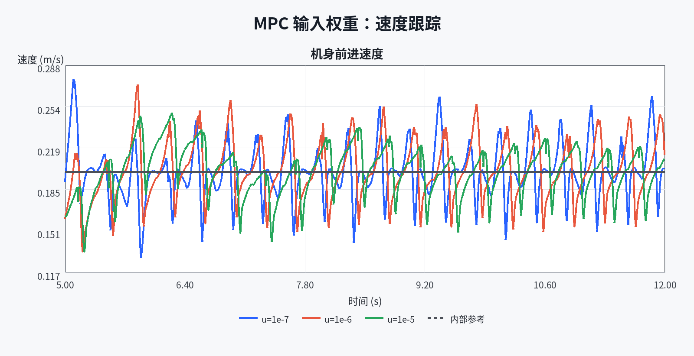
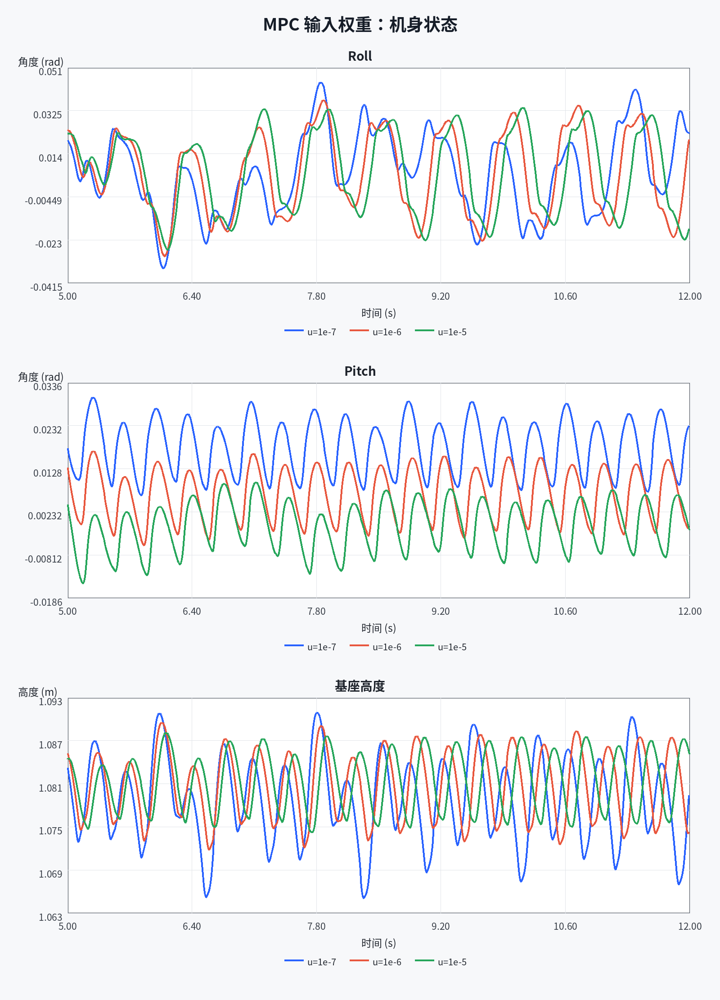
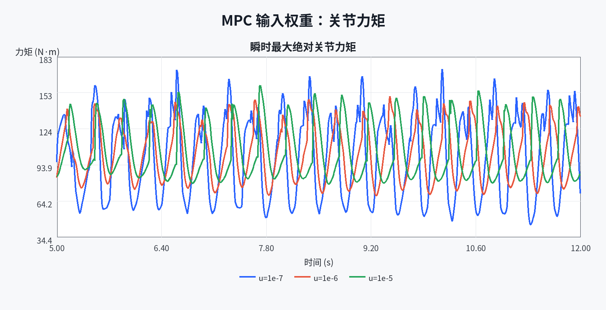

# L0：MPC 输入权重三点调参分析

> 数据来自同目录三次 Isaac Sim 运行的 `run.json`、`config.json` 和 `states.csv`。分析程序只读取结果，不启动仿真。

## 1. 实验设计

本实验只改变凸 MPC 的输入代价总系数 `u_weight`：`1e-7`、`1e-6` 和 `1e-5`。其余仿真、运动、MPC、步态、默认状态权重与输入通道权重完全相同，并且不施加外力。三份配置分别位于：

- `Pro2/experiments/L0/mpc_input_weight/low_1e-7.json`
- `Pro2/experiments/L0/mpc_input_weight/baseline_1e-6.json`
- `Pro2/experiments/L0/mpc_input_weight/high_1e-5.json`

统一分析窗口为 `5.0 s` 到日志末尾。世界坐标速度先按机身偏航角转换为机身前向速度，再与控制器内部参考比较：

$$
v_x^B=\cos(\psi)v_x^W+\sin(\psi)v_y^W
$$

控制努力使用全部关节力矩平方和的时间积分：

$$
J_{\tau}=\int_{5\,\mathrm{s}}^{t_{\mathrm{end}}}\sum_j \tau_j^2(t)\,\mathrm{d}t
$$

## 2. 数据完整性

三次运行均通过严格检查：`status=completed`、`12000` 个物理步、`1200` 个日志样本、`0.01 s` 等间隔时间轴、所有数值有限，并且实际运行配置中只有 `u_weight` 不同。

## 3. 指标结果

| 条件 | vx RMSE (m/s) | 最大倾角 (rad) | 高度标准差 (m) | 最低高度 (m) | 峰值关节力矩 (N·m) | 力矩平方积分 (N²·m²·s) | MPC QP 失败样本 | MPC 求解 P95 (ms) | 综合分数 |
|---|---:|---:|---:|---:|---:|---:|---:|---:|---:|
| u=1e-7 | 0.021894 | 0.050387 | 0.0058715 | 1.0654 | 173.01 | 1.2806e+05 | 0 | 0.51689 | 0.79794 |
| u=1e-6 | 0.023611 | 0.038328 | 0.0046429 | 1.0721 | 150.42 | 1.19e+05 | 0 | 0.47685 | 0.50662 |
| u=1e-5 | 0.020213 | 0.033809 | 0.0039889 | 1.0746 | 159.41 | 1.2237e+05 | 0 | 0.48304 | 0.082204 |

## 4. 调参结论

按本实验的平衡评价，推荐值为 `1e-05`。该条件的综合分数为 `0.082204`，三组中最低。

综合分数先在三组内部对各指标做最小—最大归一化，再按以下权重相加：速度 RMSE 40%、最大倾角 20%、高度标准差 15%、力矩平方积分 20%、MPC 求解时间 P95 5%。分数越低，表示本次无扰动直行任务中的速度跟踪、稳定性、控制努力与计算时间折中越好。

与原始基线 `u_weight=1e-6` 相比，推荐条件的速度 RMSE 降低 14.39%，最大倾角 降低 11.79%，力矩平方积分 增加 2.83%。

从控制意义上看，减小 `u_weight` 会降低对接触 wrench 偏离名义重力支撑输入的惩罚，控制器可以更积极地追踪状态参考，但可能增大关节控制努力；增大 `u_weight` 会更强地约束这种偏离，可能降低控制努力，也可能牺牲速度跟踪。实际结果必须同时查看速度、姿态、高度、力矩和 QP 状态，不能只按某一个指标判断。

本结论针对固定地形、固定速度、无扰动和单次确定性运行。若用于更广的最终参数选择，还需要在转向、外力和不同地形条件下复核。完整数值保存在 `metrics.csv` 和 `metrics.json`。
