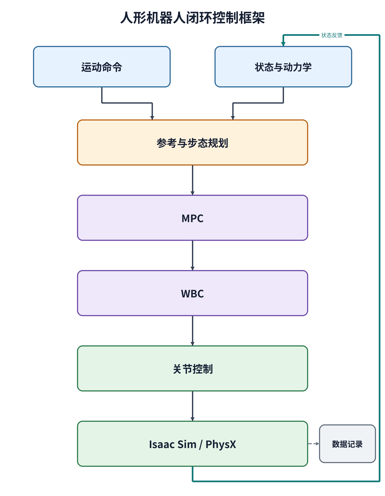

# L1 源码分析报告：Isaac Sim 下的 OpenLoong 人形 MPC/WBC 闭环

记录日期：2026-10-30

## 1. 任务目标与分析边界

L0 已经证明 OpenLoong 人形机器人可以在 Isaac Sim/PhysX 中完成站立、直行和转向。L1 的目标是把当前控制栈读懂，并让每个结论都能指向具体源码、函数或配置字段。

本报告回答：

1. Isaac Sim 给控制器提供了什么状态；
2. 速度命令怎样变成位置、速度和航向参考；
3. 步态调度与落脚规划怎样工作；
4. MPC 的状态、输入、模型、代价、约束和求解器是什么；
5. WBC 怎样把接触力和运动参考转换为全身运动与关节力矩；
6. 最终 31 个关节力矩怎样生成并施加给 PhysX；
7. 每个模块以什么频率运行。

项目书的人形路线以 MuJoCo 为默认仿真环境。本机实现保留 OpenLoong 原有的 C++ MPC、WBC、Pinocchio 动力学、步态调度、落脚规划和 PVT 控制器，将仿真后端适配为 Isaac Sim/PhysX。因此本报告分析的是当前仓库真实运行路径，不把 ROS、MuJoCo 或四足 `legged_control` 路线写成当前实现。

L1 只做源码分析。参数扫描和对照实验属于 `Pro2/output/L2/`。

## 2. 先用通俗语言理解整个闭环

整个系统可以理解成每 1 ms 重复一次的“看—想—做”：

1. **看**：Isaac Sim 返回机器人身体的位置、姿态、速度以及 31 个关节的角度和角速度；
2. **想怎么走**：命令解释器把前进和转向命令平滑成未来的运动参考；
3. **决定哪只脚支撑**：步态调度器判断左脚、右脚或双脚支撑；
4. **决定摆动脚落在哪里**：落脚规划器根据速度误差计算下一落脚点和抬脚轨迹；
5. **MPC 看未来**：用简化单刚体模型预测接下来 50 ms，计算左右脚应该产生的接触力和接触力矩；
6. **WBC 管全身**：同时考虑支撑脚、机身姿态、摆动脚、腰部和手臂任务，计算全身目标与前馈关节力矩；
7. **PVT 执行**：将 WBC 前馈力矩与关节位置、速度反馈相加，经滤波和限幅后得到最终 31 维力矩；
8. **PhysX 推进一步**：仿真器根据力矩得到下一时刻状态，再反馈给控制器。

## 3. 当前闭环控制框架图



图片文件位于：

```text
Pro2/output/L1/figures/L1闭环控制框架.png
```

可重复生成入口：

```text
Pro2/tools/render_project_diagrams.py
```

重新生成命令：

```text
python3 Pro2/tools/render_project_diagrams.py --diagram L1
```

图中的两个准确性边界非常重要：

- 当前基座和关节反馈直接来自 Isaac 仿真真值，没有运行原 OpenLoong 的 IMU/Kalman 基座状态估计；
- 日志中的左右脚 Fz 是根据动力学、Jacobian 和关节力矩反算的估计值，不是 PhysX 接触传感器的直接测量。

### 3.1 本级证据形式与总报告引用方式

L1 是源码阅读和控制链分析任务，不是仿真对照实验，因此本级没有 RMSE、最大误差、扰动恢复时间或成功率等实验指标，也没有单独生成 `metrics.json`。L0 的运行数据没有复制到 L1；L2 及后续实验数据也不混入本级。以后汇总总报告时，L1 应引用上面的闭环框架图以及下表中的分析结论，用来解释后续实验“改了什么、为什么会影响结果”。

| L1 分析成果 | 可直接用于总报告的结论 | 本报告位置或本级文件 |
|---|---|---|
| 闭环控制框架图 | 命令、状态反馈、步态、MPC、WBC、PVT 和 PhysX 构成完整闭环 | [figures/L1闭环控制框架.png](figures/L1闭环控制框架.png) |
| 模块输入输出与频率 | 物理/WBC/PVT 默认 1 kHz，MPC 默认 200 Hz，日志 100 Hz | 第 4 节 |
| MPC 数学模型 | 12 维基座状态、13 维输入、线性化单刚体预测和接触约束 | 第 7 节 |
| WBC 与关节执行 | 分层运动任务、当前时刻动力学 QP、前馈力矩与关节反馈 | 第 8、9 节 |
| 逐步调用链 | 每 1 ms 控制步的实际执行顺序 | 第 10 节 |
| 可追溯源码索引 | 每个结论对应项目根目录起的路径、类、函数或字段 | 第 12 节 |

本级的验收标准是“分析是否完整、结论是否能追溯到源码”，不能用“没有实验指标”推断控制效果好坏。控制效果的数值证据应从 `Pro2/output/L0/` 的跑通记录和 `Pro2/output/L2/` 至 `Pro2/output/L4/` 的独立实验报告中引用。

## 4. 模块、输入输出和频率

| 模块 | 主要输入 | 主要输出 | 默认逻辑频率 | 相对路径与入口 |
|---|---|---|---:|---|
| PhysX 物理仿真 | 31 维关节侧力矩 | 下一时刻基座与关节状态 | 1000 Hz | `Pro2/isaac/simulation.py::_run()` |
| Isaac 状态读取与适配 | articulation 状态 | 控制器顺序的 `q,dq,p,R,v,ω` | 1000 Hz | `Pro2/isaac/simulation.py`、`Pro2/isaac/adapter.py` |
| 命令平滑 | `vx,vy,wz` | 世界系位置、速度和航向参考 | 1000 Hz | `Pro2/OpenLoong-Dyn-Control/algorithm/joystick_interpreter.cpp` |
| Pinocchio 动力学 | 浮动基和关节状态 | `M,h,J,dJ`、CoM 与足端状态 | 1000 Hz | `Pro2/OpenLoong-Dyn-Control/algorithm/pino_kin_dyn.cpp` |
| 步态调度 | 状态、相位、估计足底力 | 支撑腿、下一支撑腿、`phi` | 1000 Hz | `Pro2/OpenLoong-Dyn-Control/algorithm/gait_scheduler.cpp` |
| 落脚规划 | 目标/实际速度、相位 | 摆动脚位置和姿态参考 | 1000 Hz | `Pro2/OpenLoong-Dyn-Control/algorithm/foot_placement.cpp` |
| MPC | 12 维基座状态、参考和接触相位 | 双脚接触 wrench 与基座参考 | 200 Hz | `Pro2/OpenLoong-Dyn-Control/algorithm/mpc.cpp` |
| WBC 任务层 | 机身、足端和关节任务 | 全身运动修正 | 1000 Hz | `Pro2/OpenLoong-Dyn-Control/algorithm/priority_tasks.cpp` |
| WBC 动力学 QP | MPC wrench、全身动力学 | 接触力修正、关节前馈力矩 | 1000 Hz | `Pro2/OpenLoong-Dyn-Control/algorithm/wbc_priority.cpp` |
| 关节 PVT | 目标/当前 `q,dq`、WBC 力矩 | 31 维关节侧力矩 | 1000 Hz | `Pro2/OpenLoong-Dyn-Control/common/PVT_ctrl.cpp` |
| 日志 | 状态、命令与诊断量 | `states.csv` | 100 Hz | `Pro2/isaac/simulation.py` |
| 默认渲染 | 仿真场景 | GUI/视频帧 | 30 Hz | `Pro2/run_isaac.py::arguments()` |

默认周期位于 `Pro2/run_isaac.py::arguments()`：

```text
dt = 0.001 s
mpc_dt = 0.005 s
log_hz = 100 Hz
render_hz = 30 Hz
```

`Pro2/isaac/native/controller_bridge.cpp` 中 `mpc_stride=mpc_dt/dt=5`，所以每五个物理步求解一次 MPC，WBC 和 PVT 每个物理步运行一次。

这些是按仿真时间安排的逻辑频率，不表示当前 Python/C++/Isaac 组合在墙钟时间上具有硬实时保证。

## 5. Isaac 状态反馈和状态估计

### 5.1 当前实际反馈

`Pro2/isaac/simulation.py::_run()` 每个物理步调用：

```python
robot.get_dof_positions()
robot.get_dof_velocities()
robot.get_world_poses()
robot.get_velocities()
```

得到 31 个关节角、31 个关节角速度、基座世界坐标位置、基座四元数以及线速度和角速度。

`Pro2/isaac/adapter.py` 负责接口边界：

- `joint_indices()`：按关节名称把 Isaac 顺序映射到 OpenLoong 顺序；
- `base_origin_velocity()`：将 PhysX 返回的质心处速度换算到 base-link 原点；
- `rpy_wxyz()`：将 `wxyz` 四元数转换成 roll、pitch、yaw，用于安全检查和日志。

`Pro2/isaac/native/controller_bridge.cpp::load_state()` 把这些真值写进 `DataBus`，再调用 Pinocchio 计算运动学和动力学。

### 5.2 原 Kalman 基座估计没有接入当前闭环

原状态估计源码仍位于：

```text
Pro2/OpenLoong-Dyn-Control/algorithm/StateEst.h
Pro2/OpenLoong-Dyn-Control/algorithm/StateEst.cpp
```

完整基座估计接口是 `StateEst::init()`、`set()`、`update()`、`get()`。当前 Isaac 桥接没有调用这组接口，而是把 Isaac 真值写入兼容字段。因此准确表述是：

> 当前 Isaac 闭环使用仿真真值作为基座和关节反馈；原 OpenLoong 的 Kalman 状态估计源码保留，但没有接入当前基座状态链。

### 5.3 `StateEst` 的足底力函数仍在使用

桥接层调用 `setF()`、`updateF()` 和 `getF()` 进行足底 wrench 估计。简化形式为：

$$
F_{est}
=-
\left(JM^{-1}J^T\right)^\dagger
\left[J M^{-1}(\tau-h)+\dot J\dot q\right],
$$

其中 $M$ 是质量矩阵，$h$ 是科氏力和重力等非线性项，$J$ 是足端 Jacobian。`GaitScheduler` 用估计的左右脚 Fz 辅助判断换腿。

## 6. 命令、步态与落脚规划

### 6.1 速度命令

命令字段定义在 `Pro2/run_isaac.py`：

- `vx`：机身坐标系前进速度；
- `vy`：机身坐标系横向速度；
- `wz`：绕 z 轴角速度。

GUI 键盘入口是 `Pro2/isaac/simulation.py::Keyboard`：W 前进、S 停止前进、A/D 左右转、H 停止转向、空格切换站立/行走请求。

`Pro2/OpenLoong-Dyn-Control/algorithm/joystick_interpreter.cpp` 将机身系速度换到世界系：

$$
\begin{aligned}
v_x^W &= \cos\psi\,v_x^B-\sin\psi\,v_y^B,\\
v_y^W &= \sin\psi\,v_x^B+\cos\psi\,v_y^B,\\
\psi_{k+1} &= \psi_k+\omega_z\Delta t.
\end{aligned}
$$

输出写入 `js_pos_des`、`js_vel_des`、`js_eul_des` 和 `js_omega_des`，供 MPC、落脚规划和 WBC 使用。

### 6.2 步态调度

步态源码：

```text
Pro2/OpenLoong-Dyn-Control/algorithm/gait_scheduler.h
Pro2/OpenLoong-Dyn-Control/algorithm/gait_scheduler.cpp
```

归一化相位按：

$$
\phi_{k+1}=\phi_k+\frac{\Delta t}{t_{Swing}}
$$

推进。当前默认 `tSwing=0.4 s`。源码使用估计足底力与相位共同判断触地和左右脚切换。

头文件虽然声明 `FzThrehold`，但当前实际逻辑在 `GaitScheduler::step()` 中直接使用 280 N 和 200 N 常数。若以后要把触地阈值做成实验参数，修改位置应是：

```text
Pro2/OpenLoong-Dyn-Control/algorithm/gait_scheduler.cpp::GaitScheduler::step()
```

并同步让 `FzThrehold` 真正参与判断。

### 6.3 落脚规划

源码：

```text
Pro2/OpenLoong-Dyn-Control/algorithm/foot_placement.h
Pro2/OpenLoong-Dyn-Control/algorithm/foot_placement.cpp
```

落脚位置的直觉是：实际速度落后于目标时，下一步落点向有助于加速的方向修正；同时加入剩余摆动时间、当前速度、转向和左右脚间距项。其结构可概括为：

$$
p_f=p_{hip}-K_p(v_d-v)+\frac12T_{swing}v+(1-\phi)T_{swing}v+\text{转向/足间距修正}.
$$

当前 Isaac 桥接在 `Pro2/isaac/native/controller_bridge.cpp` 中设置：

```cpp
feet.kp_vx = feet.kp_vy = feet.kp_wz = 0.03;
feet.stepHeight = step_height;
```

`step_height` 最终进入 `FootPlacement::Trajectory()`，生成摆动脚的抬脚和落脚曲线。

## 7. MPC：预测未来并分配双脚接触 wrench

### 7.1 状态、输入和维度

维度位于 `Pro2/OpenLoong-Dyn-Control/algorithm/mpc.h`：

```cpp
nx = 12;
nu = 13;
mpc_N = 10;
ch = 3;
```

状态为：

$$
x=[\Theta_3,\ p_3,\ \omega_3,\ v_3]^T\in\mathbb{R}^{12},
$$

即基座 roll/pitch/yaw、浮动基原点位置、角速度和线速度。它不是 31 关节完整状态，也不能严格称为完整质心位置。

输入为：

$$
u=[f_L(3),\ \tau_L(3),\ f_R(3),\ \tau_R(3),\ mg]^T\in\mathbb{R}^{13}.
$$

前 12 维是左右脚各自的三维接触力和三维接触力矩；第 13 维通过上下界固定为 $mg$，不是额外执行器。

### 7.2 单刚体预测模型

`Pro2/OpenLoong-Dyn-Control/algorithm/mpc.cpp::MPC::cal()` 使用线性化单刚体模型。连续时间结构为：

$$
\dot\Theta=R_z^T\omega,
\qquad
\dot p=v,
$$

$$
\dot\omega=I_W^{-1}(r_L\times f_L+\tau_L+r_R\times f_R+\tau_R),
$$

$$
\dot v=\frac{f_L+f_R}{m}+[0,0,g]^T.
$$

源码使用固定质量约 77.35 kg、重力加速度 -9.8 m/s² 和 MPC 摩擦系数 0.5。离散化采用前向 Euler：

$$
A_k=I+\Delta t A_{c,k},\qquad B_k=\Delta t B_{c,k}.
$$

十步预测堆叠为：

$$
X=A_{qp}x_0+B_{qp}U+C_{qp}.
$$

### 7.3 预测时间与控制时间

默认 `mpc_dt=0.005 s`，所以：

$$
T_p=N\Delta t=10\times0.005=0.05\ \mathrm{s}.
$$

前三个控制输入独立，之后预测步复用第三个输入，因此独立控制时域为：

$$
T_c=ch\Delta t=3\times0.005=0.015\ \mathrm{s}.
$$

### 7.4 代价函数与可修改权重

权重入口是：

```text
Pro2/OpenLoong-Dyn-Control/algorithm/mpc.cpp::MPC::set_weight()
```

默认值由 `Pro2/run_isaac.py::arguments()` 提供：

```text
u_weight = 1e-6
state_weights = [1,1,1, 0.001,100,1, 0.001,0.001,0.001, 1,100,1]
input_weights = 13 项均为 1
```

二次型目标可以理解为：

$$
J=(X-X_d)^T L(X-X_d)+\alpha(U-U_{ref})^T K(U-U_{ref}).
$$

第一项惩罚预测状态偏离参考，第二项惩罚接触 wrench 偏离期望支撑载荷或变化过大。增大某个 `state_weights` 会提高相应状态误差的代价，但真实运动还受输入代价、摩擦约束和 WBC 限制。

### 7.5 约束

`MPC::cal()` 包含：

- 线性化摩擦锥：限制切向力相对于竖直力的大小；
- 足底 x/y 力矩约束：限制压力中心在足底支撑区域内；
- 足底 z 轴扭矩约束；
- 接触 wrench 上下界；
- 单脚支撑时把摆动脚六维 wrench 固定为零；
- 第 13 维重力输入固定为 $mg$。

支撑脚不动由 WBC 的 `static_Contact` 任务处理；摆动脚高度由 `FootPlacement::Trajectory()` 生成并由 WBC 跟踪，不是当前 MPC 内部的足端轨迹约束。

### 7.6 求解器与输出

当前 MPC 使用 `qpOASES::QProblem`，在 `QP.init()` 后读取原始解。独立优化变量有 $13\times3=39$ 个。求解后：

- 第一预测步左右脚的 12 维 wrench 写入 `Fr_ff`；
- `des_ddq`、`des_dq` 和基座位置/姿态参考进入 WBC；
- QP 状态、耗时和工作集信息进入诊断日志。

当前实现是在线更新线性化模型并求解凸 QP，不使用 multiple shooting、SQP 或 HPIPM。项目书中的这些术语属于四足 `legged_control` 路线。

## 8. WBC：把简化模型目标变成全身运动和力矩

### 8.1 两阶段结构

当前 WBC 不是“每个任务都解一次分层 QP”，而是：

1. `PriorityTasks::computeAll()` 用加权伪逆和零空间投影逐级求运动目标；
2. `WBC_priority::computeTau()` 解一个当前时刻的动力学与接触 QP。

### 8.2 任务优先级

行走任务顺序在 `Pro2/OpenLoong-Dyn-Control/algorithm/wbc_priority.cpp`：

```text
static_Contact
↓
PosRot
↓
SwingLeg
↓
RedundantJoints
↓
HandTrackJoints
```

最高优先级的 `static_Contact` 保护支撑脚；`PosRot` 跟踪机身；`SwingLeg` 跟踪摆动脚；最后处理冗余关节和手臂动作。

站立顺序为：

```text
static_Contact
↓
CoMXY_HipRPY
↓
Pz
↓
HandTrackJoints
↓
HeadRP
```

低优先级任务只能在高优先级任务的零空间中修正目标，避免随意破坏支撑接触。

### 8.3 当前时刻动力学 QP

`WBC_priority::computeTau()` 的优化变量为：

$$
z=[\delta\ddot q_b,\ \delta F]^T\in\mathbb{R}^{18},
$$

其中 6 维是浮动基加速度修正，12 维是左右脚接触 wrench 修正。QP 包含 6 个浮动基动力学等式和 16 个接触/摩擦/足底力矩不等式，共 22 个约束。

全身动力学为：

$$
M\ddot q+h=S^T\tau+J^TF.
$$

浮动基没有直接执行器，所以基座六维动力学必须由接触力满足。QP 在 MPC 的 `Fr_ff` 附近修正接触 wrench，并修正运动任务得到的基座加速度。求解后通过逆动力学得到：

$$
\tau_{all}=M\ddot q_{opt}+h-J^TF_{opt}.
$$

取末尾 31 项作为驱动关节前馈力矩 `wbc_tauJointRes`。

## 9. 关节 PVT 与最终力矩

源码：

```text
Pro2/OpenLoong-Dyn-Control/common/PVT_ctrl.cpp
Pro2/OpenLoong-Dyn-Control/common/PVT_ctrl.h
Pro2/OpenLoong-Dyn-Control/common/joint_ctrl_config.json
```

`PVT_Ctr::calMotorsPVT()` 对每个关节计算：

$$
\tau_i=K_{p,i}(q_{d,i}-q_i)+K_{d,i}(\dot q_{d,i}-\dot q_i)+\tau_{WBC,i}.
$$

源码顺序是：

1. 计算位置和速度反馈力矩；
2. 对反馈部分进行一阶低通滤波；
3. 加上 WBC 前馈力矩；
4. 按 `maxTorque` 限幅；
5. 生成关节侧与电机侧力矩。

当前桥接向 Isaac 返回关节侧 `motor_tor_out_link`，单位 N·m，因为 Isaac articulation effort API 直接接收关节侧力矩。

`Pro2/isaac/simulation.py` 初始化时将 Isaac 内置 drive 的 stiffness 和 damping 设为零，避免 Isaac drive 与 C++ PVT 重复控制。最终调用：

```python
robot.set_dof_efforts(torque, dof_indices=indices)
```

### 9.1 初始保持和运行期腿部增益

`Pro2/isaac/native/controller_bridge.cpp` 的前三秒用于建立初始姿态。进入正常运行后，WBC 的关节位置、速度和前馈力矩进入 PVT。

双腿 12 个关节的运行期增益在 `Controller::step()` 中通过 `setJointPD()` 覆盖。因此要修改行走阶段腿部增益，必须检查：

```text
Pro2/isaac/native/controller_bridge.cpp::Controller::step()
```

不能只改 `Pro2/OpenLoong-Dyn-Control/common/joint_ctrl_config.json` 后就假定腿部行走增益已经改变。

## 10. 每个 1 ms 控制步的真实调用顺序

```text
读取 Isaac 基座和 31 关节真值
↓
关节顺序、四元数和基座速度适配
↓
Pinocchio 计算运动学与动力学
↓
根据动力学和上一周期力矩估计足底力
↓
平滑速度与航向命令
↓
更新步态相位与支撑腿
↓
生成摆动脚落点和轨迹
↓
每 5 个物理步求解一次 MPC
↓
WBC 任务优先级运动求解
↓
WBC 当前时刻动力学 QP
↓
WBC 前馈力矩 + 关节 PD/PVT
↓
31 个关节侧力矩施加给 PhysX
↓
PhysX 推进 1 ms
```

Python 侧总入口是 `Pro2/isaac/simulation.py::_run()`，C++ 侧总入口是 `Pro2/isaac/native/controller_bridge.cpp::Controller::step()`。

## 11. 项目书术语与当前实现的对应

| 项目书或通用说法 | 当前 OpenLoong Isaac 实现 |
|---|---|
| ROS + MuJoCo | 当前没有 ROS，后端是 Isaac Sim/PhysX CPU |
| IMU、编码器和 Kalman 基座估计 | 当前基座/关节状态直接采用 Isaac 仿真真值 |
| 足底接触传感器 | 当前使用动力学估计足底力 |
| 质心动力学 MPC | 12 状态、13 输入的线性化单刚体 MPC |
| multiple shooting、SQP、HPIPM | 四足路线内容，当前人形没有使用 |
| 分层 WBC QP | 任务层用零空间伪逆，力矩层解一个当前时刻 QP |
| MPC 内部摆动脚轨迹 | 当前由 `FootPlacement` 生成并由 WBC 跟踪 |
| 支撑脚固定 | WBC 的 `static_Contact` 最高优先级任务 |
| 关节前馈力矩 + PD | `PVT_Ctr::calMotorsPVT()` |
| MuJoCo 执行器量 | 当前向 Isaac 输出关节侧 N·m |

## 12. 源码索引

| 内容 | 相对路径 | 关键函数或字段 |
|---|---|---|
| 默认周期与权重 | `Pro2/run_isaac.py` | `arguments()` |
| Isaac 物理闭环 | `Pro2/isaac/simulation.py` | `_run()` |
| 坐标与关节适配 | `Pro2/isaac/adapter.py` | `joint_indices()`、`base_origin_velocity()` |
| Python/C++ 接口 | `Pro2/isaac/native.py` | `Controller.step()`、`set_weights()` |
| C++ 总控制流程 | `Pro2/isaac/native/controller_bridge.cpp` | `load_state()`、`command()`、`step()` |
| 命令平滑 | `Pro2/OpenLoong-Dyn-Control/algorithm/joystick_interpreter.cpp` | `JoyStickInterpreter::step()` |
| 步态调度 | `Pro2/OpenLoong-Dyn-Control/algorithm/gait_scheduler.cpp` | `GaitScheduler::step()` |
| 落脚规划 | `Pro2/OpenLoong-Dyn-Control/algorithm/foot_placement.cpp` | `getSwingPos()`、`Trajectory()` |
| MPC 维度 | `Pro2/OpenLoong-Dyn-Control/algorithm/mpc.h` | `nx`、`nu`、`mpc_N`、`ch` |
| MPC 目标与约束 | `Pro2/OpenLoong-Dyn-Control/algorithm/mpc.cpp` | `dataBusRead()`、`set_weight()`、`cal()` |
| WBC | `Pro2/OpenLoong-Dyn-Control/algorithm/wbc_priority.cpp` | `computeDdq()`、`computeTau()` |
| 任务优先级 | `Pro2/OpenLoong-Dyn-Control/algorithm/priority_tasks.cpp` | `buildPriority()`、`computeAll()` |
| Pinocchio | `Pro2/OpenLoong-Dyn-Control/algorithm/pino_kin_dyn.cpp` | `computeJ_dJ()`、`computeDyn()` |
| 状态/足力估计 | `Pro2/OpenLoong-Dyn-Control/algorithm/StateEst.cpp` | `set/update/get`、`setF/updateF/getF` |
| 关节控制 | `Pro2/OpenLoong-Dyn-Control/common/PVT_ctrl.cpp` | `calMotorsPVT()` |
| 关节配置 | `Pro2/OpenLoong-Dyn-Control/common/joint_ctrl_config.json` | `kp`、`kd`、`maxTorque`、`gear` |

## 13. L1 验收结论

- [x] 完整闭环控制框图已经保存为 PNG；
- [x] 图和表中标出了各模块输入、输出和频率；
- [x] 区分了 Isaac 真值反馈、原基座 Kalman 估计和当前足底力估计；
- [x] 说明了 MPC 的 12 维状态、13 维输入和单刚体模型；
- [x] 说明了代价函数、权重入口、摩擦/足底力矩/接触模式约束；
- [x] 说明了 `N=10`、`ch=3`、50 ms 预测窗和 200 Hz 调度；
- [x] 说明了 qpOASES 求解与输出；
- [x] 说明了 WBC 任务优先级、当前时刻 QP 和逆动力学；
- [x] 说明了 WBC 前馈、关节 PD、低通滤波和力矩限幅；
- [x] 每个结论都给出了项目根目录起的相对路径；
- [x] 没有把四足 NMPC/SQP/HPIPM 写成当前人形实现；
- [x] 没有把 L2 对照实验混入 L1。
- [x] 已明确 L1 是源码分析任务，本级没有实验指标，也没有伪造实验数据。

当前控制链的专业结论是：系统以 Isaac 仿真真值闭环，默认以 1 kHz 运行物理、步态、WBC 和关节 PVT，以 200 Hz 调度线性化单刚体凸 QP MPC。MPC 负责预测机身运动并分配双脚接触 wrench，WBC 负责协调全身任务与动力学约束，PVT 将全身控制前馈和关节反馈组合成最终 31 维关节侧力矩。
