# L2 四类对照实验验收报告

首次记录：2026-10-31；侧推实验更新：2026-11-05  
项目：OpenLoong 人形机器人 MPC/WBC 的 Isaac Sim 适配与对照实验

> **验收结论：四类、12 个条件的正式证据已完成。** 前三类 9 次运行保持原数据；侧推实验改为 7.0–7.5 s 持续施力，并重新录制 0/50/100 N 三组带外力箭头的视频。当前 11 个条件完整运行 12 s，100 N 长侧推在 8.994 s 触发物理失稳保护，保留 900 个真实样本和 9 s 原始视频。失稳是本组抗扰边界的正式结果；数据验收通过不等于所有条件都稳定。

## 1. 先通俗看结果

本次实验像是分别拧动四个旋钮，而且每次只拧一个：

1. **控制器有多在意前进速度误差。** 把前进速度权重从 1.0 提高到 5.0 后，速度跟踪误差下降了 22.9%，但峰值关节力矩和控制努力有所增加。它在这三个测试值里“跟得最准”，不代表所有指标或所有场景下都最优。
2. **控制器向未来看多远。** 预测窗口比较了 25、50、75 ms。50 ms 的速度跟踪最好，25 ms 的控制器计算更快；75 ms 没有带来综合收益，而且 Pitch 峰值和抽样到的控制器耗时明显增加。
3. **摆动脚抬多高。** 在当前无障碍平地上，0.08 m 比 0.12 m、0.16 m 的速度、姿态、高度波动和控制努力都更小。这个结论只适用于平地，不能用来证明 0.08 m 的越障能力更好。
4. **持续从侧面推会怎样。** 把侧推时间从 0.1 s 延长为 0.5 s 后，50 N 组仍完整走满 12 s，100 N 组却在 8.994 s 失稳。持续时间放大五倍意味着冲量也放大五倍，本次结果不能沿用旧短脉冲的“响应约为两倍”结论；它展示了当前控制器的抗扰边界。

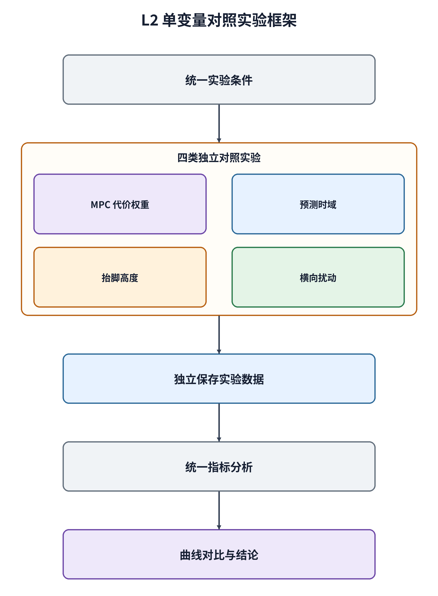

本报告把四类实验的 **12 张指标图全部嵌入第 4–7 节**，便于以后直接汇总进 L0–L4 总报告。图中只保留标题、坐标轴、单位和区分曲线所需的图例；具体数值、样本数和实验条件保存在对应的 `metrics.csv`、`run.json` 与 `states.csv` 中。

| 实验类别 | 三个独立运行目录 | 结构化指标 | 逐类分析 | 本报告收录的图 |
|---|---|---|---|---|
| 前进速度误差权重 | `Pro2/output/L2/mpc_vx_weight/low/`、`Pro2/output/L2/mpc_vx_weight/baseline/`、`Pro2/output/L2/mpc_vx_weight/high/` | `Pro2/output/L2/mpc_vx_weight/comparison/metrics.csv` | `Pro2/output/L2/mpc_vx_weight/comparison/analysis.md` | `speed_tracking.png`、`posture.png`、`control_effort.png` |
| MPC 预测时域 | `Pro2/output/L2/prediction_horizon/short_n5/`、`Pro2/output/L2/prediction_horizon/baseline_n10/`、`Pro2/output/L2/prediction_horizon/long_n15/` | `Pro2/output/L2/prediction_horizon/comparison/metrics.csv` | `Pro2/output/L2/prediction_horizon/comparison/analysis.md` | `speed_tracking.png`、`posture.png`、`solver_time.png` |
| 摆动脚抬腿高度 | `Pro2/output/L2/step_height/low_008/`、`Pro2/output/L2/step_height/baseline_012/`、`Pro2/output/L2/step_height/high_016/` | `Pro2/output/L2/step_height/comparison/metrics.csv` | `Pro2/output/L2/step_height/comparison/analysis.md` | `base_height.png`、`posture.png`、`joint_torque.png` |
| 世界系侧向扰动 | `Pro2/output/L2/lateral_push/long_push_20261105/no_push/`、`Pro2/output/L2/lateral_push/long_push_20261105/push_50N/`、`Pro2/output/L2/lateral_push/long_push_20261105/push_100N/` | `Pro2/output/L2/lateral_push/long_push_20261105/comparison/metrics.csv` | `Pro2/output/L2/lateral_push/long_push_20261105/comparison/analysis.md` | `disturbance_response.png`、`recovery.png`、`control_effort.png` |

每个独立运行目录都保存执行清单 `run.json`（JSON）、原始状态 `states.csv`（CSV）、实际配置 `config.json`、日志、场景和最终帧；四类实验没有共用或混放运行成果。

## 2. 与项目书的对应关系

项目书 L2 要求在默认示例基础上，针对代价权重、预测时域、步态或速度、抗扰能力四类中的至少三类完成有基线的对照实验，并写清“改了什么 → 观察到什么 → 为什么”。本项目完成了全部四类，每类设置三个取值，共 12 次正式运行。

| 项目书建议类别 | 本项目实验 | 条件数 | 独立成果目录 | 状态 |
|---|---|---:|---|---|
| 代价权重 | 前进速度误差权重 | 3 | `Pro2/output/L2/mpc_vx_weight/` | 完成 |
| 预测时域 | `N=5/10/15` | 3 | `Pro2/output/L2/prediction_horizon/` | 完成 |
| 步态或速度 | 摆动脚抬腿高度 | 3 | `Pro2/output/L2/step_height/` | 完成 |
| 抗扰能力 | 世界 +Y 侧推 | 3 | `Pro2/output/L2/lateral_push/` | 完成 |

原项目书建议 ROS + Gazebo/MuJoCo 路线。本机实现没有照搬该通信和仿真框架，而是保留 OpenLoong 原有 C++ MPC、WBC、Pinocchio、qpOASES 和 PVT 控制链，通过 C ABI/Python 适配到 Isaac Sim 6.0.1 与 PhysX。Isaac 适配是本项目的工程修改；本报告中的四类单变量实验才是 L2 的调参与分析证据。

## 3. 公共实验条件与证据完整性

| 参数 | 固定值 |
|---|---:|
| 仿真后端 | Isaac Sim 6.0.1 / PhysX |
| 机器人 | OpenLoong 青龙人形机器人，31 个受控关节 |
| 仿真步长 `dt` | 0.001 s |
| MPC 更新周期 `mpc_dt` | 0.005 s，200 Hz |
| 控制时域 `ch` | 3 步，0.015 s |
| 仿真时长 | 12.0 s |
| 起步时刻 | 3.0 s |
| 目标前进速度 | 0.2 m/s |
| 日志频率 | 100 Hz |
| 前三类分析窗口 | 5.0–11.99 s，共 700 个样本 |
| 侧推共同分析窗口 | 5.0–8.99 s，共 400 个样本 |
| 侧推同刻差分窗口 | 7.0–8.99 s，共 200 个样本 |

严格分析命令为：

```text
python3 Pro2/tools/analyze_l2_results.py --strict
```

该命令从 `Pro2/output/L2/active_runs.json` 读取当前正式侧推批次，另三类仍读取原始运行。正常完成的 11 次运行按 12000 步、1200 样本、12 s 验收；100 N 侧推按明确记录的物理失稳时刻 8.994 s、8994 步、900 样本验收。12/12 个条件均通过数据完整性、100 Hz 时间序列、数值有限性、关节列表和单变量检查；100 N 的 `run.json.status` 仍为 `failed`，不会改写为 `completed`。完整运行保留场景与终帧；100 N 失稳运行保留原始 `video_frames/`、实际录像 `demo.mp4`、`states.csv` 和记录停止状态的 `failure.json`。

## 4. 实验一：MPC 前进速度误差权重

### 4.1 改了什么

本组只改变 `state_weights[9]`。12 维状态顺序为 `[roll, pitch, yaw, x, y, z, wx, wy, wz, vx, vy, vz]`，所以索引 9 对应机身前进速度 `vx` 的跟踪误差权重。

| 条件 | 从项目根目录开始的配置路径 | 字段 | 值 | 独立成果目录 |
|---|---|---|---:|---|
| 低权重 | `Pro2/experiments/L2/mpc_vx_weight/low.json` | `state_weights[9]` | 0.2 | `Pro2/output/L2/mpc_vx_weight/low/` |
| 基线 | `Pro2/experiments/L2/mpc_vx_weight/baseline.json` | `state_weights[9]` | 1.0 | `Pro2/output/L2/mpc_vx_weight/baseline/` |
| 高权重 | `Pro2/experiments/L2/mpc_vx_weight/high.json` | `state_weights[9]` | 5.0 | `Pro2/output/L2/mpc_vx_weight/high/` |

参数经 `Pro2/run_isaac.py::arguments()`、`Pro2/isaac/simulation.py::_run()`、`Pro2/isaac/native.py::Controller.set_weights()` 进入 `Pro2/OpenLoong-Dyn-Control/algorithm/mpc.cpp::MPC::set_weight()`。

### 4.2 观察到什么

| 权重 | vx RMSE (m/s) | Roll RMS (rad) | Pitch RMS (rad) | 峰值关节力矩 (N·m) | ∫Στ²dt (N²·m²·s) | 绝对机械功代理 (J) |
|---:|---:|---:|---:|---:|---:|---:|
| 0.2 | 0.04430 | 0.01846 | 0.01007 | 157.63 | 120548.5 | 774.46 |
| 1.0 | 0.02354 | 0.01825 | 0.00870 | 149.17 | 119201.3 | 766.78 |
| 5.0 | 0.01814 | 0.01844 | 0.00865 | 165.87 | 121014.3 | 795.49 |

相对基线，权重 0.2 的 vx RMSE 增加 88.2%；权重 5.0 的 vx RMSE 降低 22.9%，但峰值关节力矩增加 11.2%、力矩平方积分增加 1.5%、绝对机械功代理增加 3.7%。因此，**5.0 是三个测试值中速度跟踪最好的取值，但付出了更高峰值力矩和控制努力；不能写成总体或全局最优参数。**

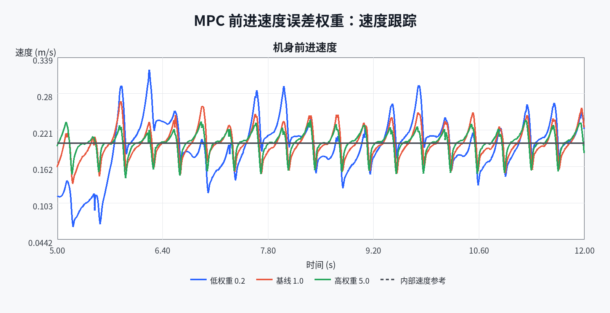

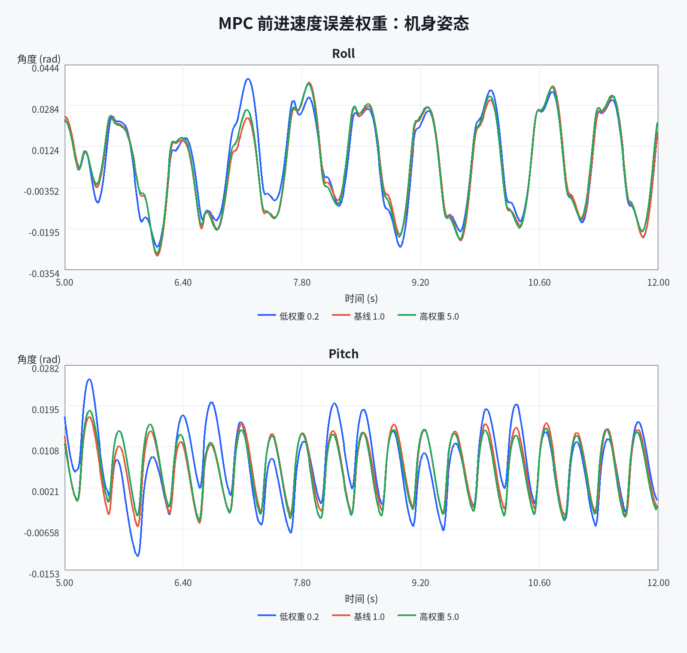

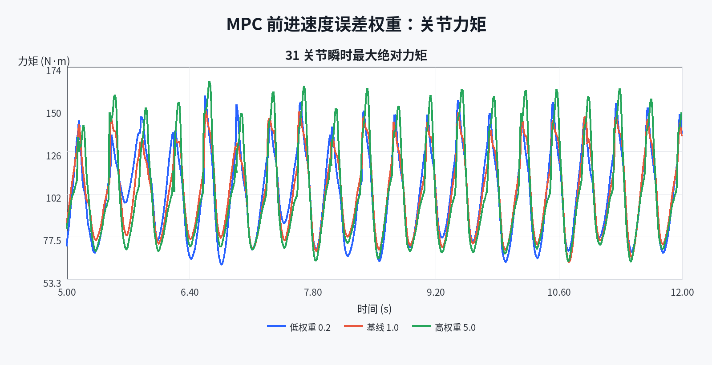

### 4.3 为什么

MPC 二次型代价为状态误差代价与控制输入代价之和。提高 `Q` 中 `vx` 对应项后，同样大小的前进速度误差会变得更“贵”，求解器倾向于通过接触 wrench 更积极地修正速度。接触力、摩擦和关节力矩仍受约束，因此误差降低不等于没有代价；本次峰值力矩和控制努力的增加正体现了这个权衡。

- 结构化指标（CSV）：[`Pro2/output/L2/mpc_vx_weight/comparison/metrics.csv`](mpc_vx_weight/comparison/metrics.csv)
- 逐类分析：[`Pro2/output/L2/mpc_vx_weight/comparison/analysis.md`](mpc_vx_weight/comparison/analysis.md)
- 原始证据：三个独立成果目录中的 `run.json`（执行清单）和 `states.csv`（时序数据）。

## 5. 实验二：MPC 预测时域

### 5.1 改了什么

本组保持 `mpc_dt=0.005 s` 与控制时域 `ch=3` 不变，只改变预测步数 `mpc_horizon_steps`。

| 条件 | 从项目根目录开始的配置路径 | 字段 | 预测窗口 | 独立成果目录 |
|---|---|---|---:|---|
| 短时域 | `Pro2/experiments/L2/prediction_horizon/short_n5.json` | `mpc_horizon_steps=5` | 0.025 s | `Pro2/output/L2/prediction_horizon/short_n5/` |
| 基线 | `Pro2/experiments/L2/prediction_horizon/baseline_n10.json` | `mpc_horizon_steps=10` | 0.050 s | `Pro2/output/L2/prediction_horizon/baseline_n10/` |
| 长时域 | `Pro2/experiments/L2/prediction_horizon/long_n15.json` | `mpc_horizon_steps=15` | 0.075 s | `Pro2/output/L2/prediction_horizon/long_n15/` |

预测步数是 C++ 固定尺寸矩阵的一部分，因此三组分别使用 `Pro2/isaac/build/mpc_n5/`、`mpc_n10/`、`mpc_n15/` 中的控制库。三个 `run.json` 记录了互不相同且与磁盘文件一致的 SHA256，证明三组确实加载了不同的控制库。相关实现位置为 `Pro2/OpenLoong-Dyn-Control/algorithm/mpc.h` 的 `OPENLOONG_MPC_N`、`Pro2/isaac/native/CMakeLists.txt` 的 `OPENLOONG_MPC_HORIZON_STEPS` 和 `Pro2/isaac/native.py::_build_directory()`。

### 5.2 观察到什么

| N | vx RMSE (m/s) | Roll 峰值 (rad) | Pitch 峰值 (rad) | 抽样控制器均值 (ms) | 抽样控制器 P95 (ms) | QP CPU time P95 (ms) |
|---:|---:|---:|---:|---:|---:|---:|
| 5 | 0.02482 | 0.03883 | 0.01603 | 0.934 | 1.070 | 0.480 |
| 10 | 0.02354 | 0.03739 | 0.01711 | 1.148 | 1.272 | 0.472 |
| 15 | 0.02613 | 0.03491 | 0.02620 | 1.562 | 1.746 | 0.536 |

`N=10` 的速度跟踪误差在三个候选值中最低。`N=5` 的抽样控制器均值比基线低 18.7%；`N=15` 比基线高 36.1%，同时 Pitch 峰值增加 53.1%。虽然 `N=15` 的 Roll 峰值降低了 6.6%，但不能据此声称整体姿态更好，因为另一个姿态轴明显恶化。

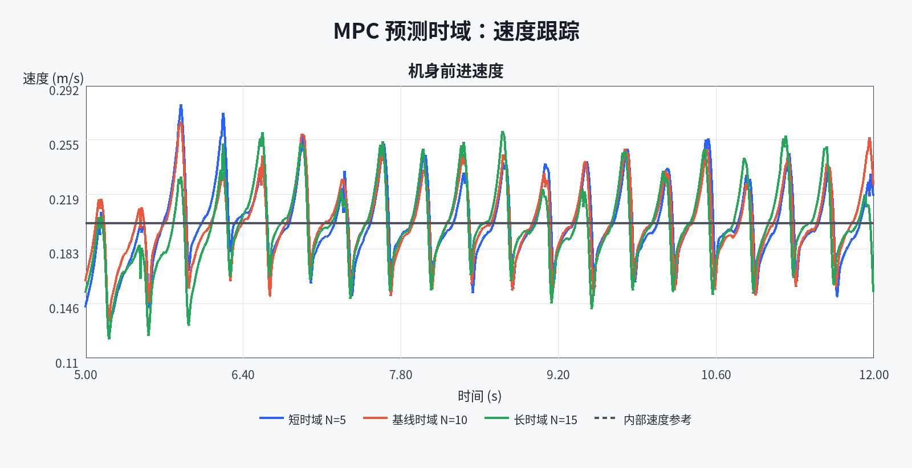

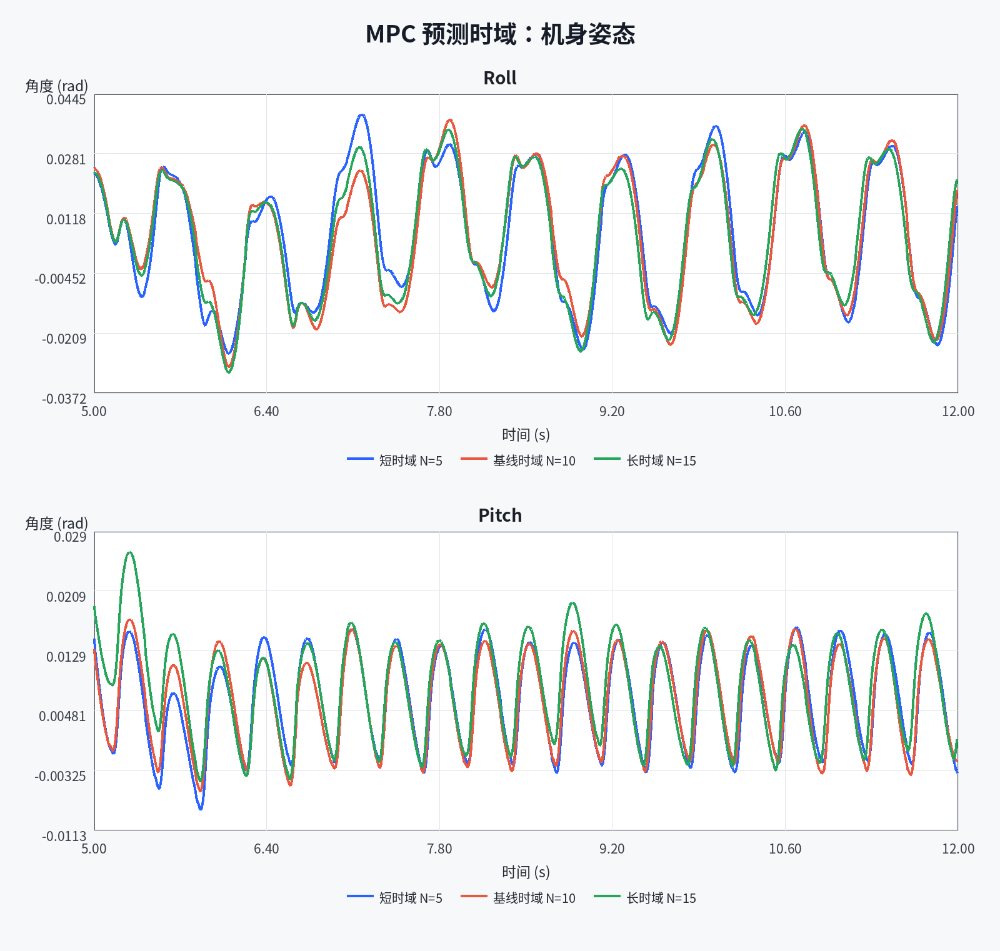

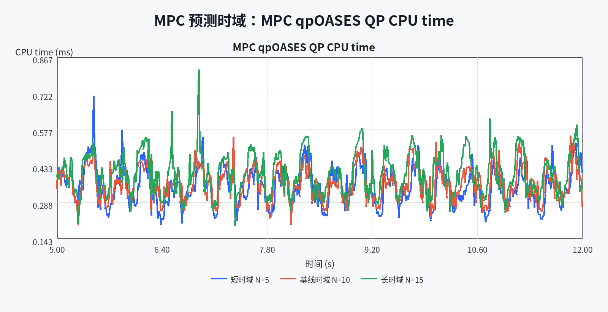

### 5.3 为什么

增大 `N` 会扩展状态预测矩阵和未来时间窗口，改变压缩后的 QP 系数与控制决策。当前实现固定 `ch=3`、单步输入维数 `nu=13`，所以 qpOASES 的决策变量维数始终为 `nu×ch=39`，不会随 `N` 增大。`controller:mpc_solve_s` 只包含 qpOASES 报告的 QP CPU time，不含预测矩阵和 QP 组装；`controller_step_s` 更接近完整 native 控制器调用，但日志只以 100 Hz 抽样，且采样与 MPC 更新周期对齐。因此这些时间只能比较本次抽样到的 MPC 更新周期，不能当作全部 1 kHz 控制步的统计。

- 结构化指标（CSV）：[`Pro2/output/L2/prediction_horizon/comparison/metrics.csv`](prediction_horizon/comparison/metrics.csv)
- 逐类分析：[`Pro2/output/L2/prediction_horizon/comparison/analysis.md`](prediction_horizon/comparison/analysis.md)
- 原始证据：三个独立成果目录中的 `run.json`（执行清单）和 `states.csv`（时序数据）。

## 6. 实验三：摆动脚抬腿高度

### 6.1 改了什么

| 条件 | 从项目根目录开始的配置路径 | 字段 | 值 | 独立成果目录 |
|---|---|---|---:|---|
| 低抬腿 | `Pro2/experiments/L2/step_height/low_008.json` | `step_height` | 0.08 m | `Pro2/output/L2/step_height/low_008/` |
| 基线 | `Pro2/experiments/L2/step_height/baseline_012.json` | `step_height` | 0.12 m | `Pro2/output/L2/step_height/baseline_012/` |
| 高抬腿 | `Pro2/experiments/L2/step_height/high_016.json` | `step_height` | 0.16 m | `Pro2/output/L2/step_height/high_016/` |

该字段经 `Pro2/isaac/native/controller_bridge.cpp` 的 `feet.stepHeight` 进入 `Pro2/OpenLoong-Dyn-Control/algorithm/foot_placement.cpp::Trajectory()`。

### 6.2 观察到什么

| 步高 (m) | vx RMSE (m/s) | Roll RMS (rad) | Pitch RMS (rad) | 高度标准差 (m) | 峰值关节力矩 (N·m) | 绝对机械功代理 (J) |
|---:|---:|---:|---:|---:|---:|---:|
| 0.08 | 0.01788 | 0.01533 | 0.00533 | 0.00340 | 138.16 | 546.19 |
| 0.12 | 0.02354 | 0.01825 | 0.00870 | 0.00463 | 149.17 | 766.78 |
| 0.16 | 0.02708 | 0.02161 | 0.01192 | 0.00570 | 162.70 | 1051.31 |

相对 0.12 m 基线，0.08 m 的 vx RMSE 降低 24.0%、组合姿态 RMS 降低约 19.7%、高度标准差降低 26.6%、绝对机械功代理降低 28.8%。0.16 m 的对应指标分别增加 15.0%、约 22.0%、23.0% 和 37.1%。因此，**0.08 m 是当前无障碍平地和三个测试值中综合指标最好的候选值。**

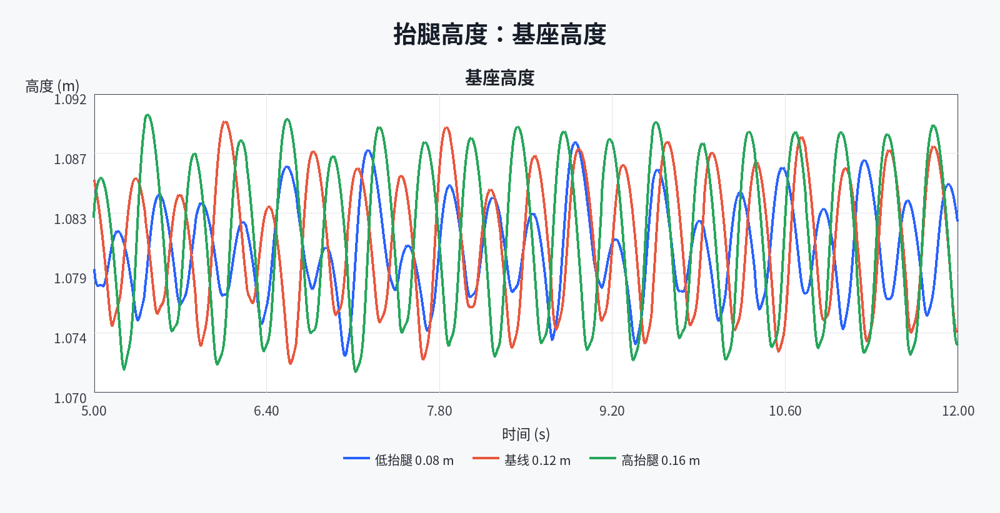

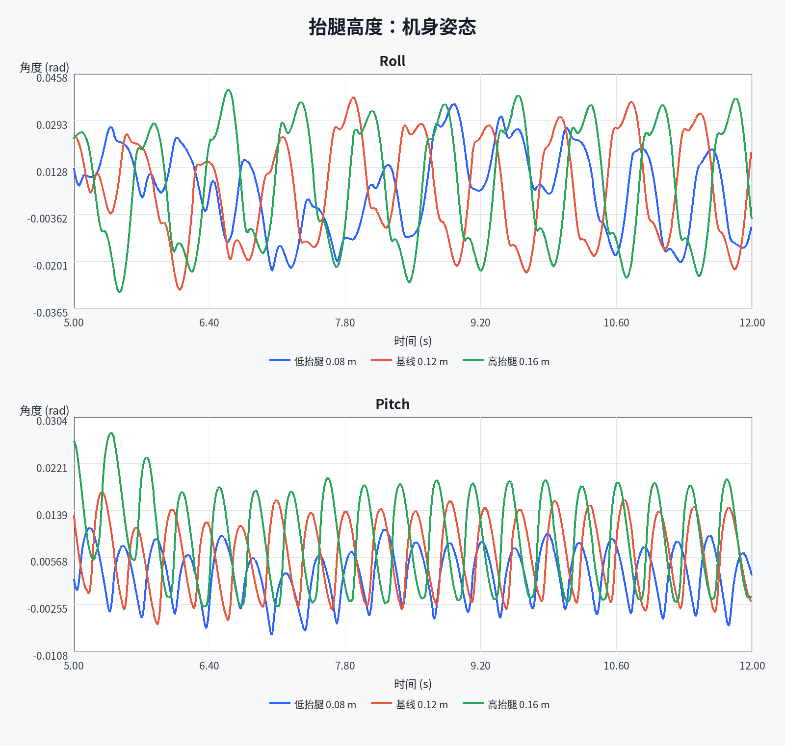

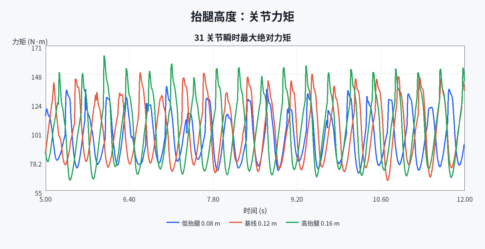

### 6.3 为什么与适用边界

提高摆动脚期望轨迹后，WBC 要用更大的腿部运动去跟踪足端任务，可能把更多周期扰动传到机身，并增加关节运动和机械功。当前 `states.csv` 没有左右脚世界坐标，因此 0.08/0.12/0.16 m 是控制器的**期望抬腿参数**，不是实测离地间隙。平地上的 0.08 m 结果不能外推到台阶、碎石或障碍物场景；越障实验还需要记录足端位置并改变地形。

- 结构化指标（CSV）：[`Pro2/output/L2/step_height/comparison/metrics.csv`](step_height/comparison/metrics.csv)
- 逐类分析：[`Pro2/output/L2/step_height/comparison/analysis.md`](step_height/comparison/analysis.md)
- 原始证据：三个独立成果目录中的 `run.json`（执行清单）和 `states.csv`（时序数据）。

## 7. 实验四：世界坐标系 +Y 持续侧向扰动

### 7.1 改了什么

2026-11-05 根据视频反馈，将侧推持续时间从 0.1 s 延长到 **0.5 s**，在 **7.0–7.5 s** 施力。三组仍只改变 `push_force[1]`，分别为 0、50、100 N；起步、速度、步态、控制器参数与地面条件一致。`Pro2/isaac/simulation.py::_run()` 使用世界坐标系外力接口，录像中箭头跟随实际施力时刻、位置和方向显示，箭头属于无碰撞的可视化对象。

| 条件 | 配置路径 | `push_force` | 持续时间 | 冲量 | 独立成果目录 |
|---|---|---:|---:|---:|---|
| 自然步态参照 | `Pro2/experiments/L2/lateral_push/no_push.json` | `[0, 0, 0]` N | 0.5 s | 0 N·s | `Pro2/output/L2/lateral_push/long_push_20261105/no_push/` |
| 50 N 侧推 | `Pro2/experiments/L2/lateral_push/push_50N.json` | `[0, 50, 0]` N | 0.5 s | 25 N·s | `Pro2/output/L2/lateral_push/long_push_20261105/push_50N/` |
| 100 N 侧推 | `Pro2/experiments/L2/lateral_push/push_100N.json` | `[0, 100, 0]` N | 0.5 s | 50 N·s | `Pro2/output/L2/lateral_push/long_push_20261105/push_100N/` |

`states.csv` 逐样本核对确认：两个受扰组都在 7.00–7.49 s 记录到 50 个非零外力样本，按 100 Hz 矩形积分分别得到 25 与 50 N·s。三组在 7.0 s 以前的基座状态、关节位置/速度和控制力矩逐样本完全一致。本次曲线和定量分析直接使用这三次录制产生的数据，与视频属于同一批次。 施力前一致性核查见 [`pre_push_consistency_verification.json`](lateral_push/long_push_20261105/pre_push_consistency_verification.json)。视频按 30 fps 采样显示，精确施力起止与冲量以 100 Hz CSV 外力列为依据。

为选择可清楚观察的施力时间，先做过 100 N、1.0 s 预试验：8.374 s 触发失稳；随后 100 N、0.5 s 预试验在 8.994 s 失稳，50 N、0.5 s 完整运行 12 s。最终统一采用 0.5 s，保留强扰动失稳，不通过缩短脉冲或挑选成功录像隐藏失败。预试验保存在 `Pro2/output/L2/lateral_push/pilot_long_push_20261105/`，不混入正式三条件指标。

### 7.2 观察到什么

| 条件 | 结果 | 实际仿真时长 | 状态样本 | 原始视频时长 |
|---|---|---:|---:|---:|
| 0 N | 完成 | 12.000 s | 1200 | 12.000 s |
| 50 N | 完成 | 12.000 s | 1200 | 12.000 s |
| 100 N | 触发物理失稳保护 | 8.994 s | 900 | 9.000 s |

100 N 组停止时基座高度为 0.5983 m、Roll 为 -0.9779 rad、Pitch 为 0.01285 rad；高度低于 0.60 m 触发保护。原始 CSV 最后一个样本在 8.99 s，不补写到 12 s。视频按 30 fps 保存已采集的 270 帧；最终同屏比较在停止后冻结该格并明确标注“失稳保护，仿真已停止”，不能把冻结段算作继续仿真。

为避免周期步态与不同日志长度影响比较，三组常规指标都使用 **5.00–8.99 s**；扰动差分都使用 **7.00–8.99 s** 的 200 个共同时间样本，先逐点计算受扰轨迹减无扰动轨迹，再取最大绝对差。

| 侧推 | 最大同刻 ΔRoll (rad) | 最大同刻 ΔPitch (rad) | 最大同刻 Δvx (m/s) | 最大同刻 Δvy (m/s) | 相对参照的额外高度下降 (m) |
|---:|---:|---:|---:|---:|---:|
| 50 N | 0.05250 | 0.00807 | 0.06008 | 0.33707 | 0.01057 |
| 100 N | 0.95188 | 0.11364 | 1.32332 | 2.73351 | 0.47840 |

50 N 仍保持完整行走，而 100 N 引起明显侧向倾倒和基座下落，响应不再随外力幅值近似成比例。100 N 的共同窗口峰值关节力矩达到 396 N·m。三组全部已记录样本的 MPC/WBC 状态均为 0，说明 **QP 返回成功不能保证整个闭环在强扰动下稳定**；不能把“求解器无错误”写成“机器人未失稳”。

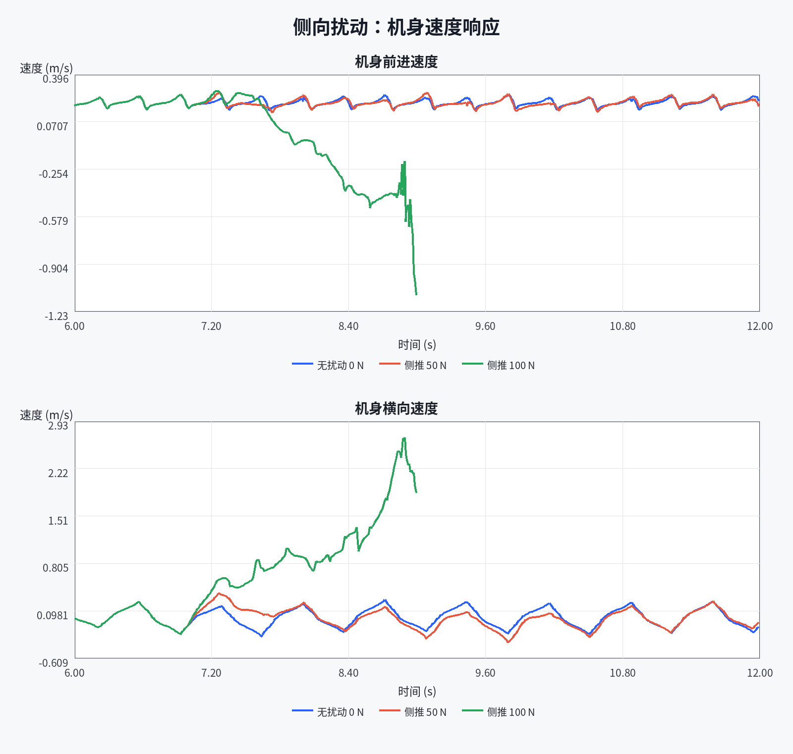

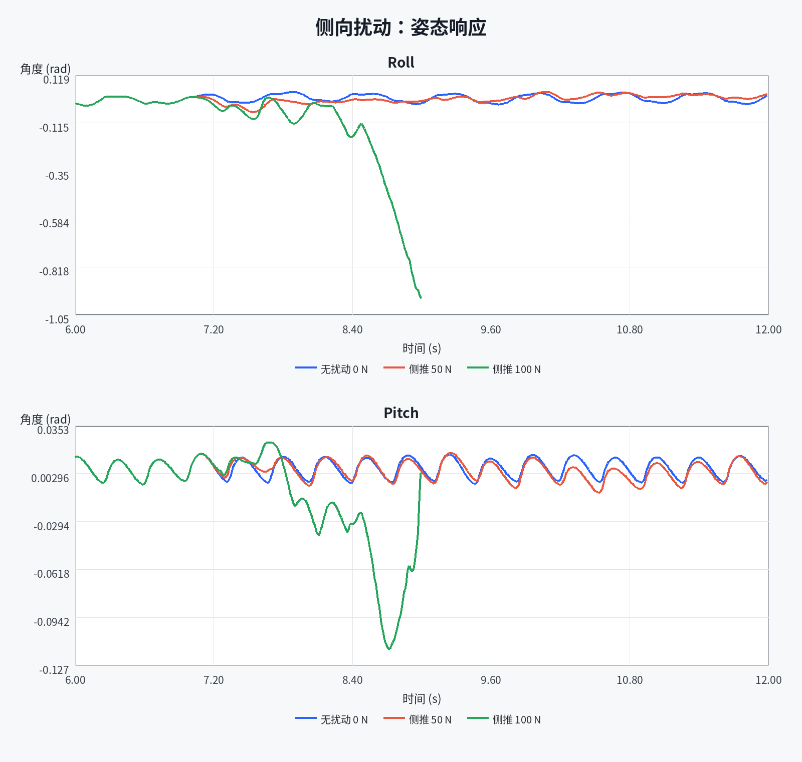

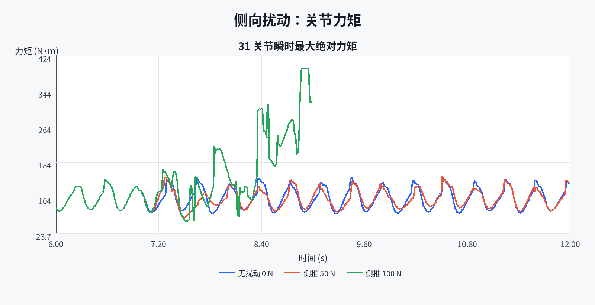

### 7.3 为什么与恢复时间口径

通俗地说，持续推的时间变长，即使力的大小不变，也会累积更多横向动量。本次 50 N 与 100 N 的冲量分别为 25 与 50 N·s，是原 0.1 s 实验的五倍。MPC 可调整足底接触 wrench，WBC 再产生全身关节力矩，但控制能力仍受接触、摩擦、支撑切换、运动学和力矩限幅约束。100 N 条件中的失稳说明本次组合已超过现有闭环能够保持行走的范围；仅凭这些日志不能进一步断言某一项约束是唯一原因，也不能推断普遍抗扰阈值。

原固定阈值恢复判据要求速度误差不超过 0.05 m/s、Roll/Pitch 相对施力前均值偏差不超过 0.03 rad，并连续保持 0.5 s。当前 `no_push` 自然步态本身也无法满足，所以不能由该判据报告有效恢复时间。100 N 失稳的结论直接来自基座高度阈值、倾倒轨迹与真实停止记录，并不依赖这个无效恢复判据；50 N 只表述为完整运行 12 s，不虚构恢复耗时。

- 当前结构化指标：[`Pro2/output/L2/lateral_push/long_push_20261105/comparison/metrics.csv`](lateral_push/long_push_20261105/comparison/metrics.csv)。
- 当前逐类分析：[`Pro2/output/L2/lateral_push/long_push_20261105/comparison/analysis.md`](lateral_push/long_push_20261105/comparison/analysis.md)。
- 视频与 PPT 数值摘要：[`presentation_summary.json`](lateral_push/long_push_20261105/comparison/presentation_summary.json)。
- 历史 0.1 s 原始数据和分析继续保存在 `Pro2/output/L2/lateral_push/no_push/`、`push_50N/`、`push_100N/` 与 `Pro2/output/L2/lateral_push/comparison/`；它们仅用于历史追溯，不作为当前长侧推结论。

## 8. 指标定义与结论边界

世界系速度通过当前 Yaw 旋转到机身系。前进速度 RMSE 使用机身系前进速度与控制器内部平滑参考之间的误差。报告中的 `∫Στ²dt` 是控制努力代理；`∫Σ|τ·dq|dt` 是绝对机械功代理，不是电机电能。左右脚竖直力是控制器的动力学反算值，不是 PhysX 接触传感器实测值。每个条件当前只有一次确定配置运行，因此结果不能用于统计显著性检验，也不能声称普遍规律或全局最优。

- [`summary/L2总指标.csv`](summary/L2总指标.csv)
- [`summary/L2实验结论.md`](summary/L2实验结论.md)

## 9. 代码改动与可复现入口

本次为了让预测时域成为可控实验变量，新增或修改了以下位置：

- `Pro2/OpenLoong-Dyn-Control/algorithm/mpc.h`：`OPENLOONG_MPC_N` 与 `mpc_N`；
- `Pro2/OpenLoong-Dyn-Control/algorithm/mpc.cpp`：按 `nu*ch` 修正 Hessian 正则项维度；
- `Pro2/isaac/native/CMakeLists.txt`：`OPENLOONG_MPC_HORIZON_STEPS`、范围检查和编译定义；
- `Pro2/isaac/native.py`：`_build_directory()` 按 `mpc_n5/mpc_n10/mpc_n15` 隔离构建；
- `Pro2/run_isaac.py`：`--mpc-horizon-steps` 与 3–30 步校验；
- `Pro2/isaac/simulation.py`：记录控制库、SHA256、预测与控制时域；
- `Pro2/tools/analyze_l2_results.py`：四类实验的严格校验、指标、曲线和 Markdown 生成。

复现某一组时指定相同配置和一个新的输出子目录，例如：

```text
python3 Pro2/run_isaac.py --isaac-root /home/xqw/isaacsim6.0.1 --level L2 --headless --no-build --config Pro2/experiments/L2/mpc_vx_weight/high.json --output Pro2/output/L2/mpc_vx_weight/high_r2
```

## 10. 最终演示视频状态

L2 四类对照视频已完成，并按实验分别在同一画面同步播放。前三类录像继续使用原补录：

- 速度权重：`Pro2/output/L2/ppt_demo_20261104/`。
- 预测时域：`Pro2/output/L2/prediction_horizon/ppt_video_20261104/`。
- 抬腿高度：`Pro2/output/L2/step_height/ppt_video_20261104/`。
- 当前外力扰动：`Pro2/output/L2/lateral_push/long_push_20261105/`，每个条件目录内同时保存 `demo.mp4`、`states.csv` 和 `run.json`。

前三类的补录视频与原正式定量运行分别保留来源；本次侧推的录像、曲线与数值来自同一批运行。综合视频保存在 `Pro2/output/final/assets/项目验收演示_L0_L2_L4.mp4`，嵌入正式 PPT 第 1 页；第 9 页引用本批侧推曲线及共同窗口指标。

重新录制本次侧推可从项目根目录运行：

```text
python3 Pro2/tools/record_l2_long_push.py --output-root Pro2/output/L2/lateral_push/long_push_repeat
```

输出目录必须是尚未使用的新目录；若 `long_push_repeat/` 已存在运行成果，请改用另一个新目录名。该入口先执行真实仿真，再保留成功运行或物理失稳之前采集到的录像。100 N 条件必须保留真实失败状态及停止时刻。

## 11. 验收清单

| 验收项 | 状态 | 证据 |
|---|---|---|
| 四类实验分别保存 | 通过 | 四个独立类别目录 |
| 每类包含基线与修改组 | 通过 | 每类 3 个条件 |
| 12 个条件证据完整 | 通过 | 11 个 `completed`；100 N 长侧推为已记录的物理失稳结果 |
| 原始数据完整 | 通过 | 正常组各 1200 样本；100 N 长侧推 900 个真实样本，无补齐 |
| 单变量原则 | 通过 | 严格配置对比与运行清单 |
| 定量指标与曲线 | 通过 | 4 份 `metrics.csv`、12 张 PNG |
| “改动—现象—原理”分析 | 通过 | 本报告第 4–7 节及各类 `analysis.md` |
| Isaac 适配说明 | 通过 | 本报告第 2 节与第 9 节 |
| L2 演示 MP4 | 已录制 | 四类各自三条件；侧推带外力箭头与真实失稳过程 |
