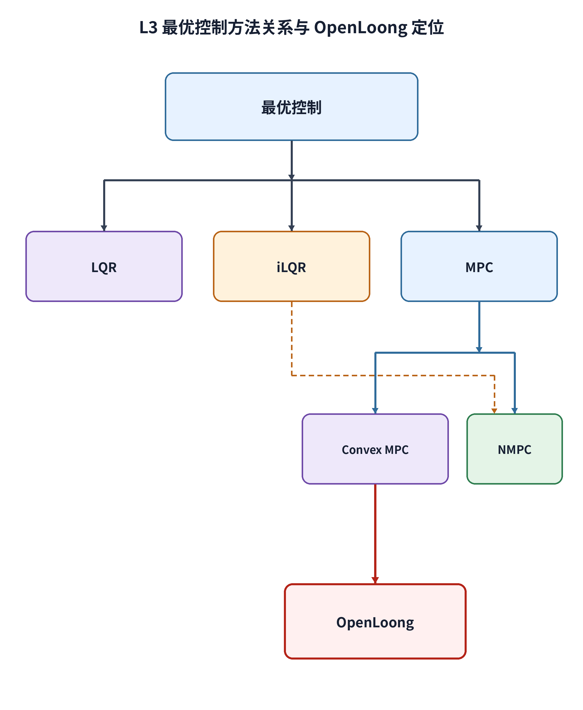
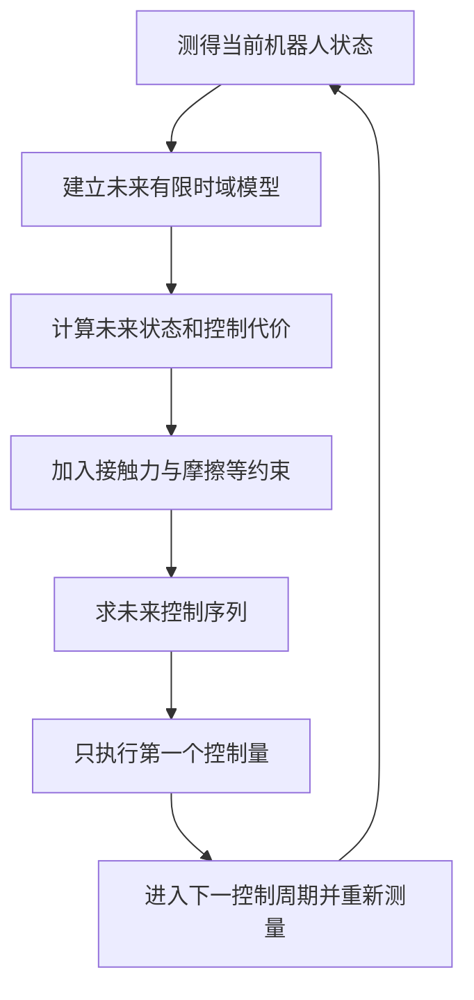

# L3 理论联系报告：从 LQR / iLQR 到 OpenLoong 凸 MPC

记录日期：2026-10-31  
项目：OpenLoong 人形机器人 MPC/WBC 的 Isaac Sim 适配实践

验收状态：**已完成**  
成果范围：项目书“七、L3 · 理论联系”的三项问答、公式推导、当前源码定位、L2 证据边界和理论关系图。项目书没有要求 L3 新增仿真实验；系统实现并对比凸 MPC 与 NMPC 属于 L4 挑战项，因此本层不伪造额外实验结果。

> 本报告回答项目书 L3 的三个理论问题，并把结论逐项对应到 OpenLoong 凸 MPC 源码和 L2 实验数据。L3 阶段的工作性质是理论分析与源码核对：当时没有实现或实测 LQR、iLQR、NMPC 对照控制器，因此下文不会把理论推导写成 L3 已运行结果，也不会用 L2 数据声称凸 MPC 优于 LQR、iLQR 或 NMPC。项目后续在 L4 增加了 SQP-RTI NMPC 适配和单次正式对照；它属于 L4 新证据，不会反向混入 L3 指标。

图 1　LQR、iLQR、Convex MPC、NMPC 的关系，以及当前 OpenLoong 控制器的准确位置。可复现绘图入口为 `Pro2/tools/render_project_diagrams.py` 中的 `render_l3()`；从项目根目录运行 `python3 Pro2/tools/render_project_diagrams.py --diagram L3` 即可重新生成图片。

## 0. L3 证据口径与指标来源

| 报告内容 | 直接来源 | 可以支持的结论 | 不能支持的结论 |
|---|---|---|---|
| LQR、iLQR、MPC 公式与关系图 | 本报告的理论推导、文末经典资料 | 解释三类方法的数学联系、求解结构与适用条件 | 不能当成仓库已经运行 LQR 或 iLQR 的实验记录 |
| OpenLoong 算法分类 | `Pro2/OpenLoong-Dyn-Control/algorithm/mpc.h`、`mpc.cpp` 与 Isaac 原生桥 | 核对状态、输入、线性化模型、QP 代价、约束和滚动调用 | 不能把线性化凸 QP 的最优解扩展成非线性机器人全局最优解 |
| L2 权重、时域、侧推和步高指标 | `Pro2/output/L2/L2验收报告.md`、各实验 `comparison/metrics.csv` 与 `Pro2/output/L2/summary/L2总指标.csv` | 说明当前凸 MPC 控制链在有限测试点上的权衡和现象 | 不能证明相对 LQR、iLQR 或 NMPC 的算法优越性；每组单次运行也不构成统计结论 |
| 后续 L4 NMPC 结果 | `Pro2/output/L4/L4验收报告.md` 与 `Pro2/output/L4/04_mpc_comparison/analysis_same_binary/metrics.json` | 记录后续同二进制 Convex/NMPC 单次对照 | 不属于 L3 验收指标，也不改变 OpenLoong 原生 `mpc.cpp` 仍是凸 MPC 的分类 |

因此，本报告出现的数值只在第 7 节作为 L2 的有限旁证；图 1 和公式属于理论结构；源码路径用于算法归类。三类证据分别解释，不能相互替代。

## 1. 项目书 L3 的三项问题与本报告结论

项目书要求用自己的话回答：

1. MPC 与课堂中的 LQR / iLQR 有什么联系与区别？
2. 为什么足式机器人不能只依赖一个固定的 LQR 增益？MPC 显式处理了哪些问题？
3. 凸 MPC 与非线性 MPC（NMPC）各有什么优缺点？

先用通俗语言给出答案。

### 1.1 通俗理解

**LQR 像一张在某种路况附近预先算好的“纠偏表”。** 机器人偏左多少、倾斜多少，就按一个固定比例把它拉回来。只要机器人一直在这张表适用的小范围内，而且不存在力的上限、脚底打滑、脚离地等问题，这种方法很快、很可靠。

**iLQR 像先画一条非线性路线，再反复修正整条路线。** 它先猜一串未来动作，向前模拟机器人会走到哪里；再从终点向前反推每一步应该如何修改；然后重新向前模拟。重复几轮后，得到一条局部更优的状态和控制轨迹。iLQR 是一种求解最优控制问题的迭代算法，不等同于 MPC；把 iLQR 放在滚动时域中每个周期重新运行时，它可以成为 NMPC 的一种求解方式。

**MPC 像每隔很短时间重新做一次“带规则的未来计划”。** 它读取机器人现在的姿态、速度、脚的位置和支撑状态，预测未来若干步，规划足底应该施加的力和力矩，同时遵守“脚不能拉地面”“切向力不能超过摩擦能力”“摆动脚不能产生支撑力”等规则。控制器只执行计划的第一步；下一个周期拿到新状态后，再把时间窗口向前移动并重新求解。

这三者的共同基础都是：用模型预测控制输入如何改变状态，并在“跟踪准确”和“控制动作不要过大”之间做权衡。主要区别在于模型是否线性、是否反复线性化、是否显式加入约束，以及是否在线滚动重算。

当前 OpenLoong 实现对应这张图中的“线性化单刚体模型 + 二次代价 + 线性约束 + QP 求解”。它没有在每个控制周期内进行多轮非线性前向、反向迭代。

## 2. 用一个统一最优控制问题连接三种方法

### 2.1 一般形式

把机器人在第 $k$ 步的状态记为 $x_k$，控制输入记为 $u_k$。一般有限时域最优控制问题可以写成：

$$
\begin{aligned}
\min_{u_0,\ldots,u_{N-1}}\quad
& \Phi(x_N)+\sum_{k=0}^{N-1}\ell_k(x_k,u_k) \\
\text{s.t.}\quad
&x_{k+1}=f_k(x_k,u_k),\\
&g_k(x_k,u_k)\le 0,\\
&h_k(x_k,u_k)=0,\\
&x_0=x_{\mathrm{meas}}.
\end{aligned}
$$

这里：

- $f_k$ 是动力学模型；
- $\ell_k$ 是每一步的状态误差与控制代价；
- $\Phi$ 是终端代价；
- $g_k$ 和 $h_k$ 分别表示不等式约束与等式约束；
- $N$ 是预测步数；
- $x_{\mathrm{meas}}$ 是当前实测状态。

LQR、iLQR 和 MPC 都可以从这个统一问题出发理解。

### 2.2 LQR：线性动力学、二次代价、通常不显式处理不等式约束

在参考轨迹附近定义偏差

$$
\delta x_k=x_k-x_k^{\mathrm{ref}},\qquad
\delta u_k=u_k-u_k^{\mathrm{ref}}.
$$

线性系统和二次型代价写成：

$$
\delta x_{k+1}=A_k\delta x_k+B_k\delta u_k,
$$

$$
J=\frac{1}{2}\delta x_N^\mathsf{T}Q_N\delta x_N+
\frac{1}{2}\sum_{k=0}^{N-1}
\left(
\delta x_k^\mathsf{T}Q_k\delta x_k+
\delta u_k^\mathsf{T}R_k\delta u_k
\right).
$$

当没有输入和状态不等式约束时，可以用动态规划得到反馈律

$$
\delta u_k=-K_k\delta x_k.
$$

有限时域 Riccati 反向递推从 $P_N=Q_N$ 开始：

$$
G_k=R_k+B_k^\mathsf{T}P_{k+1}B_k,
$$

$$
K_k=G_k^{-1}B_k^\mathsf{T}P_{k+1}A_k,
$$

$$
P_k=Q_k+A_k^\mathsf{T}P_{k+1}A_k
-A_k^\mathsf{T}P_{k+1}B_kG_k^{-1}B_k^\mathsf{T}P_{k+1}A_k.
$$

若 $A,B,Q,R$ 不随时间变化、时域足够长并满足相应可控性与可检测性条件，$P_k$ 可收敛到离散代数 Riccati 方程的稳定解，进而得到一个固定增益 $K$。课堂中常说的“离线求 LQR 增益”通常指这种无限时域、定常、无约束情形。

若参考轨迹非零、动力学含仿射项，最优控制还会包含前馈项，形式更一般地写成

$$
\delta u_k=k_k-K_k\delta x_k.
$$

所以“LQR 就是一个比例反馈矩阵”只适合最简单的定常调节问题；轨迹跟踪型有限时域 LQR 本身也可以是时变反馈加前馈。

### 2.3 iLQR：反复求解局部 LQR 子问题

iLQR 保留非线性离散动力学

$$
x_{k+1}=f_k(x_k,u_k),
$$

并围绕当前名义轨迹 $\{\bar x_k,\bar u_k\}$ 进行局部展开：

$$
\delta x_{k+1}\approx A_k\delta x_k+B_k\delta u_k,
\quad
A_k=\left.\frac{\partial f_k}{\partial x}\right|_{\bar x_k,\bar u_k},
\quad
B_k=\left.\frac{\partial f_k}{\partial u}\right|_{\bar x_k,\bar u_k}.
$$

同时把代价在名义轨迹附近展开到二阶。设下一步价值函数的导数为 $V_x',V_{xx}'$，忽略动力学二阶导数的常用 iLQR/Gauss–Newton 形式为：

$$
\begin{aligned}
Q_x &= \ell_x+A_k^\mathsf{T}V_x',\\
Q_u &= \ell_u+B_k^\mathsf{T}V_x',\\
Q_{xx} &= \ell_{xx}+A_k^\mathsf{T}V_{xx}'A_k,\\
Q_{ux} &= \ell_{ux}+B_k^\mathsf{T}V_{xx}'A_k,\\
Q_{uu} &= \ell_{uu}+B_k^\mathsf{T}V_{xx}'B_k.
\end{aligned}
$$

#### Backward pass：从终点向前算修正方向

在每一步计算

$$
k_k=-Q_{uu}^{-1}Q_u,
\qquad
K_k=-Q_{uu}^{-1}Q_{ux}.
$$

其中 $k_k$ 是开环前馈修正，$K_k$ 是局部反馈增益。实际实现通常给 $Q_{uu}$ 加正则项 $\lambda I$，避免它病态或非正定。再把局部最优结果代回，递推价值函数的一阶、二阶项，例如：

$$
V_x=Q_x-Q_{ux}^\mathsf{T}Q_{uu}^{-1}Q_u,
$$

$$
V_{xx}=Q_{xx}-Q_{ux}^\mathsf{T}Q_{uu}^{-1}Q_{ux},
$$

并在数值实现中对 $V_{xx}$ 做对称化。

#### Forward pass：沿非线性动力学重新展开轨迹

选取线搜索系数 $\alpha\in(0,1]$，从真实初始状态重新向前模拟：

$$
u_k^{\mathrm{new}}=\bar u_k+\alpha k_k+K_k
\left(x_k^{\mathrm{new}}-\bar x_k\right),
$$

$$
x_{k+1}^{\mathrm{new}}=f_k(x_k^{\mathrm{new}},u_k^{\mathrm{new}}).
$$

若新轨迹使代价下降，就接受它并开始下一次 backward/forward 迭代；否则减小 $\alpha$ 或增大正则化。由此可以看到：**iLQR 的每一轮 backward pass 本质上在求一个局部 LQR 问题，但整个算法通过多次非线性 forward rollout 更新工作点。**

基本 iLQR 并不天然严格处理摩擦锥、单边接触等一般不等式约束。要处理约束，需要使用控制限幅、投影、增广拉格朗日、障碍函数、active-set 变体，或改用 SQP 等方法。因此不能仅凭“使用 iLQR”就断言足式接触约束已经被严格满足。

### 2.4 MPC：有限时域问题的在线滚动执行方式

MPC 的关键不是某一个特定求解器，而是以下循环：

1. 在时刻 $t$ 测量或估计当前状态 $x_t$；
2. 更新参考轨迹、接触序列和预测模型；
3. 在 $N$ 步时域内求出 $U_t^*=\{u_{0|t}^*,\ldots,u_{N-1|t}^*\}$；
4. 只执行第一步 $u_{0|t}^*$；
5. 到 $t+1$ 后重新测量，再求一次新的有限时域问题。

如果 MPC 使用线性或仿射模型、二次代价、没有不等式约束，那么它可以与有限时域 LQR 求解同一个问题。但“等价”有严格前提：二者必须使用相同的模型、初始状态、参考轨迹、预测长度、阶段代价、终端代价和控制量参数化；或者虽然保留了约束，但无约束最优解恰好使全部约束不激活。满足这些条件时，Riccati 递推和无约束凝聚 QP 只是两条不同的数值求解路线，得到相同的最优控制序列和第一步控制。加入被激活的线性不等式约束后，最优策略一般是状态的分段仿射函数，不能再用一个全局固定矩阵 $-Kx$ 表示。

当前 OpenLoong 还有一个容易忽略的条件：预测步数为 $N=10$，独立控制步数为 `ch=3`，第三段控制量会保持到预测结束。标准有限时域 LQR 通常让每个预测步都拥有独立的 $u_k$。因此，若要把当前无约束 QP 与 LQR 严格对应，必须也给 LQR 使用相同的 move blocking（控制量分段保持）参数化；不能直接把当前 39 维 QP 与拥有 $13\times10$ 个独立输入的标准问题说成完全相同。

如果 MPC 使用非线性模型，并以 iLQR、DDP 或 SQP 等方法在线迭代求解，它就属于 NMPC。由此可见：

- LQR 是一类线性二次最优控制问题及其反馈解；
- iLQR 是反复解局部 LQR 子问题的非线性轨迹优化算法；
- MPC 是“有限时域在线求解、只执行第一步、随后滚动重算”的控制结构；
- 三者可以组合，而不是彼此完全互斥的三个标签。

## 3. OpenLoong 当前 MPC 如何对应上述公式

### 3.1 当前实现的状态、输入和时域

当前代码在 `Pro2/OpenLoong-Dyn-Control/algorithm/mpc.h:15-21` 定义：

$$
n_x=12,\qquad n_u=13,\qquad N=10\text{（默认）},\qquad N_c=3.
$$

状态由 `Pro2/OpenLoong-Dyn-Control/algorithm/mpc.cpp:132-151` 读入，顺序为

$$
x=
\begin{bmatrix}
\mathrm{roll}&\mathrm{pitch}&\mathrm{yaw}&
p_x&p_y&p_z&
\omega_x&\omega_y&\omega_z&
v_x&v_y&v_z
\end{bmatrix}^{\mathsf T}.
$$

前 12 个输入是左右脚的三维力与三维力矩，最后一个标量用于把重力作为固定的仿射项写入增广输入。`Pro2/OpenLoong-Dyn-Control/algorithm/mpc.cpp:493-530` 最终只把最优序列第一步的前 12 个量写入 `Data.Fr_ff`，交给 WBC 作为接触 wrench 前馈。

`N` 是预测步数，`N_c=ch=3` 是独立控制步数。`Pro2/OpenLoong-Dyn-Control/algorithm/mpc.cpp:257-267` 构造压缩预测矩阵，并在超过第 3 个控制步后保持最后一个控制量。因此，默认配置下：

- 预测状态覆盖 $10\times 0.005=0.050\,\mathrm{s}$；
- 前三个 5 ms 区间分别使用独立控制块，第三个控制块随后保持到 50 ms 预测窗口末端；
- QP 决策变量数是 $13\times3=39$，不会因为仅增大预测步数 $N$ 而同步增大；
- 线性约束矩阵有 $32\times3=96$ 行，此外还有输入上下界。

### 3.2 在线更新的线性化单刚体模型

当前代码使用离散线性时变形式

$$
x_{k+1}=A_kx_k+B_ku_k.
$$

`Pro2/OpenLoong-Dyn-Control/algorithm/mpc.cpp:218-241` 根据当前 Yaw、质心惯量、质量和脚相对质心的位置构造 $A_k,B_k$，并用一阶 Euler 形式 $A_k=I+\Delta t A_{c,k}$、$B_k=\Delta t B_{c,k}$ 离散化。随后 `Pro2/OpenLoong-Dyn-Control/algorithm/mpc.cpp:243-267` 将多步模型压缩成

$$
X=\mathcal A x_0+\mathcal B U.
$$

这里的模型矩阵会在不同 MPC 更新周期之间随当前测量状态变化，但在一次预测和 QP 求解内部冻结为已知常量。当前实现也没有沿预测节点传播不同的名义非线性状态再逐点重线性化。因此“模型在线更新”不等于“求解的是非线性规划”；冻结这些矩阵后，当前优化问题仍是凸 QP。

接触状态也进入预测。`Pro2/OpenLoong-Dyn-Control/algorithm/mpc.cpp:193-205` 根据当前步态相位、当前支撑腿和下一支撑腿生成预测接触模式；`Pro2/OpenLoong-Dyn-Control/algorithm/gait_scheduler.cpp:79-155` 依据步态相位和估计触地力切换左右支撑。接触模式在进入 QP 前已经由步态调度器给定，它不是 MPC 的离散优化变量；当前实现优化的是**给定接触日程下的连续足底 wrench**。

从实现细节看，虽然 `legState` 数组按 `N` 个预测点生成，但名义支撑力、输入上下界和约束激活在 `Pro2/OpenLoong-Dyn-Control/algorithm/mpc.cpp:269-282`、`Pro2/OpenLoong-Dyn-Control/algorithm/mpc.cpp:385-433`、`Pro2/OpenLoong-Dyn-Control/algorithm/mpc.cpp:444-464` 中都只遍历 `i < ch`。第 3 个独立控制块及其接触假设又通过 move blocking 保持到预测末端。因此，当前代码只让前 `ch=3` 个控制块分别响应接触模式，不能把它描述成对整个 `N=10` 时域中的任意多次接触切换进行独立优化。这是当前凝聚参数化的工程限制。此外，接触相位外推在 `Pro2/OpenLoong-Dyn-Control/algorithm/mpc.cpp:197-204` 直接使用 0.4 s 分母，并未从桥接层的任意 `swing_time` 参数读取。

### 3.3 二次型代价与 LQR 的直接联系

把整段预测状态和输入堆叠成 $X,U$，当前实现的代价可以概括为

$$
J=(X-X_d)^\mathsf{T}L(X-X_d)
+\alpha(U-U_{\mathrm{ref}})^\mathsf{T}K_u(U-U_{\mathrm{ref}}).
$$

其中 $L$ 是状态误差权重，$K_u$ 是输入权重，$U_{\mathrm{ref}}$ 对应抵消重力的名义支撑 wrench。源码中的 `delta_U` 与这里的符号关系是 $U_{\mathrm{ref}}=-\delta U$，所以展开后梯度中出现 `+ 2 * alpha * K * delta_U`。源码成员变量名 `K` 是**输入代价矩阵**，不是 LQR 反馈增益 $K_k$，两者不能混淆。

`Pro2/OpenLoong-Dyn-Control/algorithm/mpc.cpp:87-130` 将单步状态权重和输入权重沿预测时域复制；`Pro2/OpenLoong-Dyn-Control/algorithm/mpc.cpp:284-285` 构造压缩 QP：

$$
\frac12 U^\mathsf{T}HU+c^\mathsf{T}U,
$$

$$
H=2(\mathcal B^\mathsf{T}L\mathcal B+\alpha K_u)+10^{-10}I,
$$

$$
c=2\mathcal B^\mathsf{T}L(\mathcal A x_0-X_d)
+2\alpha K_u\delta U.
$$

这与 LQR 使用的“状态误差二次代价 + 控制二次代价”完全同源。区别在于当前代码没有通过 Riccati 递推得到反馈矩阵，而是把未来状态消元、形成关于 $U$ 的 QP，然后交给 qpOASES。

在当前 Isaac 桥接层中，`Pro2/isaac/native/controller_bridge.cpp:428-438` 要求状态权重非负、输入权重严格为正且 `u_weight > 0`。旋转后的输入权重仍保持正定，再加上 Hessian 中的 $10^{-10}I$，所以当前参数检查成立时有 $H\succ0$。摩擦、wrench 和变量边界又都是仿射约束。因此，在问题可行且 qpOASES 成功返回时，当前求解的是一个**严格凸 QP**，其数值容差内的最优解唯一。

这里的“唯一全局最优”只属于当前冻结线性模型、当前参考、给定接触序列和当前凸约束构成的 QP。它不表示原始非线性人形动力学的全局最优解，也不表示已经在所有可能接触序列中找到了最优步态。

### 3.4 显式接触约束

当前 QP 显式包含：

- `Pro2/OpenLoong-Dyn-Control/algorithm/mpc.cpp:287-303`：线性化摩擦锥，即摩擦棱锥；
- `Pro2/OpenLoong-Dyn-Control/algorithm/mpc.cpp:305-378`：足底绕 $x,y,z$ 方向的力矩/支撑区域约束；
- `Pro2/OpenLoong-Dyn-Control/algorithm/mpc.cpp:382-433`：根据双支撑、左支撑、右支撑切换 wrench 上下界，并把摆动脚 wrench 置零；
- `Pro2/OpenLoong-Dyn-Control/algorithm/mpc.cpp:439-464`：根据接触模式启用相应线性约束边界。

`Pro2/OpenLoong-Dyn-Control/algorithm/mpc.cpp:466-490` 把 Hessian、梯度、约束矩阵和上下界传给 qpOASES。代码每次只调用一次 QP 求解，没有“线性化—QP—更新轨迹—再次线性化”的 SQP 外循环，所以当前人形控制器应准确称为**在线更新模型的凸 MPC / 线性化 MPC**，不能称为已经实现的 NMPC。

### 3.5 滚动时域在 Isaac 适配中的实际调用

项目书原路线以 ROS + MuJoCo 为主要示例，本项目则自行完成了 Isaac Sim + PhysX 适配。这个替换改变了仿真器接口、状态来源和关节执行后端，没有改变 MPC 的算法类别。`Pro2/isaac/native/controller_bridge.cpp:58-76` 用 `mpc_dt/dt` 得到 MPC 更新步幅；`Pro2/isaac/native/controller_bridge.cpp:273-279` 每到一个 MPC 周期就重新读取状态、更新权重、调用 `MPC::cal()`，随后把当前第一步结果写回数据总线。

当前 L2 公共配置为：

- Isaac PhysX 物理步长 `dt=0.001 s`，即 1000 Hz；
- MPC 周期 `mpc_dt=0.005 s`，即 200 Hz；
- WBC 在每个物理步执行，见 `Pro2/isaac/native/controller_bridge.cpp:294-297`；
- 关节层 PVT/PD 在每个物理步把 WBC 前馈力矩与位置、速度误差反馈相加，公式位于 `Pro2/OpenLoong-Dyn-Control/common/PVT_ctrl.cpp:79-88`。

所以当前控制链不是“只用 MPC”或“只用固定反馈”，而是：MPC 决定未来接触 wrench，WBC 在当前时刻满足全身动力学与任务，最后由关节 PD/PVT 完成高频局部跟踪。

还要区分控制器假设和仿真环境参数：当前 MPC 在 `Pro2/OpenLoong-Dyn-Control/algorithm/mpc.cpp:13-19` 使用质量 77.35 kg、重力 -9.8 m/s²、摩擦系数 0.5 和固定足底几何；当前 Isaac 场景在 `Pro2/isaac/simulation.py:196-207` 把地面静、动摩擦系数都设为 1.0，脚底材料还从 `Pro2/cache/robot/model_metadata.json` 读取 1.0 并由 `Pro2/isaac/asset_builder.py:87-101` 写入 USD。控制器采用 0.5，相当于比这组仿真接触参数更保守，但二者不是同一个参数。桥接层直接读取 Isaac 提供的基座和关节真实状态用于当前闭环验证，因此本报告不把 L2 结果扩展成含传感器噪声与状态估计误差的实机结论。

## 4. 问题一：MPC 与 LQR / iLQR 的联系和区别

### 4.1 联系

1. **共同使用模型。** 三者都预测控制输入如何改变未来状态。
2. **共同使用代价函数。** OpenLoong 的 $L$ 与 $K_u$ 对应 LQR 中的 $Q$ 与 $R$，都在跟踪误差和控制努力之间权衡。
3. **线性无约束 MPC 与有限时域 LQR 等价。** 模型、时域和代价相同时，两者得到相同的第一步最优控制。
4. **iLQR 的每次反向传播都在解局部 LQR。** 它通过多次线性化、二次近似和非线性前向 rollout 处理更大的非线性范围。
5. **Riccati 递推与 QP 是不同的计算路线。** 对无约束线性二次问题可用 Riccati 高效求解；加入接触不等式约束后，OpenLoong 直接构造并求解 QP。

第 3 点的“相同”还包括参考、终端项和控制参数化。对当前 `N=10、ch=3` 的实现，只有给 LQR 加上相同的控制量分段保持，才能作严格等价比较。

### 4.2 区别

| 方面 | 固定增益 LQR | iLQR | 当前 OpenLoong MPC |
|---|---|---|---|
| 动力学 | 通常是一个定常线性模型 | 非线性模型，沿名义轨迹反复线性化 | 每个 MPC 周期更新线性化单刚体模型 |
| 代价 | 二次型 | 一般平滑代价的局部二次展开 | 状态误差与接触 wrench 的二次型代价 |
| 求解方式 | 离线 Riccati/DARE，得到固定 $K$ | 多轮 backward/forward 迭代 | 压缩预测模型后由 qpOASES 解一次 QP |
| 一般不等式约束 | 标准 LQR 不显式处理 | 基本 iLQR 不天然严格处理 | 显式处理摩擦、wrench、支撑模式和输入边界 |
| 在线更新 | 常见固定增益形式不更新 | 轨迹优化时迭代更新 | 200 Hz 滚动重算，只使用第一步结果 |
| 解的性质 | 线性反馈 | 局部轨迹与局部反馈 | 约束 QP 的最优控制序列 |
| 本项目状态 | 没有实现/实测 | 没有实现/实测 | 已在 Isaac Sim 中运行和记录 |

补充说明：有限时域 LQR、时变 LQR（TVLQR）、周期 LQR、增益调度和约束 LQR 都可以扩展经典固定增益方案。因此本报告讨论的是“一个围绕单一工作点、单一接触模式设计的经典无约束固定增益”，而不是声称所有 LQR 变体都无法用于足式机器人。

## 5. 问题二：为什么足式机器人不能只用一个固定 LQR 增益

更准确的说法是：**固定 LQR 可以在某一个接触模式和工作点附近承担局部稳定任务，但不足以独立覆盖完整人形行走过程。** 当前 OpenLoong 仍然使用关节 PD 作为高频局部反馈；问题不在于固定增益毫无用处，而在于它无法单独表达行走中的混合接触、硬约束和未来接触计划。

### 5.1 支撑脚和摆动脚不断切换

左脚支撑时，右脚是摆动脚，右脚不能向地面提供支撑力；换步后角色相反。于是系统的输入矩阵 $B_k$ 和可用输入集合都会改变。一个围绕“双脚都接触”模型设计的固定增益可能命令摆动脚产生不可能的地面反力。

当前代码通过 `Pro2/OpenLoong-Dyn-Control/algorithm/gait_scheduler.cpp:79-155` 切换支撑腿，通过 `Pro2/OpenLoong-Dyn-Control/algorithm/mpc.cpp:193-205` 读取并外推给定的未来接触模式，再在 `Pro2/OpenLoong-Dyn-Control/algorithm/mpc.cpp:382-433` 将摆动脚 wrench 约束为零。标准固定 LQR 没有这套随模式变化的可行域；当前 MPC 也没有在线选择最优支撑脚，只是在调度器给定的模式下优化 wrench。

### 5.2 足底力必须满足单边接触和摩擦限制

地面可以推脚，不能把脚向下“吸住”；切向力过大会打滑；足底力矩超过支撑区域允许范围时，脚会绕边缘翻转。标准 LQR 会给出使二次代价最小的控制量，但不会自动保证：

$$
f_z\ge 0,
\qquad
|f_x|\le \mu f_z,
\qquad
|f_y|\le \mu f_z,
$$

上式是常见圆摩擦锥的轴向必要关系。当前代码在足端坐标系中采用更保守的内接线性摩擦棱锥：`Pro2/OpenLoong-Dyn-Control/algorithm/mpc.cpp:294-300` 的系数为 $\mu/\sqrt{2}$，对应轴向边界 $|f_x|,|f_y|\le \mu f_z/\sqrt{2}$。它还显式约束压力中心和足底力矩边界，因此求解器是在该线性可行接触 wrench 集合中找最优解。

### 5.3 模型会随姿态和落脚几何变化

机器人转向后，机身坐标系与世界坐标系关系变化；脚相对质心的位置改变后，同样大小的地面力会产生不同的转动力矩。`Pro2/OpenLoong-Dyn-Control/algorithm/mpc.cpp:176-191` 更新当前旋转、质心和足位置，`Pro2/OpenLoong-Dyn-Control/algorithm/mpc.cpp:218-241` 据此重建 $A_k,B_k$。固定增益只针对设计时的 $A,B$，工作点变化过大时性能和稳定裕度都可能下降。

### 5.4 行走需要对未来接触和落点做前瞻

当前时刻看起来误差很小，并不代表下一步仍安全。机器人可能即将换支撑腿，或者需要提前产生动量才能把质心送到新的支撑区域。MPC 可以把未来状态、给定接触模式和参考放进同一个预测窗口。OpenLoong 的参考序列在 `Pro2/OpenLoong-Dyn-Control/algorithm/mpc.cpp:139-165` 滚动更新，落脚点则由外部 `Pro2/OpenLoong-Dyn-Control/algorithm/foot_placement.cpp:36-120` 根据速度误差、步态相位和转向速度计算。也就是说，当前 MPC 会利用未来支撑信息，但**没有把足端落点作为 QP 决策变量一起优化**。

### 5.5 扰动后可能进入饱和区

小扰动时，固定线性反馈可能有效；大扰动时，理想接触力可能超过摩擦和接触 wrench 边界。直接把 LQR 输出截断会改变闭环系统，并可能破坏原先的稳定性分析。当前 OpenLoong MPC 会在求解阶段同时考虑状态误差、摩擦和接触 wrench 边界，选择该 QP 约束下可实现的折中动作。但它**没有把关节力矩上限直接写入 MPC QP**；关节力矩由下游 WBC/PVT 生成，并在执行层处理力矩限制。MPC 也不能创造物理上不存在的可行解：推力过大、摩擦太小或落脚区域不可达时，QP 同样可能不可行或机器人仍会跌倒。

### 5.6 当前项目展示的是“分层控制”，不是一种算法包办全部问题

当前实现各层分工如下：

1. 步态调度器决定支撑模式；
2. 落脚点模块生成摆动脚参考；
3. MPC 在简化模型上预测并分配接触 wrench；
4. WBC 在当前时刻处理全身动力学、任务优先级和接触约束；
5. 关节 PVT/PD 执行高频局部跟踪并叠加 WBC 力矩前馈。

因此，固定反馈适合保留在内环处理快速局部误差，MPC 适合处理慢一些但涉及未来、模式和约束的决策。这也解释了为什么 OpenLoong 同时存在 MPC、WBC 和关节 PD，而不是用其中任一层替代所有其他层。

## 6. 问题三：凸 MPC 与 NMPC 的优缺点

### 6.1 先通俗比较

凸 MPC 会先在当前附近把问题“拉直”，然后快速求一个凸 QP。只要近似后的问题可行，求解器面对的就不是带有多个非凸局部极小点的问题。它像每次拿一张局部平面地图规划，速度快、求解稳定，但地图离当前工作点越远，近似越可能不准。

NMPC 直接保留更多非线性关系，并通过多次迭代寻找局部最优轨迹。它像使用更真实的曲面地图，能表达大姿态、复杂动力学和较长预测中的非线性，但每次规划更重，对初值、导数、迭代次数和实时算力更敏感。

### 6.2 专业比较

| 比较维度 | 凸 MPC | NMPC |
|---|---|---|
| 预测模型 | 线性、线性时变或在工作点冻结的仿射模型 | 保留非线性动力学和非线性输出 |
| 典型问题 | 二次代价 + 线性等式/不等式约束的 QP | 非线性代价/动力学/约束构成的 NLP |
| 典型求解器 | active-set、interior-point QP、OSQP、qpOASES | SQP/RTI、multiple shooting、DDP/iLQR 类方法、非线性 interior-point |
| 最优性 | 在凸模型和可行域内可得到全局最优解 | 一般只能保证局部最优或局部驻点 |
| 计算量 | 较小且较可预测，适合高频控制 | 较大，随状态维数、时域和迭代数明显增长 |
| 初值敏感性 | 通常较低，热启动主要帮助提速 | 较高，差的初值可能收敛慢、收敛到差的局部解或失败 |
| 非线性精度 | 大动作、长时域或大姿态时近似误差增大 | 能更直接表示姿态、质心动力学和状态相关效应 |
| 约束表达 | 线性化摩擦棱锥、线性 wrench 边界很方便 | 可表达非线性摩擦、几何和状态约束，但求解更难 |
| 实时确定性 | 通常更好，容易设定严格时间预算 | 受迭代停止条件影响，最坏计算时间更难保证 |
| 调试难度 | 模型和 QP 结构较透明 | 还要检查导数、离散化、线搜索、正则化和收敛性 |
| 适用场景 | 高频稳定行走、已知接触序列、局部模型足够准确 | 大幅运动、强非线性、复杂轨迹、算力与求解器条件充足 |

两点需要额外说明：

1. **NMPC 不等于自动优化落脚时序。** 如果接触序列仍由外部步态调度器固定，NMPC 只是对给定模式求非线性连续轨迹。若要同时优化离散接触选择，通常会引入混合整数、互补约束或接触隐式优化，难度会显著提高。
2. **凸 MPC 的“全局最优”只针对近似后的凸问题。** QP 解得再精确，也不能消除简化单刚体模型、线性化和固定接触预测造成的模型误差。

对当前 OpenLoong 还可以说得更严格：在桥接层的正权重检查成立、QP 可行并且 qpOASES 成功收敛时，正定 Hessian 使当前 QP 的最优控制序列唯一。任何“全局最优”表述都必须带上“当前线性化 QP、给定接触序列、数值容差内”这些限定。

一次控制周期只求一个 QP 也不是判断 SQP 的充分依据，因为 SQP-RTI 可能每周期只执行一次迭代。当前代码之所以不是 SQP-RTI，是因为它没有非线性 NLP 的名义状态—控制轨迹、非线性缺陷、跨周期轨迹平移和 SQP 更新结构；它直接从当前状态构造凝聚线性 QP。当前实现也不是 multiple shooting，因为预测状态已经通过 $X=\mathcal A x_0+\mathcal B U$ 被消元。

### 6.3 当前 OpenLoong 属于哪一类

当前实现具有以下特征：

- 使用 12 维单刚体状态和 13 维增广 wrench 输入；
- 每个 MPC 周期根据当前 Yaw 和脚—质心几何更新线性模型；
- 使用二次代价和线性约束；
- 一次调用 qpOASES 求解 QP；
- 没有 SQP 外循环、multiple shooting、非线性 forward rollout 或 iLQR backward pass。

因此它属于凸 MPC / 线性化 MPC。WBC 在 `Pro2/OpenLoong-Dyn-Control/algorithm/wbc_priority.cpp:198-389` 还会求另一个只针对当前时刻的 QP；这个 WBC QP 不是第二个 MPC，也不把整套控制器变成 NMPC。

仓库后续 L4 的 `Pro2/control/nmpc_rti.py` 实现了外部 SQP-RTI NMPC，并通过 `Pro2/control/runtime_adapter.py` 在成功且接触状态匹配时覆盖接触 wrench。它是后来增加的并行后端；OpenLoong 原生 `mpc.cpp` 的上述分类没有因此改变。L4 单次正式对照及其指标边界见 `Pro2/output/L4/L4验收报告.md` 第 6 节。

## 7. L2 实验对 L3 理论的旁证与边界

L2 不是 LQR、iLQR、凸 MPC、NMPC 四种控制器的横向对照。它只能说明当前 OpenLoong 凸 MPC 在不同参数下出现了与理论权衡一致的现象。

### 7.1 代价权重实验：支持 $Q/R$ 权衡，但不能证明算法优劣

L2 将前进速度状态权重 `state_weights[9]` 从 0.2、1.0 调到 5.0。在三个候选值中：

- 权重 1.0 的速度 RMSE 为 0.02354 m/s；
- 权重 5.0 的速度 RMSE 为 0.01814 m/s，相对基线降低 22.9%；
- 权重 5.0 的峰值关节力矩为 165.87 N·m，相对基线增加 11.2%；
- 控制努力代理和绝对机械功代理也有所增加。

这与二次型最优控制的含义一致：提高某个状态误差的权重，会让优化器更愿意使用控制作用修正该误差。但这只是当前三个取值、当前平地任务下的结果，不能推出 5.0 是全局最优，也不能推出 MPC 比 LQR 或 NMPC 更好。

证据路径：

- `Pro2/output/L2/mpc_vx_weight/comparison/metrics.csv`
- `Pro2/output/L2/mpc_vx_weight/comparison/analysis.md`

### 7.2 预测时域实验：支持前瞻与计算量的权衡，但不说明“越长越好”

L2 保持 `mpc_dt=0.005 s`、控制时域 `ch=3` 不变，比较：

| 预测步数 | 预测窗口 | vx RMSE (m/s) | Pitch 峰值 (rad) | 抽样控制器均值 (ms) |
|---:|---:|---:|---:|---:|
| 5 | 25 ms | 0.02482 | 0.01603 | 0.934 |
| 10 | 50 ms | 0.02354 | 0.01711 | 1.148 |
| 15 | 75 ms | 0.02613 | 0.02620 | 1.562 |

在三个候选值中，$N=10$ 的速度 RMSE 最小；$N=5$ 更快；$N=15$ 计算更慢且 Pitch 峰值更大。这支持“时域太短可能缺少前瞻，太长会增加组装计算并积累模型近似误差”的解释，但只有三个测试点和每组一次运行，不能推出普遍最优时域。

本实验中 QP 决策维数始终是 39，因为 `ch=3` 不变；增大 $N$ 主要扩大预测矩阵与状态代价窗口。`controller:mpc_solve_s` 仅是 qpOASES 报告的 QP CPU time，不包括全部预测矩阵和 QP 组装；报告中的 `controller_step_s` 也只是与日志采样周期对齐的 native 控制器调用样本。因此不能把这些数据解释成完整求解器复杂度标定。

证据路径：

- `Pro2/output/L2/prediction_horizon/comparison/metrics.csv`
- `Pro2/output/L2/prediction_horizon/comparison/analysis.md`

### 7.3 侧推实验：展示滚动闭环的抗扰边界，不能证明相对固定 LQR 更强

L2 当前正式侧推已于 2026-11-05 更新为世界坐标系 +Y、持续 0.5 s。50 N 组完整运行 12 s；100 N 组在 8.994 s 因基座高度降到 0.5983 m 触发失稳保护。相对同一时刻无扰动轨迹，在共同 7.00–8.99 s 窗口内，100 N 的最大 Roll 差为 0.95188 rad、最大横向速度差为 2.73351 m/s、额外高度下降为 0.47840 m。全部记录中 MPC/WBC 状态仍为 0，说明 QP 成功求解不能保证强扰动下的闭环稳定；本组证据展示了当前控制链的有限抗扰能力，不能沿用原 0.1 s 短脉冲“100 N 仍保持运行”的结论。

但 L2 阶段没有运行固定 LQR、iLQR 或 NMPC 对照组，所以不能据此声称“滚动 MPC 的恢复一定优于固定 LQR”。原固定阈值恢复时间判据连无扰动周期步态也无法连续满足，因此 L2 正确地没有给出虚假的恢复时间。后续 L4 的 NMPC 单次对照使用另一组正式运行，不能用于改写这项 L2 侧推实验的结论。

证据路径：

- `Pro2/output/L2/lateral_push/long_push_20261105/comparison/metrics.csv`
- `Pro2/output/L2/lateral_push/long_push_20261105/comparison/analysis.md`

### 7.4 步高实验：反映全身任务负担，不是算法类别比较

在当前无障碍平地上，期望步高 0.08 m 比 0.12 m、0.16 m 的速度误差、机身波动和控制努力更低。这说明摆动脚任务会影响 WBC 与整机运动，但它不能用于比较凸 MPC 与 NMPC，也不能证明 0.08 m 在有障碍地形更好。

所有 L2 数值和口径的完整来源为：

- `Pro2/output/L2/L2验收报告.md`
- `Pro2/output/L2/summary/L2总指标.csv`

## 8. 源码定位汇总

| 理论环节 | 从项目根目录开始的源码位置 | 实际作用 |
|---|---|---|
| 状态、输入、时域维数 | `Pro2/OpenLoong-Dyn-Control/algorithm/mpc.h:15-33` | 定义 $N,n_x,n_u,N_c$ 和约束维数 |
| 预测矩阵与优化变量 | `Pro2/OpenLoong-Dyn-Control/algorithm/mpc.h:53-81` | 保存 $A,B,\mathcal A,\mathcal B,L,K_u,H,c$ 与约束 |
| 当前状态和参考序列 | `Pro2/OpenLoong-Dyn-Control/algorithm/mpc.cpp:132-165` | 读取 RPY、位置、角速度、线速度并滚动参考 |
| 接触序列预测 | `Pro2/OpenLoong-Dyn-Control/algorithm/mpc.cpp:193-205` | 根据相位生成预测支撑模式 |
| 接触模式实际进入 QP | `Pro2/OpenLoong-Dyn-Control/algorithm/mpc.cpp:269-282`、`Pro2/OpenLoong-Dyn-Control/algorithm/mpc.cpp:385-464` | 只对前 `ch=3` 个独立控制块设置名义力、边界和约束 |
| 线性模型更新 | `Pro2/OpenLoong-Dyn-Control/algorithm/mpc.cpp:218-241` | 根据当前姿态、惯量和脚位置构造 $A_k,B_k$ |
| 多步压缩预测 | `Pro2/OpenLoong-Dyn-Control/algorithm/mpc.cpp:243-267` | 形成 $X=\mathcal Ax+\mathcal BU$，实现 `ch=3` 控制保持 |
| 代价权重 | `Pro2/OpenLoong-Dyn-Control/algorithm/mpc.cpp:87-130` | 沿预测时域展开状态和输入权重 |
| QP Hessian/梯度 | `Pro2/OpenLoong-Dyn-Control/algorithm/mpc.cpp:284-285` | 构造 $H,c$ |
| 摩擦约束 | `Pro2/OpenLoong-Dyn-Control/algorithm/mpc.cpp:287-303` | 线性摩擦棱锥 |
| 足底力矩/支撑域约束 | `Pro2/OpenLoong-Dyn-Control/algorithm/mpc.cpp:305-378` | 约束足底可实现 wrench |
| 支撑模式输入边界 | `Pro2/OpenLoong-Dyn-Control/algorithm/mpc.cpp:382-464` | 摆动脚 wrench 置零并切换约束 |
| QP 求解 | `Pro2/OpenLoong-Dyn-Control/algorithm/mpc.cpp:466-490` | 调用 qpOASES 获取控制序列 |
| 只输出第一步 | `Pro2/OpenLoong-Dyn-Control/algorithm/mpc.cpp:493-530` | 第一组 12 维接触 wrench 写给 WBC |
| Isaac 中的滚动调用 | `Pro2/isaac/native/controller_bridge.cpp:273-279` | 按 MPC 周期重读状态、求解、写回 |
| Isaac 权重合法性检查 | `Pro2/isaac/native/controller_bridge.cpp:428-438` | 保证当前状态权重非负、输入权重和系数为正 |
| WBC 当前时刻 QP | `Pro2/OpenLoong-Dyn-Control/algorithm/wbc_priority.cpp:198-389` | 把 MPC 前馈转为满足全身动力学的力矩 |
| 关节前馈 + PD | `Pro2/OpenLoong-Dyn-Control/common/PVT_ctrl.cpp:79-88` | WBC 力矩与关节位置、速度反馈叠加 |

## 9. 容易混淆但必须说清的边界

1. 当前源码中没有 Riccati 递推。报告给出 Riccati 公式是为了解释 LQR 与 MPC 的理论联系。
2. 当前源码中没有 iLQR backward/forward 迭代。报告给出 iLQR 步骤是课堂理论分析，不是运行日志。
3. OpenLoong 原生 `algorithm/mpc.cpp` 中没有 NMPC/SQP 外循环。一次 QP 前在线更新 $A_k,B_k$ 仍属于线性化凸 MPC；后续 L4 的 Python SQP-RTI 适配是独立控制后端。
4. 源码成员 `K` 是输入代价矩阵，不是 LQR 反馈增益。
5. WBC 也使用 qpOASES，但它只处理当前时刻；“使用 QP”本身不代表“使用 MPC”。
6. L2 数据只来自当前 OpenLoong 凸 MPC 控制链，不能作为 LQR、iLQR、NMPC 的性能对照。
7. L0–L3 的 Isaac Sim 适配替换了仿真接口与执行后端，没有把 OpenLoong 原生控制算法改成 NMPC。L4 后续增加外部 NMPC 后端时，仍保留 C++ Convex MPC 作为独立基线和失败回退。
8. 当前 MPC 接收步态调度器给出的接触模式，并未在线优化离散接触序列或落脚点；只有前 `ch=3` 个独立控制块分别使用接触模式，第三段假设保持到预测末端。
9. qpOASES 成功求得的是当前严格凸 QP 的唯一最优解，不是原非线性人形行走问题的全局最优策略。

## 10. L3 验收清单

- [x] 用通俗语言说明 LQR、iLQR 与 MPC 的直观区别。
- [x] 给出统一有限时域最优控制问题。
- [x] 给出有限时域 LQR 的 Riccati 反向递推和反馈律。
- [x] 给出 iLQR 的线性化、代价二次展开、backward pass 和 forward pass。
- [x] 说明 MPC 的滚动时域流程和“只执行第一步”。
- [x] 说明无约束线性 MPC 与有限时域 LQR 的等价关系。
- [x] 写明等价所需的相同终端项、参考和控制参数化，并解释 `N=10、ch=3` 的 move blocking 边界。
- [x] 解释固定增益在支撑切换、摩擦、单边接触、饱和、模型变化和未来落点方面的局限。
- [x] 说明固定反馈仍适合作为局部内环，避免把 LQR 描述成完全无用。
- [x] 对比凸 MPC 与 NMPC 的模型、求解器、最优性、实时性和适用范围。
- [x] 将当前 OpenLoong 准确归类为在线更新模型的凸 MPC / 线性化 MPC。
- [x] 区分给定接触日程下的 wrench 优化与离散接触/落脚点优化。
- [x] 限定严格凸 QP 的唯一最优性，不扩展到非线性机器人全局最优。
- [x] 对状态、输入、代价、约束、QP 求解、滚动调用和 WBC 给出项目根目录相对路径与代码位置。
- [x] 使用 L2 权重、时域和侧推数据作为有限旁证，并明确单次运行与无跨算法对照的边界。
- [x] 没有把 L3 阶段写成已经实现或实测 LQR、iLQR、NMPC；后续 L4 NMPC 证据已单独标明，不混入 L3 指标。

## 11. 三问的最终回答

**第一问：MPC 与 LQR / iLQR 的联系与区别。** 它们都以模型和代价函数为基础。在模型、参考、时域、阶段/终端代价和控制参数化完全相同且约束不激活时，无约束线性 MPC 与有限时域 LQR 求解同一个问题；iLQR 则沿非线性名义轨迹反复求局部 LQR 子问题。LQR 常离线得到固定增益，iLQR 用 backward/forward 迭代优化轨迹，MPC 在线滚动求解并只执行第一步。当前 OpenLoong 通过压缩模型和 qpOASES 解约束 QP，没有使用 Riccati 或 iLQR 迭代。

**第二问：为什么不能只用一个固定 LQR 增益。** 人形行走的支撑模式、可用接触力、模型矩阵和落脚几何不断变化；足底还必须满足单边接触、摩擦、支撑区域和 wrench 上下界。固定增益适合局部小范围稳定，却不能单独保证这些随时间变化的硬约束，也没有未来接触的前瞻。OpenLoong 让步态调度器给定接触日程，让 MPC 优化该日程下的未来接触 wrench，让 WBC 处理当前全身动力学与接触修正，并保留关节 PD 处理高频局部误差。

**第三问：凸 MPC 与 NMPC 的取舍。** 凸 MPC 把模型在当前工作点附近线性化，解 QP，速度快、结果稳定、适合高频控制，但远离线性化点时近似误差增大。NMPC 保留更多非线性，可能在大动作和长时域中更准确，但求解更重、依赖初值、通常只能得到局部最优。L3 所分析的 OpenLoong 原生控制器采用凸 MPC，现有 L2 数据不足以比较两类算法。项目后续在 L4 另行实现了外部 SQP-RTI NMPC，并在相同控制库、时间轴和参考命令下完成各一次正式运行；该单次对照仍不能证明某种算法普遍更优。

## 12. 本地证据与延伸阅读

本报告的工程结论以仓库中的当前源码和已验收数据为准：

- L1 控制链与源码分析：[`Pro2/output/L1/L1源码分析报告.md`](../L1/L1源码分析报告.md)
- L2 四类对照实验报告：[`Pro2/output/L2/L2验收报告.md`](../L2/L2验收报告.md)
- L2 汇总指标：[`Pro2/output/L2/summary/L2总指标.csv`](../L2/summary/L2总指标.csv)
- OpenLoong MPC 主体：`Pro2/OpenLoong-Dyn-Control/algorithm/mpc.h`、`Pro2/OpenLoong-Dyn-Control/algorithm/mpc.cpp`
- Isaac 原生桥接层：`Pro2/isaac/native/controller_bridge.cpp`

用于理解理论关系的经典资料如下。它们只作为理论背景，不替代对当前仓库代码的核对：

1. Anderson, B. D. O. and Moore, J. B., *Optimal Control: Linear Quadratic Methods*, 1990：LQR、Riccati 方程与线性二次调节。
2. Rawlings, J. B., Mayne, D. Q. and Diehl, M., *Model Predictive Control: Theory, Computation, and Design*, 2nd ed.：有限时域最优控制、约束 MPC 与滚动时域。
3. Li, W. and Todorov, E., “Iterative Linear Quadratic Regulator Design for Nonlinear Biological Movement Systems,” 2004：iLQR 的反向/前向迭代思想。
4. Diehl, M. et al., “A Real-Time Iteration Scheme for Nonlinear Optimization in Optimal Feedback Control,” 2005：NMPC 中 SQP 实时迭代的典型框架。

