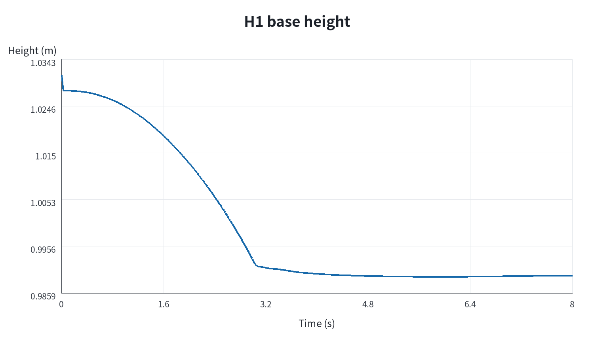
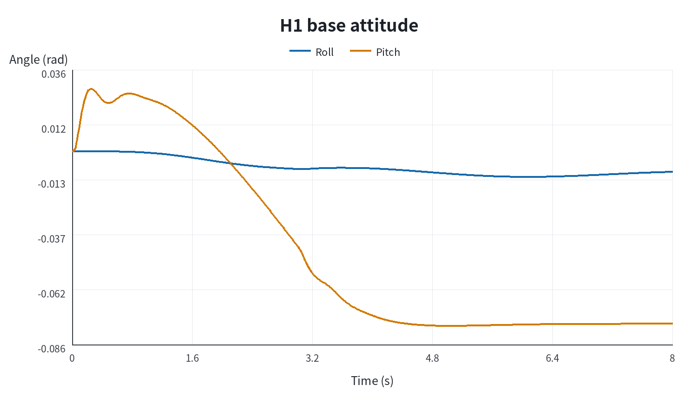
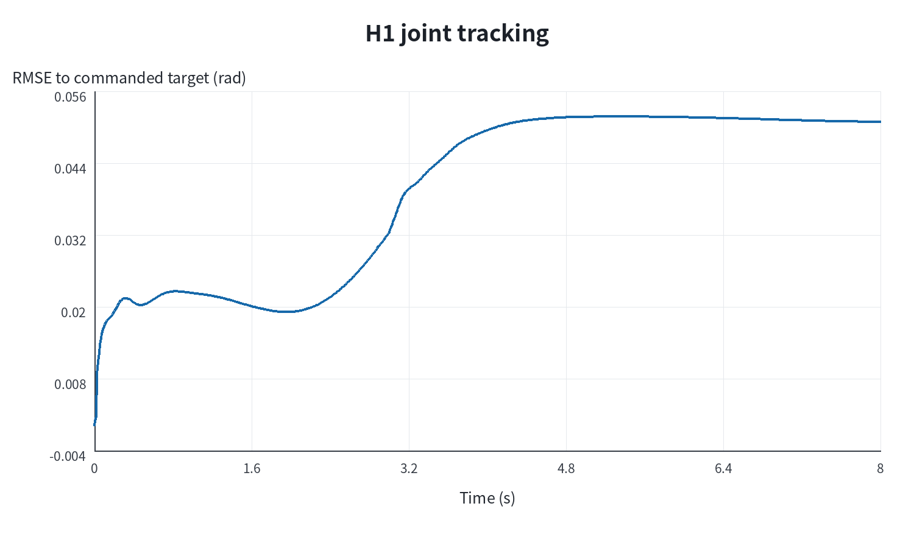
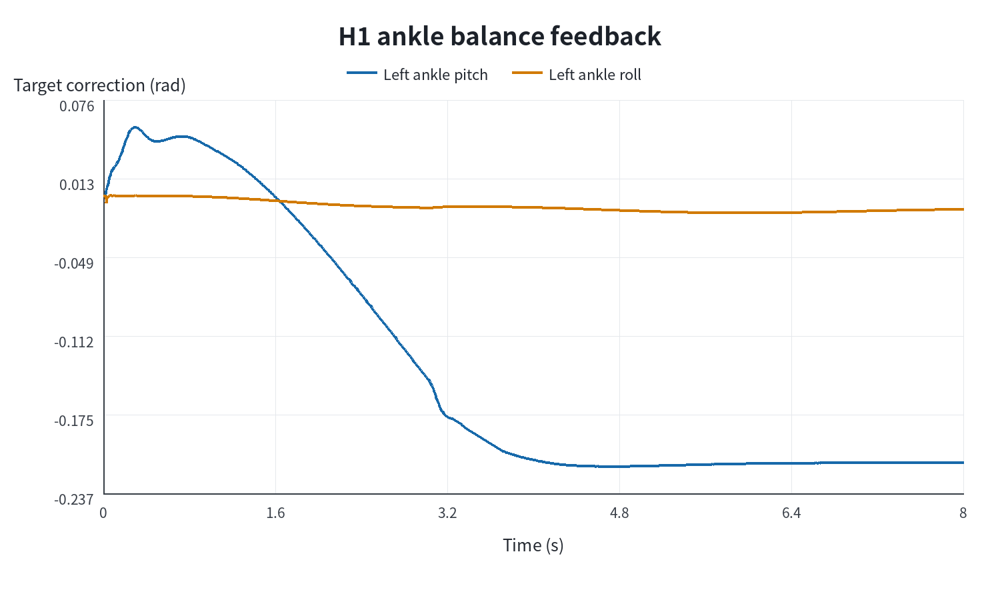
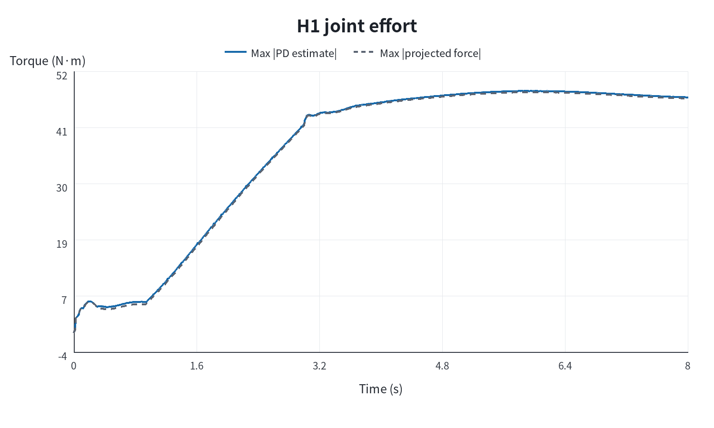

# L4-01 模型更换验收：Unitree H1-2 Handless

## 先看结论

本项已经在本机 Isaac Sim 6.0.1 中真实加载并运行 Unitree H1-2 Handless，完成 8 秒自由基座站立实验。机器人用 3 秒从零位过渡到本机 Unitree 配置中的 `FixStand` 姿态，随后保持 5 秒，验收通过。

这次完成的是“更换模型后的 Isaac 资产、关节映射、PD 初始化和站立验收”。H1-2 并没有由原项目的 OpenLoong MPC/WBC 控制。原控制器仍固定 AzureLoong 的 31 个执行关节与 `nv=37`，H1-2 则有 27 个执行关节与 `nv=33`，因此不能把资产加载成功写成 MPC 已经移植成功。

正式证据目录：`Pro2/output/L4/01_robot_swap/h1_fixstand_feedback_8s_final_v2/`。

## 可复现实验命令

在项目根目录运行：

```text
python3 Pro2/run_h1_isaac.py --headless --output Pro2/output/L4/01_robot_swap/h1_fixstand_feedback_8s_recheck
```

入口只使用 Python。若省略 `--output`，程序会按当前时间在 `Pro2/output/L4/01_robot_swap/` 下创建新的独立实验目录，不覆盖已有成果。

## 正式验收结果

| 指标 | 实测值 | 判据 | 结果 |
|---|---:|---:|---|
| 仿真时长 | 8.000000 s | ≥ 8.000 s | 通过 |
| FixStand 过渡时间 | 3.000000 s | 与源配置 `ts=[0,3]` 一致 | 通过 |
| 最终姿态保持时间 | 5.000000 s | ≥ 5.000 s | 通过 |
| 最低骨盆高度 | 0.989278 m | ≥ 0.85 m | 通过 |
| 最大 Roll/Pitch | 0.077643 rad | ≤ 0.20 rad | 通过 |
| 最大水平漂移 | 0.060733 m | ≤ 0.10 m | 通过 |
| 最终关节目标 RMSE | 0.036503 rad | ≤ 0.10 rad | 通过 |
| 最大 PD 力矩估计 | 48.383448 N·m | 记录项 | 已记录 |
| 最大显式 actuation 缓冲 | 0.000000 N·m | 记录项 | 已记录 |
| 最大 PhysX 投影关节力矩 | 48.123581 N·m | 记录项 | 已记录 |
| 最大踝关节平衡修正 | 0.215653 rad | ≤ 0.75 rad | 通过 |

机器可读原始值在 `Pro2/output/L4/01_robot_swap/h1_fixstand_feedback_8s_final_v2/metrics.json`，逐步状态在同目录 `states.csv`。CSV 共 800 个采样行、230 列，所有行列数一致。

## 正式运行曲线与保持阶段分析

以下五张图只读取正式目录
`Pro2/output/L4/01_robot_swap/h1_fixstand_feedback_8s_final_v2/states.csv`，没有使用失败或调试运行。派生指标、计算定义和三个原始来源文件的 SHA-256 均保存在
`Pro2/output/L4/01_robot_swap/h1_fixstand_feedback_8s_final_v2/analysis/metrics.json`。











CSV 的记录频率是 100 Hz。保持阶段取 $t\geq3\ \mathrm{s}$，实际包含 3.002–7.992 s 的 500 个样本：

| 保持阶段派生指标 | 数值 |
|---|---:|
| 基座高度均值 | 0.989677 m |
| 基座高度总体标准差 | 0.000576 m |
| 基座高度范围 | 0.989278–0.992553 m |
| 最大 $|\mathrm{Roll}|$ 或 $|\mathrm{Pitch}|$ | 0.077643 rad |
| 保持阶段 27 关节相对逐时刻控制目标的总体 RMSE | 0.049752 rad |
| 27 关节相对名义 FixStand 目标 RMSE | 0.036676 rad |
| 最大平衡反馈修正 | 0.215653 rad |
| 最大关节速度 | 0.192869 rad/s |
| 最大采样 PD 力矩估计 | 48.368211 N·m |
| 最大采样 PhysX 投影关节力 | 48.123581 N·m |

原始 `metrics.json` 在 500 Hz 物理步中累计极值，并在完整 8.000 s 后读取最终状态；100 Hz CSV 的最后一行是 7.992 s。因此，正式通过判定以原始 `metrics.json` 为准，`analysis/metrics.json` 用于解释图片和复核记录样本。两者在最大 PD 力矩和最终关节 RMSE 上的轻微差异由采样时刻造成。

在项目根目录重新生成派生分析：

```text
python3 Pro2/tools/analyze_l4_h1_stand.py Pro2/output/L4/01_robot_swap/h1_fixstand_feedback_8s_final_v2
```

程序只会写入正式运行目录下的 `analysis/`，不会修改 `run.json`、原始 `metrics.json` 或 `states.csv`。

## 模型与配置来源

- USD：`/home/xqw/xqw-file/unitree_model/H1-2/h1_2_handless/h1_2_handless.usd`；程序以只读引用方式组合场景，不修改源资产。
- FixStand：`/home/xqw/xqw-file/unitree_rl_lab/deploy/robots/h1_2/config/config.yaml` 的 `FSM.FixStand`。
- 机器人规格：`Pro2/robots/unitree_h1_2_handless.json`。
- USD 预检报告：`Pro2/output/L4/01_robot_swap/preflight/h1_2_handless_preflight.md`。

USD 预检真实读出了 27 个转动关节、28 个刚体、66.983999 kg 显式总质量、浮动基和左右足碰撞，并验证 Isaac 的实际 DOF 顺序与规格文件完全一致。

## 控制方法

源配置按 Unitree 电机顺序给出 27 维最终姿态、每关节 Kp 和 Kd。程序先按关节名重排到 Isaac 的实际 DOF 顺序，避免把“数组下标相同”误当成“关节语义相同”。3 秒过渡阶段的名义目标为

$$
q_{nom}(t)=\min(1,t/3)q_{FixStand}.
$$

只用名义姿态 PD 时，本地 H1-2 会逐渐前倾。正式实验因此增加了一个可查看、可关闭的双踝平衡反馈。Pitch 通道为

$$
\Delta q_{ankle,pitch}=\operatorname{clip}
(1.5\theta+0.1\dot{\theta}+2.0x+1.0\dot{x},-0.75,0.75),
$$

Roll 通道为

$$
\Delta q_{ankle,roll}=\operatorname{clip}
(1.2\phi+0.15\dot{\phi},-0.75,0.75).
$$

最终位置目标是 `q_nom + Δq`，隐式 drive 的 PD 估算为

$$
\tau_{PD}=\operatorname{clip}(K_p(q_{des}-q)-K_d\dot q,\,-\tau_{max},\tau_{max}).
$$

`get_dof_efforts()` 在本实验中读取的是通过 `set_dof_efforts()` 写入的显式 actuation 缓冲；因为本实验使用隐式 PD drive，所以它为零。实际受力观察使用 `get_dof_projected_joint_forces()`，它记录 PhysX 将连杆传入关节的作用力投影到关节运动方向后的量。报告没有把前者的零值误写成“机器人没有关节力矩”。

## 实现文件

| 项目根目录相对路径 | 作用 |
|---|---|
| `Pro2/run_h1_isaac.py` | 独立 H1-2 Isaac 入口、FixStand 插值、平衡反馈、数据记录和验收 |
| `Pro2/robots/unitree_h1_2_handless.json` | 资产候选路径、27 关节语义、Isaac DOF 顺序、FixStand q/Kp/Kd |
| `Pro2/isaac/robot_spec.py` | 普通 Python 可运行的规格校验和资产发现 |
| `Pro2/isaac/robot_usd.py` | composed USD 检查、质量/刚体/碰撞/关节验证 |
| `Pro2/tools/preflight_l4_robot.py` | 一条 Python 命令完成 USD 与 OpenLoong 兼容性预检 |
| `Pro2/isaac/tests/test_robot_spec.py` | 规格、关节排列和资产解析单元测试 |

没有修改其他 L4 项目共用的 `Pro2/run_isaac.py` 或 `Pro2/isaac/simulation.py`。

## 作为控制初学者可以修改和分析的位置

1. 在 `Pro2/run_h1_isaac.py` 的 `arguments()` 中修改默认的 `--balance-pitch-kp`、`--balance-pitch-kd`、`--balance-x-kp` 和 `--balance-x-kd`，观察姿态反馈与位置反馈分别怎样影响前后倾和水平漂移。每次必须用新的 `--output Pro2/output/L4/01_robot_swap/<实验名>`。
2. 在 `Pro2/run_h1_isaac.py` 的 `_run_experiment()` 中查看 `pitch_correction` 和 `roll_correction`，尝试关闭位置反馈或改变限幅，并用 `states.csv` 的 `q_nominal_rad:*`、`q_des_rad:*` 和 `q_balance_correction_rad:*` 比较名义目标、控制目标和反馈量。
3. 在 `Pro2/robots/unitree_h1_2_handless.json` 的 `stand_control` 中查看 `position_targets_rad`、`kp_nm_per_rad` 和 `kd_nm_s_per_rad`。这些值当前逐项复现源 `FixStand`，若做学习性调参，应复制成新的机器人规格 JSON，并通过 `--spec` 指向副本，保留基线。
4. 在 `Pro2/run_h1_isaac.py` 的验收指标处修改高度、倾角、漂移或关节 RMSE 阈值时，应在报告中解释阈值依据，不能只为了让失败实验显示为通过。
5. 使用 `Pro2/output/L4/01_robot_swap/h1_fixstand_feedback_8s_final_v2/states.csv` 分析“角度反馈过弱会前倾、过强会后倾、位置反馈抑制长期漂移”的过程。失败调参目录 `h1_fixstand_feedback_8s_run01` 至 `run05` 被保留，可作为对照证据。

## OpenLoong 直接移植仍需完成的工作

预检的 `openloong_controller_ready` 为 `false`。若后续目标从“模型更换并稳定站立”提升为“让原 OpenLoong MPC/WBC 控制 H1”，还需要：

1. 获取与本地 H1-2 USD 同版本的 URDF，并交叉验证关节、质量和惯量；
2. 将桥接 ABI、DataBus、PVT 和 Pinocchio 模型中的 31 关节固定维数参数化为 27 关节；
3. 按 H1 连杆重建足端、髋、手和腰任务以及 WBC 选择矩阵；
4. 用 H1 参数替换 MPC 中 AzureLoong 的 77.35 kg 质量、质心惯量、髋宽、足底尺寸等常量；
5. 重新完成站立、前进、转向和扰动验收。

因此，本项的严谨结论是：**H1-2 模型已在 Isaac 中完成资产适配与独立站立控制验收；OpenLoong MPC/WBC 的 H1 动力学移植尚未完成。**

## 验证记录

- `python3 -m unittest discover -s Pro2/isaac/tests -v`：当前 40 项通过；
- `python3 -m unittest Pro2.isaac.tests.test_robot_spec -v`：6 项通过；
- `python3 Pro2/tools/preflight_l4_robot.py --robot unitree_h1_2_handless`：资产预检通过，控制器直接兼容性未通过且阻塞证据完整；
- `python3 Pro2/run_h1_isaac.py --headless --output Pro2/output/L4/01_robot_swap/h1_fixstand_feedback_8s_final_v2`：真实 PhysX CPU 仿真退出码 0，验收通过。
