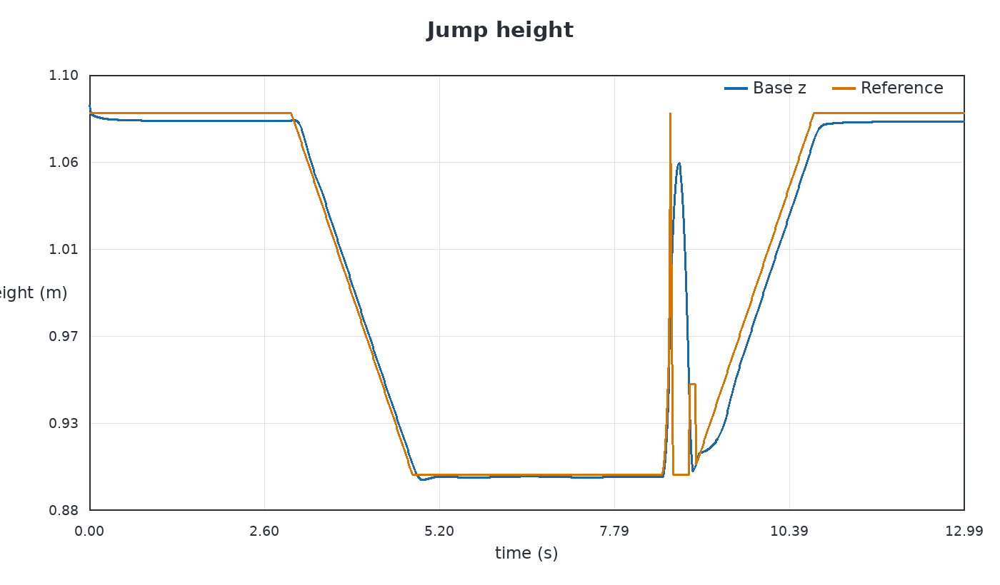
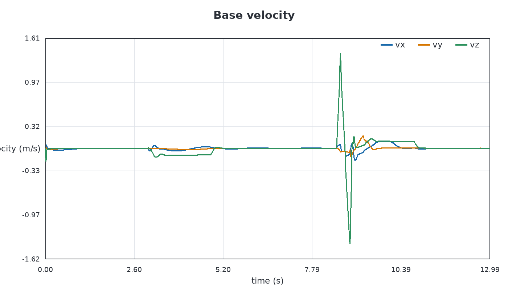
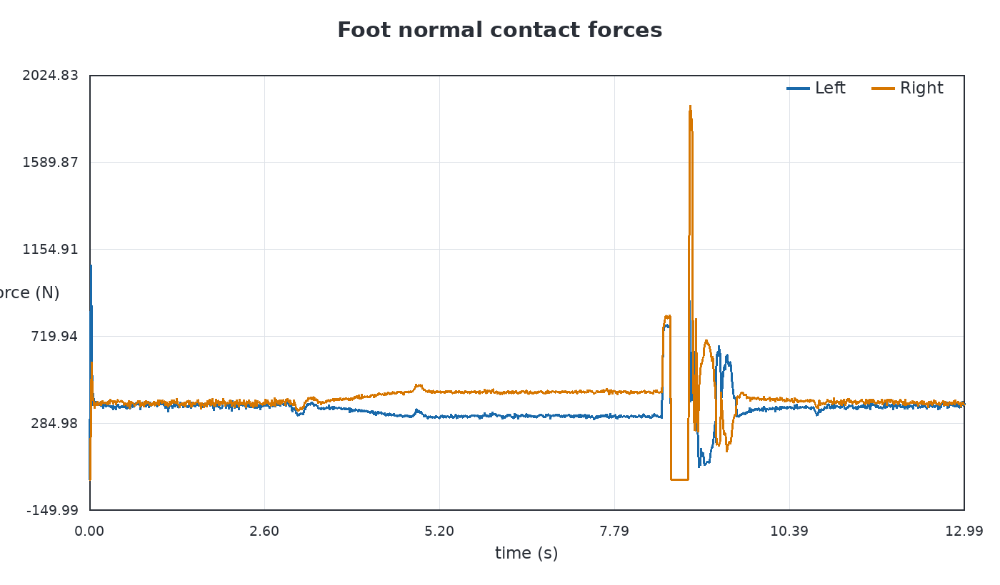
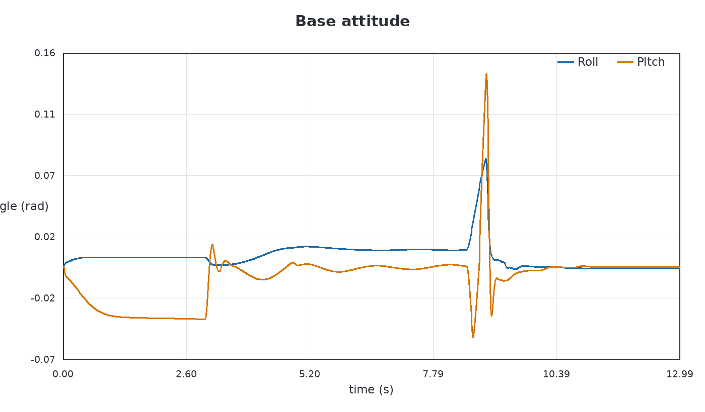
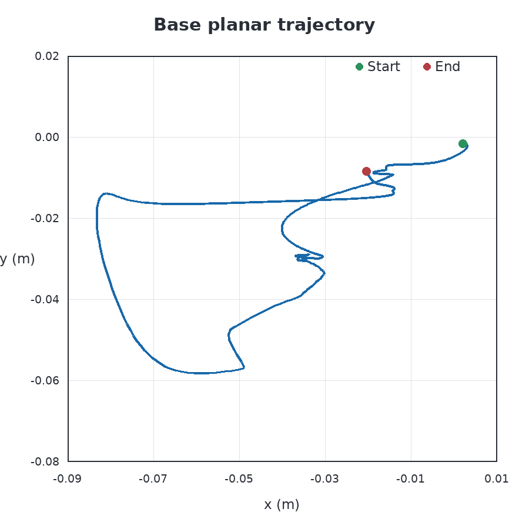

# L4 Isaac 竖直跳跃实现与验收记录

> 正式验收：`Pro2/output/L4/03_terrain_and_jump/vertical_jump_acceptance_run01/`、`Pro2/output/L4/03_terrain_and_jump/vertical_jump_acceptance_run02/`  
> 首次通过：`Pro2/output/L4/03_terrain_and_jump/vertical_jump_run35/`  
> 结论：相同最终配置和控制库的两次正式 13 s Isaac/PhysX CPU 复现均完成八阶段；两份独立分析均为 `pass: true`

## 1. 通俗说明

这次实现不是把机器人整体向上“推一下”。机器人先下蹲，双脚保持接触时由 MPC 计算蹬地 wrench；双脚离地后关闭接触力 MPC，用腿部 IK/PV 收腿和前摆；双脚再次接触地面后，用落地 MPC 与 WBC 吸收冲击，再把身体平稳抬回站立高度。

算法顺序仿照原项目的 `Pro2/OpenLoong-Dyn-Control/demo/jump_mpc.cpp`。Isaac 适配增加了原 MuJoCo 主循环之外的显式事件检查：左右脚是否真的离地、竖直速度何时过零、左右脚是否同时落地、落地速度是否已经稳定、恢复高度是否已经到位。判断数据来自 PhysX 的左右脚对地接触力和基座状态。

## 2. 阶段与控制器

| 阶段 | 作用 | MPC | 腿部/全身控制 |
|---|---|---:|---|
| `prepare` | 初始站立 | 标准站立控制 | 双足站立 WBC/PVT |
| `crouch` | 以 0.1 m/s 下蹲 | 标准站立控制 | 动态高度参考 |
| `thrust` | 建立向上速度并蹬地 | 开启 | Convex MPC wrench，经 $-J^TF$ 映射到腿部 |
| `flight_up` | 上升腾空与收腿 | 关闭 | 世界系足端锚点、腿部 IK/PV |
| `flight_down` | 下降腾空与双脚前摆 | 关闭 | 腿部 IK/PV，只更新前后方向落脚点 |
| `landing` | 双足触地和冲击吸收 | 开启 | 落地权重 MPC + WBC/QP |
| `recovery` | 按冲击沉降后的高度重新锚定并恢复高度 | 短时开启后关闭 | 双足固定 WBC 与水平速度阻尼 |
| `complete` | 保持恢复后的站立 | 关闭 | 继续自定义双足恢复 WBC |

配置的目标弹道高度为 $h_{target}=0.12\ \mathrm{m}$。蹬伸速度参考沿用上游公式：

$$
v_{z,target}=\sqrt{2gh_{target}}.
$$

因此目标值约为 $1.534\ \mathrm{m/s}$。正式运行实测最大向上速度为 $1.389\ \mathrm{m/s}$，实际离地后高度增量为 $0.070812\ \mathrm{m}$。目标弹道高度是控制参考，实测高度由 PhysX 轨迹计算，二者不能混写。

## 3. 与原 `jump_mpc.cpp` 相同的逻辑

1. 起跳前把身体从站立高度降低到下蹲高度；
2. 蹬伸阶段启用 OpenLoong Convex MPC，并使用原示例的起跳状态权重和输入权重；
3. 目标竖直速度从 0 线性增加到 $\sqrt{2gh}$，高度参考由速度积分得到；
4. 腾空上升阶段关闭接触力 MPC，以约 5 m/s 的足端参考变化收腿；
5. 竖直速度由正变为非正时进入下降阶段；
6. 下降阶段双脚世界系 x 目标前移 0.2 m，持续时间 0.02 s，对应上游 10 m/s 的 `Ramp`；
7. 双脚接触后切换到落地 MPC，冲击稳定后再把身体高度参考以 0.1 m/s 恢复至 1.08 m；
8. 腿部 IK 中保留上游对双踝俯仰的基座 pitch 补偿。

Isaac 的 `landing -> recovery` 高度交接没有逐行照搬上游。首次触地时落地参考保持约 0.94507 m；冲击沉降后进入恢复时，参考按实测约 0.90414 m 重新锚定，相当于下调约 0.04093 m，随后再以 0.1 m/s 上升。该处理用于避免 PhysX 落地后立刻强追触地高度，因此不能描述成全程参考完全连续。

上游与当前正式配置的主要常数和事件判据如下：

| 项目 | 上游 MuJoCo 示例 | 当前 Isaac 正式配置 |
|---|---:|---:|
| 弹道高度参数 | `jump_z = 0.20 m` | `jump.target_height_m = 0.12 m` |
| 蹬伸时间 | 公式给出约 0.101 s | 0.13 s |
| 最高点判据 | `dq(2) < 0.1 m/s` | 已观察上升且 $v_z \le 0$ |
| 双足落地判据 | 逆动力学估计每脚 $F_z > 1000\ \mathrm{N}$ | PhysX 对地接触每脚 $F_z \ge 300\ \mathrm{N}$，并确认 0.001 s |
| 下降前摆 | 0.20 m，约 0.02 s | 0.20 m，0.02 s |

当前实现复现的是状态切换、MPC/IK/PV 分工和落脚逻辑；这些数值差异用于适配 PhysX，不能解释为 MuJoCo 与 Isaac 的轨迹数值等价。

## 4. Isaac/PhysX 适配差异

### 4.1 显式状态机和真实接触事件

`Pro2/isaac/jump_controller.py::JumpStateMachine.update()` 管理八个阶段和超时条件。`Pro2/isaac/simulation.py::_run()` 读取左右踝足端相对 `/World/Terrain/Ground` 的 PhysX 接触力，分别用于：

- 两脚法向力均低于离地阈值时记录起跳；
- 上升已发生且竖直速度不再为正时切换到下降；
- 两脚法向力均超过落地阈值并持续满足确认时间时记录着地；
- 着地后双足仍有支撑且竖直速度进入阈值时进入恢复。

逆动力学足力估计保留为诊断通道；状态机的正式离地/落地判定使用 PhysX 对地接触力。

### 4.2 落地通过 WBC/QP 处理

上游示例在落地 MPC 中继续用 $-J^TF$ 直接得到腿部力矩。该映射在 Isaac 的接触几何下曾出现快速横滚发散，所以当前实现只在蹬伸时保留直接映射。落地与早期恢复仍使用上游 MPC 的 contact wrench 和权重，但把 wrench 送入 WBC/QP，与双足接触、基座姿态和高度任务一起求解；后期恢复关闭 MPC，使用重力支撑和下面的水平阻尼 wrench。

恢复阶段另外加入水平速度阻尼：

$$
F_{xy}=-K_v v_{xy},
$$

再按左右脚平均分配并限幅。这个力用于刹住落地后的水平滑移，不是外部辅助力。`landing` 硬保持源 MPC 水平 wrench，`recovery` 早期软跟踪该 wrench，MPC 窗口结束后的 `recovery` 和 `complete` 再硬保持限幅后的阻尼 wrench。进入 `complete` 后当前仍运行 `run_jump_recovery_control()` 做稳态保持，没有切回普通 `run_standard_control()`。

### 4.3 恢复阶段的严格加速度层级

恢复 WBC 的高优先级任务先固定双足，低优先级任务再恢复基座姿态与高度。令 $N$ 为已经累积的高优先级零空间，$M$ 为质量矩阵：

$$
P=N M^{-1}N^T.
$$

在数值上对 $P$ 对称化后，低优先级加速度修正使用：

$$
J^\#=P J^T\left(JPJ^T\right)^+,
$$

$$
\ddot q_k=\ddot q_{k-1}+J^\#
\left(a_k^*-\dot J_k\dot q-J_k\ddot q_{k-1}\right).
$$

本文称它为 **nullspace-restricted inverse（受零空间约束的逆）**：低优先级加速度修正不离开前面任务的累积零空间。当前严格分支只作用于恢复模式的 `ddq` 层，`delta_q`、`dq` 仍使用原任务求解方式，最后的 WBC QP 仍可调整浮动基加速度与接触力。

## 5. 两次正式重复验收结果

两个正式目录为：

- `Pro2/output/L4/03_terrain_and_jump/vertical_jump_acceptance_run01/`；
- `Pro2/output/L4/03_terrain_and_jump/vertical_jump_acceptance_run02/`。

两次 `run.json.controller_library_sha256` 均为：

`8e8d5f8c6328ef5521428e4da7920dc650d11ca5d36652365d2b7f13b6e1bc48`

两次关键指标完全一致。下面的时间线和指标表同时适用于 run01 与 run02。

正式运行完成的实际时间线：

| 事件 | 时间 |
|---|---:|
| 开始下蹲 | 3.000 s |
| 开始蹬伸 | 8.500 s |
| 进入上升腾空 | 8.630 s |
| 检测到双脚离地 | 8.632 s |
| 进入下降腾空 | 8.752 s |
| 检测到双脚落地 | 8.901 s |
| 进入恢复 | 9.002 s |
| 进入完成 | 10.761 s |
| 仿真结束 | 13.000 s |

| 验收指标 | run01 / run02 实测值 | 判据 | 结果 |
|---|---:|---:|---|
| 100 Hz CSV 重算起跳 / 落地时刻 | 8.640 / 8.900 s | 与 1 kHz 事件差不超过日志周期加确认时间 | 通过 |
| CSV 起跳 / 落地事件时间差 | +0.008 / -0.001 s | 绝对值 ≤ 0.011 s | 通过 |
| 100 Hz CSV 保守起跳高度增量 | 0.060816 m | ≥ 0.060 m | 通过 |
| 1 kHz 事件摘要高度增量 | 0.070812 m | 交叉记录项 | 已记录 |
| 100 Hz CSV 观测腾空 | 26 样本 / 0.250 s | 至少两个连续双脚离地样本 | 通过 |
| 1 kHz 摘要腾空 | 0.269 s | 记录项 | 已记录 |
| 腾空时 MPC 开启样本 | 0 | = 0 | 通过 |
| 外部辅助力峰值 | 0 N | = 0 N | 通过 |
| 落地后二次双脚离地最长持续时间 | 0 s | ≤ 0.05 s | 通过 |
| 末 0.5 s 双足接触占比 | 100% | ≥ 95% | 通过 |
| 末段最大水平速度 | 0.002306 m/s | ≤ 0.20 m/s | 通过 |
| 末段最大竖直速度绝对值 | 0.000739 m/s | ≤ 0.15 m/s | 通过 |
| 末段最大倾角 | 0.001027 rad | ≤ 0.20 rad | 通过 |
| 末段最大高度误差 | 0.004190 m | ≤ 0.12 m | 通过 |
| 全程水平净漂移 | 0.022466 m | ≤ 0.30 m | 通过 |
| MPC / WBC QP 失败样本 | 0 / 0 | 0 / 0 | 通过 |
| 左 / 右脚法向接触力峰值 | 2535.268 / 8354.200 N | 记录项 | 需进一步冲击分析 |
| 1 kHz 运行时最大关节命令力矩 | 396.0 N·m | 记录项 | 需进一步饱和分析 |
| 100 Hz 日志采样到的最大关节命令力矩 | 376.453 N·m | 记录项 | 已记录 |

### 5.1 正式验收曲线

以下五张图来自 `vertical_jump_acceptance_run01/analysis_final/`，由该次正式运行的 `states.csv` 生成。对应机器判定保存在同目录 `acceptance.json`，原始高频事件摘要为上一级 `jump_metrics.json`。run02 也在自己的 `analysis_final/` 中保留同样五类图片和独立验收结果；正文展示 run01，最终复现结论同时依赖两次运行。







接触力图来自 100 Hz `states.csv`，用于显示持续腾空、双足落地和采样到的冲击波形；表中 2535.268 / 8354.200 N 的高频峰值来自 1 kHz `jump_metrics.json`，因此不会完整出现在降采样曲线上。





独立分析器以 `states.csv` 的 0.060816 m 保守重算值作高度判据，不让 1 kHz `jump_metrics.json` 的 0.070812 m 单独决定结果。约 0.009996 m 差值来自 1 kHz 事件时刻与 100 Hz 日志的采样分辨率。

两次正式重复运行的最终基座位置均为 $(-0.021523,-0.006443,1.075863)\ \mathrm{m}$。加强后的独立分析器对每次运行执行 21 项检查。

run01 逐项判定：[Pro2/output/L4/03_terrain_and_jump/vertical_jump_acceptance_run01/analysis_final/acceptance.json](vertical_jump_acceptance_run01/analysis_final/acceptance.json)。其余正式证据：

- `Pro2/output/L4/03_terrain_and_jump/vertical_jump_acceptance_run01/analysis_final/README.md`；
- `Pro2/output/L4/03_terrain_and_jump/vertical_jump_acceptance_run01/analysis_final/height.png`；
- `Pro2/output/L4/03_terrain_and_jump/vertical_jump_acceptance_run01/analysis_final/velocity.png`；
- `Pro2/output/L4/03_terrain_and_jump/vertical_jump_acceptance_run01/analysis_final/contact_forces.png`；
- `Pro2/output/L4/03_terrain_and_jump/vertical_jump_acceptance_run01/analysis_final/attitude.png`；
- `Pro2/output/L4/03_terrain_and_jump/vertical_jump_acceptance_run01/analysis_final/planar_trajectory.png`。

run02 逐项判定：[Pro2/output/L4/03_terrain_and_jump/vertical_jump_acceptance_run02/analysis_final/acceptance.json](vertical_jump_acceptance_run02/analysis_final/acceptance.json)。其余正式证据：

- `Pro2/output/L4/03_terrain_and_jump/vertical_jump_acceptance_run02/analysis_final/README.md`；
- `Pro2/output/L4/03_terrain_and_jump/vertical_jump_acceptance_run02/analysis_final/height.png`；
- `Pro2/output/L4/03_terrain_and_jump/vertical_jump_acceptance_run02/analysis_final/velocity.png`；
- `Pro2/output/L4/03_terrain_and_jump/vertical_jump_acceptance_run02/analysis_final/contact_forces.png`；
- `Pro2/output/L4/03_terrain_and_jump/vertical_jump_acceptance_run02/analysis_final/attitude.png`；
- `Pro2/output/L4/03_terrain_and_jump/vertical_jump_acceptance_run02/analysis_final/planar_trajectory.png`。

两个运行原有的 `analysis/` 和 `analysis_csv_verified/` 是验收器逐步加固时生成的历史分析版本。它们继续保留，正式结论使用最终 21 项检查的 `analysis_final/`。

`Pro2/output/L4/03_terrain_and_jump/vertical_jump_run35/` 记录首次开发通过。它的控制库哈希与正式复现对不同，因此不与 run01/run02 合并统计；正式可复现结论只引用 run01 和 run02。

这里通过的是 Isaac/PhysX 仿真功能验收，配置的 0.12 m 目标弹道高度并未达到。状态和接触量来自无传感器噪声的仿真真值。约 8.35 kN 的单脚接触峰值和 1 kHz 运行时 396 N·m 的最大关节命令还需要冲击载荷、关节限幅和执行器裕量分析；100 Hz 日志采样到的对应力矩峰值为 376.453 N·m。这些数据不能直接证明实机传感器下同样稳定、结构安全或可部署。

当前边界还包括：目标弹道高度为 0.12 m，而实测高频增量为 0.070812 m，所以结论是“完成超过 0.06 m 判据的可验证跳跃”，不是“达到 0.12 m”；1 kHz 状态机在单个周期检测到双脚低于阈值后锁存起跳，正式运行的原始 CSV 又确认了 0.25 s 持续腾空，因此本次不是接触抖动误判，但接入含噪传感器前应增加起跳确认时间；恢复水平阻尼 `450 N/(m/s)` 和单脚 `150 N` 限力目前是 `Pro2/isaac/native/controller_bridge.cpp` 中的常量，进行不同摩擦、质量或地形实验前应将其参数化并重新验收。两次正式复现都在平地、PhysX CPU、完全状态反馈和无外部扰动下完成，不代表其他条件下具有同样鲁棒性。

## 6. 普通行走回归

受零空间约束的加速度逆只在跳跃恢复模式启用。为检查它没有改变普通站立/行走分支，使用同一最终控制库运行了：

`Pro2/output/L0/jump_change_regression_run01/`

10 s Isaac/PhysX 普通行走状态为 `completed`，最终 x 为 1.17394 m，最大倾角 0.04058 rad，最低基座高度 1.06519 m，MPC/WBC QP 失败样本均为 0。这是非跳跃回归证据，不与 L4 跳跃验收数据混放。

## 7. 历史失败记录的解释

`Pro2/output/L4/03_terrain_and_jump/vertical_jump_preflight/` 是功能实现前的真实记录：当时动态高度、腾空切换与双足接触反馈均为 `false`，所以状态是 `preflight_failed`。两次正式重复运行中的 `jump_preflight.json` 都显示三项能力均为 `true`、`ready: true`。

开发期间的其他失败运行也保留在各自独立目录。它们用于分析落地力矩映射、水平制动方向、WBC 层级和足端前摆时间，不进入正式验收数据。保留这些目录能说明修复依据，不代表当前跳跃仍未实现。

## 8. 复现和分析

使用新的输出目录运行：

```text
python3 Pro2/run_isaac.py --isaac-root /home/xqw/isaacsim6.0.1 --level L4 --config Pro2/experiments/L4/jump/vertical_jump.json --headless --log-control-decomposition --output Pro2/output/L4/03_terrain_and_jump/vertical_jump_repeat03
```

运行完成后独立分析：

```text
python3 Pro2/tools/analyze_l4_jump.py --run Pro2/output/L4/03_terrain_and_jump/vertical_jump_repeat03
```

每次实验必须使用新的 `Pro2/output/L4/03_terrain_and_jump/<实验名>/`。分析器默认写入该次运行自己的 `analysis/`，并拒绝覆盖已有目录。

## 9. 可以修改和学习的位置

- `Pro2/experiments/L4/jump/vertical_jump.json`：修改 `jump.target_height_m`、`jump.crouch_height_m`、`jump.thrust_duration_s`、`jump.landing_foot_advance_m`、`jump.landing_foot_swing_duration_s`、接触阈值和恢复时间；
- `Pro2/isaac/jump_controller.py::JumpStateMachine.update()`：理解事件驱动的相位切换；
- `Pro2/isaac/jump_controller.py::JumpStateMachine._reference()`：理解每个阶段如何产生高度、速度与足端参考；
- `Pro2/isaac/native/controller_bridge.cpp::run_jump_force_control()`：理解起跳/落地 MPC；
- `Pro2/isaac/native/controller_bridge.cpp::run_jump_flight_control()`：理解腾空腿部 IK 与落脚前摆；
- `Pro2/isaac/native/controller_bridge.cpp::run_jump_recovery_control()`：理解落地后的水平制动与高度恢复；
- `Pro2/OpenLoong-Dyn-Control/algorithm/wbc_priority.cpp::WBC_priority::computeDdq()`：理解恢复 WBC 任务；
- `Pro2/OpenLoong-Dyn-Control/algorithm/priority_tasks.cpp::PriorityTasks::computeAll()`：理解恢复模式的受零空间约束加速度逆；
- `Pro2/tools/analyze_l4_jump.py`：理解结果如何与验收阈值比较。

适合初学者的第一组实验是只修改 `jump.target_height_m`。低、中、高三档各自保存到新目录，比较实际上升高度、腾空时间、触地力、末段速度、倾角、漂移和 QP 状态。一次只改变一个参数，才能把现象和原因对应起来。
