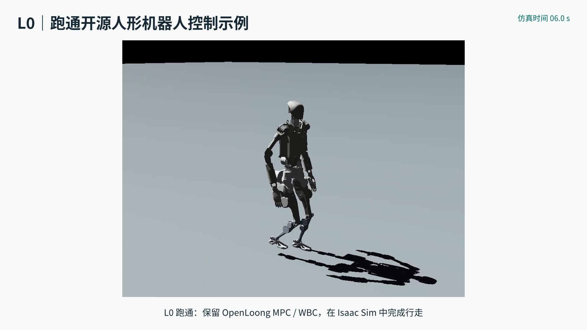

# tongji-proClass-AAR · Project 2：青龙人形机器人 MPC/WBC

当前为 **`project2` 分支**，项目目录为 `Pro2/`。机械臂画家项目位于
[`project1` 分支](https://github.com/Xlovlhj/tongji-proClass-AAR/tree/project1) 的 `Pro1/`。

本项目将 OpenLoong 的 C++ MPC、WBC、步态规划与关节控制接入 Isaac Sim，并按 L0、L1、L2、L3、L4 保存复现、源码分析、参数实验、理论联系和拓展验证。

## 成果展示

[](Pro2/output/final/assets/项目验收演示_L0_L2_L4.mp4)

点击上图打开 **132 秒验收演示视频**，包含基础行走、参数与侧推对照、路径跟踪、四种地形同屏行走和跳跃。

- [正式汇报 PPT（15 页，内嵌视频）](Pro2/output/final/青龙MPC_项目汇报_15页.pptx)
- [同版 PDF](Pro2/output/final/青龙MPC_项目汇报_15页.pdf)
- [逐页讲稿与证据来源](Pro2/output/final/逐页讲稿与证据来源.md)
- [项目要求与 PPT 页码对应](Pro2/output/final/验收要求与PPT对应.md)
- [工程与参数改动清单](Pro2/output/final/工程与参数改动清单.md)

## L0–L4 阶段报告

| 阶段 | 内容 | 报告 |
| --- | --- | --- |
| L0 | 环境、示例复现、基础运行与输入权重实验 | [L0 验收报告](Pro2/output/L0/L0验收报告.md) |
| L1 | MPC/WBC 闭环结构与源码定位 | [L1 源码分析报告](Pro2/output/L1/L1源码分析报告.md) |
| L2 | 速度权重、预测时域、抬腿高度与侧向扰动实验 | [L2 验收报告](Pro2/output/L2/L2验收报告.md) |
| L3 | LQR、iLQR、MPC 与凸优化的理论联系 | [L3 理论联系报告](Pro2/output/L3/L3理论联系报告.md) |
| L4 | 模型适配、路径跟踪、地形与跳跃、MPC 对比、力矩分解 | [L4 验收报告](Pro2/output/L4/L4验收报告.md) |

各阶段的原始 CSV、配置、结构化指标、图片与录像保存在对应 `Pro2/output/L0/` 至 `L4/` 中，每次实验使用独立子目录。正式运行、调试运行和失稳工况的区别以报告说明为准。

## 运行

准备 Linux、NVIDIA GPU、Isaac Sim 6.0.1，以及 CMake 和 C++17 编译器。在仓库根目录执行：

```bash
python3 Pro2/run_isaac.py --check-env
python3 Pro2/run_isaac.py --show-config --mode walk
python3 Pro2/run_isaac.py --mode walk --duration 20 --vx 0.2
```

启动器负责寻找 Isaac 安装与编译控制库；Isaac Sim 本身需要提前安装。完整环境、参数、实验命令与输入输出说明见 [Pro2/README.md](Pro2/README.md)。

青龙模型和实际使用的 OpenLoong 修改源码已包含在本分支；L4 的 Unitree H1 拓展使用外部 USD 模型，需要按 [机器人模型规格](Pro2/robots/README.md) 单独准备资产。

## 目录

| 路径 | 内容 |
| --- | --- |
| `Pro2/run_isaac.py` | 青龙仿真的 Python 启动入口 |
| `Pro2/isaac/` | Isaac 适配、场景、状态与控制接口、原生桥接和测试 |
| `Pro2/OpenLoong-Dyn-Control/` | 上游工程、模型、依赖及本项目修改后的 C++ 源码 |
| `Pro2/experiments/` | 可复用的实验配置 |
| `Pro2/control/` | 控制算法与数学对照 |
| `Pro2/tools/` | 实验分析、作图、报告检查工具 |
| `Pro2/output/L0/` 至 `Pro2/output/L4/` | 分阶段实验与报告成果 |
| `Pro2/output/final/` | 一套 15 页正式汇报、视频、讲稿及验证记录 |

缓存、编译产物、日志、依赖本机缓存的 USD 场景、录像逐帧图片和视频合成中间文件不随仓库发布。已发布的代码、数据、图片、视频与 PPT 使用普通 Git 保存。

上游版本与修改文件见 [UPSTREAM.md](Pro2/OpenLoong-Dyn-Control/UPSTREAM.md)，许可证及第三方声明保留在原目录。
